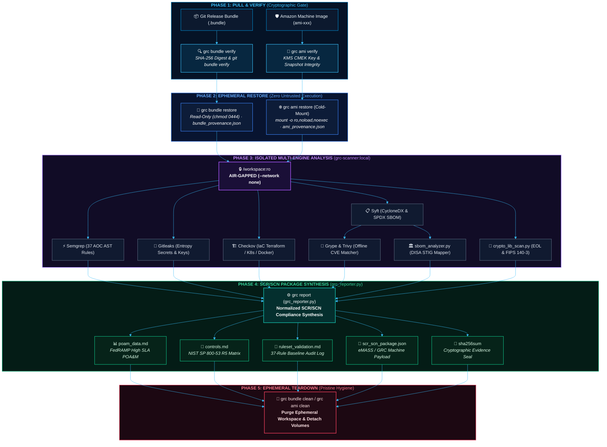

# GRCx — The GRC eXperience (`grcx`)

<p align="center">
  <picture>
    <source media="(prefers-color-scheme: dark)" srcset="assets/logo/grcx-logo-dark.png">
    <source media="(prefers-color-scheme: light)" srcset="assets/logo/grcx-logo-light.png">
    
  </picture>
</p>

<p align="center">
  <a href="README.md"><b>📖 README</b></a> &nbsp;·&nbsp;
  <a href="INSTALL.md"><b>⚙️ Install Guide</b></a> &nbsp;·&nbsp;
  <a href="COMMANDS.md"><b>⌨️ CLI Commands</b></a> &nbsp;·&nbsp;
  <a href="amplifying-info/ARCHITECTURE.md"><b>🏛️ Architecture & Tech Stack</b></a> &nbsp;·&nbsp;
  <a href="amplifying-info/DATAFLOW.md"><b>🔄 Data Flow</b></a> &nbsp;·&nbsp;
  <a href="SECURITY.md"><b>🛡️ Security Policy</b></a> &nbsp;·&nbsp;
  <a href="amplifying-info/GOVERNANCE.md"><b>⚖️ Governance & Mandates</b></a> &nbsp;·&nbsp;
  <a href="testing/TESTING.md"><b>🧪 Verification Plan</b></a> &nbsp;·&nbsp;
  <a href="testing/live-demo.md"><b>🎬 Live Demo</b></a> &nbsp;·&nbsp;
  <a href="hygiene/RELEASE_NOTES.md"><b>🚀 Release Notes</b></a> &nbsp;·&nbsp;
  <a href="hygiene/PATCH_LOG.md"><b>🩹 v1 Patch Log</b></a> &nbsp;·&nbsp;
  <a href="hygiene/ROADMAP.md"><b>🗺️ Roadmap</b></a> &nbsp;·&nbsp;
  <a href="docs/scan-transform-guide.md"><b>📊 Scan-to-POA&M Guide</b></a> &nbsp;·&nbsp;
  <a href="docs/grc-bundle-use-case.md"><b>📑 Bundle Walkthrough</b></a> &nbsp;·&nbsp;
  <a href="docs/test-dummies-guide.md"><b>🎯 Test Dummies Guide</b></a>
</p>

```text
> grcfetch
        .--.          .--.          .--.
  ,p#G*""TG#Gp, ,p#G*""TG#Gp, ,p#G*""TG#Gp,                  eodartintlabs-hue/grcx
 {GGG'     `G# {GGG     `GGG {GGG'     `G#                   ----------------------
 @GGG          @GGG     ,GGG @GGG          ,p#Gp,   ,p#Gp,   App: GRCx v1.3.0 (Sasebo)
 'GGG   ,p#GG# @GGG#**#GGG"  'GGG           `GGG, ,GGG'      OS: Darwin ARM64 / Linux Bookworm
  GGG   ""`GGG @GGG   `GGG,   GGG             `GGGGG'        Model: Out-of-Band (OOB) / Fail-Open
 ]GGG#     GGG @GGG    ]GGG  ]GGG#     ,G#    ,GGGGG,        Isolation: Air-Gapped (--network none, :ro)
  @GGGb,,,dGGG @GGG     GGG,  @GGGb,,,dGG"  ,GGG' `GGG,      Engines: (10) Semgrep, Gitleaks, Checkov, Syft,
   `@GGGG###G# @GGG     `GGG   `@GGGG###G" dGGG'   `GGGb                    Grype, Trivy, OpenSCAP, Crypto, SBOM, Transform
     `"%N>"`    `"%NW" `"%NW"    `"%N>"`   `"%N"   "%N"`     Ruleset: 37 AST Rules (AOC 02–140)
                                                             Frameworks: DISA STIG, NIST 800-53 R5, FedRAMP
       ───  T h e   G R C   e X p e r i e n c e  ───         Output: FedRAMP POA&M (.xlsx/.md), Controls, SCR/SCN

                                                             ███ ███ ███ ███ ███ ███ ███ ███
                                                             ▄▄▄ ▄▄▄ ▄▄▄ ▄▄▄ ▄▄▄ ▄▄▄ ▄▄▄ ▄▄▄
```

> **Classification**: Internal DevSecOps & Security Compliance Specification  
> **Release Stage**: `v1.3.0 — Sasebo` (**Restricted Beta — Integration Testing Access Only**) · *Full GA Release (`v2.0.0 — Pearl Harbor`) transitions to the **Hawaiian Military Base Cities** series (see [Roadmap](hygiene/ROADMAP.md))*  
> **Target Frameworks**: DISA STIG, NIST SP 800-53 Rev. 5, FedRAMP High, DoD Cloud Computing SRG, OWASP Top 10  
> **Operational Model**: Out-of-Band (OOB), Fail-Open, Zero Untrusted Execution, Ephemeral Hygiene  
> **Companion Test Corpus**: [`grc-test-dummies`](https://github.com/eodartintlabs-hue/grc-test-dummies)  

---

## Table of Contents

1. [Executive Overview](#1-executive-overview)
2. [End-to-End Architecture & 5-Phase Lifecycle](#2-end-to-end-architecture--5-phase-lifecycle)
3. [Core Architectural Principles](#3-core-architectural-principles)
4. [Areas of Concern (AOC) & NIST SP 800-53 Coverage Matrix](#4-areas-of-concern-aoc--nist-sp-800-53-coverage-matrix)
5. [Integrated Security Scanning & Synthesis Engines](#5-integrated-security-scanning--synthesis-engines)
6. [Phase 4 Compliance Deliverables & SCR/SCN Package](#6-phase-4-compliance-deliverables--scrscn-package)
7. [Minimum & Recommended System Requirements](#7-minimum--recommended-system-requirements)
8. [Installation, Quickstart & CLI Reference (`INSTALL.md` & `COMMANDS.md`)](#8-installation-quickstart--cli-reference-installmd--commandsmd)
9. [Security Assurance, Negative Testing & Verification](#9-security-assurance-negative-testing--verification)
10. [Product Roadmap (`Yokosuka` $\rightarrow$ `Kadena` $\rightarrow$ `Misawa` $\rightarrow$ `Sasebo` $\rightarrow$ `Pearl Harbor` GA)](#10-product-roadmap-yokosuka-rightarrow-kadena-rightarrow-misawa-rightarrow-sasebo-rightarrow-pearl-harbor-ga)
11. [Repository Structure & Documentation Index](#11-repository-structure--documentation-index)

---

## 1. Executive Overview

**GRCx** (*The GRC eXperience*) is an automated, cryptographic verification, static security analysis, and Continuous Monitoring (ConMon) compliance platform engineered for **FedRAMP High**, **DISA STIG**, and **DoD RMF** environments. It supports two primary operational workflows:

1. **Standalone Scan-to-FedRAMP POA&M Transformation (`./grc transform` / [`scripts/transform_scans.py`](scripts/transform_scans.py))**: Built for direct, standalone daily use by GRC analysts (requiring zero Docker containers or `.bundle` files). Analysts simply drop **Tenable** or **AWS Inspector** scan exports (`.csv` or `.xlsx`) and their previous **OPEN FedRAMP POA&M** (`.xlsx`) into the designated **`scans/`** folder, pick their file by number or filename, automatically move remediated items into the **CLOSED FedRAMP POA&M** template, auto-draft missing remediation plans with official Tenable/AWS URLs, and receive an itemized **SLA Breach & Finding Age** report. *(See **[`docs/scan-transform-guide.md`](docs/scan-transform-guide.md)**).*
2. **5-Phase Out-of-Band Release & Infrastructure Auditing (`./grc bundle`, `./grc ami`, `./grc scan`)**: Audits **Git software release bundles (`.bundle`)** and **Amazon Machine Images (`AMI`)** inside an air-gapped 9-engine scanner suite (`grc-scanner:local`) to generate **Security Change Request / Security Change Notification (SCR/SCN)** evidence packages without gating or slowing down developer CI/CD velocity.

> 🏛️ **Explore the Visual Technology Stack**: View our Layered System Architecture diagram and detailed technology stack breakdown in **[`amplifying-info/ARCHITECTURE.md`](amplifying-info/ARCHITECTURE.md)**.

---

## 2. End-to-End Architecture & 5-Phase Lifecycle



---

## 3. Core Architectural Principles

* **Out-of-Band (OOB) & Fail-Open**: Audits execute asynchronously on read-only copies of release artifacts. Engineering deployments are never blocked by scanner latency, while compliance teams receive 100% visibility.
* **Zero Untrusted Code Execution**:
  * **Git Bundles**: Extracted source trees are immediately locked with `0444` read-only permissions; build scripts, hooks, and binaries are never executed.
  * **AMIs (EBS Snapshot Cold-Mount)**: Root EBS snapshots are attached as secondary non-boot volumes and mounted with `mount -o ro,noload,noexec,nosuid` inside an isolated `chroot`, preventing binaries, systemd units, or cron jobs from activating.
* **Air-Gapped Container Isolation & Zero Host Pollution**:
  * All third-party scanners run inside the local **`grc-scanner:local`** Docker container with `--network none` and a read-only workspace mount (`/workspace:ro`).
  * All host orchestration scripts (`grc_bundle.py`, `grc_ami.py`, `grc_reporter.py`, `crypto_lib_scan.py`, `sbom_analyzer.py`) use **100% Python 3 standard library modules**—requiring zero `pip` installs on the host workstation and **\$0.00 in cloud compute costs** for local verification.
* **Automated Evidence Segregation**: `./grc scan` inspects provenance metadata and automatically namespaces outputs into `evidence/<bundle-name>/`, preventing cross-contamination across sequential reviews.

---

## 4. Areas of Concern (AOC) & NIST SP 800-53 Coverage Matrix

The pipeline enforces **37 custom Semgrep AST rules** ([`rules/custom-baseline-ruleset.yaml`](rules/custom-baseline-ruleset.yaml)) alongside cryptographic and vulnerability catalogs across Python, Go, Java, JavaScript/TypeScript, Terraform, and Ansible:

| AOC ID | Area of Concern | Governing NIST 800-53 Controls | DISA STIG Impact | Target Anti-Patterns & Violations Caught |
| :--- | :--- | :--- | :--- | :--- |
| **AOC-02** | **Password Hygiene** | `IA-2` | `CAT I / II` | Hardcoded passwords, database credentials, static API keys, and bearer tokens. |
| **AOC-03** | **Weak Encryption Check** | `SI-16`, `SC-13` | `CAT I / II` | Broken hash algorithms (`MD5`, `SHA-1`), legacy ciphers (`DES`, `3DES`, `RC4`), and insecure `AES/ECB` modes. |
| **AOC-04** | **Command Injection** | `SI-4`, `SI-10` | `CAT I` | Unsanitized runtime shell execution (`os.system`, `subprocess(shell=True)`, Go `exec.Command`, Java `Runtime.exec`). |
| **AOC-05** | **Improper TLS** | `SI-17`, `SC-8` | `CAT I / II` | Deprecated `TLS 1.0` / `TLS 1.1` protocols and disabled certificate verification (`verify=False`, `InsecureSkipVerify`). |
| **AOC-06** | **Secrets Management** | `SC-12`, `IA-2` | `CAT I` | Embedded PEM/PKCS private keys (`RSA`, `EC`, `DSA`, `OPENSSH`) and high-entropy secrets in source history. |
| **AOC-07** | **IaC Misconfigurations** | `AC-3`, `AC-6`, `CM-6`, `SC-28` | `CAT I / II` | Public S3 buckets, open `0.0.0.0/0` SSH/RDP ingress rules, unencrypted EBS volumes, and disabled SELinux. |
| **AOC-09** | **Unsupported Crypto Libraries** | `SI-7`, `SC-12`, `SC-13` | `CAT I` | End-of-Life (EOL) and unmaintained cryptographic providers (`pycrypto`, `OpenSSL 1.1.1`, `Bouncy Castle < 1.70`). |
| **AOC-10** | **CRITICAL Severity Findings** | `RA-5`, `SI-2` | `CAT I` | Known CVSS 9.0–10.0 CVEs (e.g., Log4Shell, Spring4Shell) and unsafe object deserialization (`pickle`, `ObjectInputStream`). |
| **AOC-11** | **Category I STIG Violations** | `SI-2`, `CM-8` | `CAT I` | Exposed production debug listeners, XML External Entity (XXE) processing, insecure cookies, and OS STIG CAT I gaps. |
| **AOC-12** | **Lack of FIPS Mode** | `SC-13` | `CAT I` | Kernel bootloaders with `fips=0`, OS crypto-policies set to `DEFAULT`, and OpenSSL configs missing `[fips_sect] activate = 1`. |
| **AOC-140** | **Org-Specific Guardrails** | `CM-6` | `CAT II` | Credential leakage to `stdout`/logs, hardcoded internal IPs, and root container execution. |

---

## 5. Integrated Security Scanning & Synthesis Engines

### 5.1 Containerized Security Suite (`grc-scanner:local`)
Bundled via [`docker/Dockerfile.scanner`](docker/Dockerfile.scanner) and orchestrated by [`docker/scan_orchestrator.sh`](docker/scan_orchestrator.sh):

| Engine | Domain | Role in Pipeline | Output Artifact |
| :--- | :--- | :--- | :--- |
| **Semgrep** | SAST / AST Policy | Evaluates source code against the 37-rule custom AOC baseline. | `semgrep_findings.json` |
| **Gitleaks** | Secret Detection | Scans files and Git history for exposed API keys, tokens, and private keys. | `gitleaks_findings.json` |
| **Checkov** | IaC Compliance | Audits Terraform, CloudFormation, Kubernetes, and Ansible against CIS/STIG rules. | `checkov_findings.json` |
| **Syft** | SBOM Generation | Generates complete CycloneDX Software Bills of Materials across app & OS layers. | `sbom.cdx.json` |
| **Grype** | CVE Analysis | Matches SBOM components against NVD and vendor advisories for critical CVEs. | `grype_findings.json` |
| **Trivy** | Multi-Target CVE | Secondary vulnerability and filesystem misconfiguration verification. | `trivy_findings.json` |
| **OpenSCAP** | OS STIG Engine | Evaluates cold-mounted AMI filesystems (`oscap-chroot`) against DISA STIG XCCDF profiles. | `oscap_results.xml` |

### 5.2 Native Python Compliance Engines (`scripts/`)
Zero-dependency Python 3 engines that power both standalone GRC analyst workflows and the 5-phase `.bundle`/`AMI` audit pipeline:

* **[`transform_scans.py`](scripts/transform_scans.py)** *(Standalone GRC Analyst Engine — `./grc transform`)*: Ingests **Tenable** or **AWS Inspector** vulnerability scan exports (`.csv` or `.xlsx`), populates the official **[`OPEN FedRAMP-POAM-Template.xlsx`](templates/OPEN%20FedRAMP-POAM-Template.xlsx)** and **[`CLOSED LEGACY FedRAMP-POAM-Template.xlsx`](templates/CLOSED%20LEGACY%20FedRAMP-POAM-Template.xlsx)** workbooks (1 row per `Vulnerability + Asset`), reconciles against a previous OPEN POA&M to automatically move remediated items to the CLOSED POA&M, interactively drafts missing remediation plans with official Tenable/AWS URLs, and reports passed SLAs and finding age in days.
* **[`grc_bundle.py`](scripts/grc_bundle.py)**: Verifies SHA-256 checksums, validates `git bundle` headers, extracts read-only workspaces, and emits `bundle_provenance.json`.
* **[`grc_ami.py`](scripts/grc_ami.py)**: Validates AWS AMI encryption, orchestrates EBS snapshot cold-mounting (`ro,noload,noexec,nosuid`), resolves `/etc/os-release` to DISA STIG benchmarks, supports `--mock` offline simulation, and emits `ami_provenance.json`.
* **[`crypto_lib_scan.py`](scripts/crypto_lib_scan.py)**: Statically inspects manifests (`requirements.txt`, `package.json`, `pom.xml`, `go.mod`) and native libraries (`libcrypto.so*`) against [`rules/crypto_catalog.json`](rules/crypto_catalog.json).
* **[`sbom_analyzer.py`](scripts/sbom_analyzer.py)**: Maps CycloneDX and SPDX SBOM inventories directly to applicable DISA STIGs and DoD SRGs (`stig_matrix.md`).
* **[`grc_reporter.py`](scripts/grc_reporter.py)**: Phase 4 aggregator that parses all scanner outputs into formal POA&Ms, NIST control matrices, ruleset logs, and sealed SCR/SCN packages.

---

## 6. Phase 4 Compliance Deliverables & SCR/SCN Package

Every completed scan automatically populates `evidence/<target-name>/` with a sealed, audit-ready package:

| Deliverable File | Format | Consumer / System | Compliance Purpose |
| :--- | :--- | :--- | :--- |
| **`bundle_provenance.json`** / **`ami_provenance.json`** | JSON | Audit Archive | Cryptographic chain-of-custody record (SHA-256, Git commit/tag or AMI/Snapshot/KMS ARN, timestamps). |
| **`poam_data.md`** | Markdown | FedRAMP 3PAO / AO | **Plan of Action & Milestones**: Itemizes all findings with FedRAMP SLAs (**30d Critical/CAT I**, **60d High/CAT II**, **90d Medium/CAT III**), target dates, and remediation steps. |
| **`controls.md`** | Markdown | Security Assessors | **NIST SP 800-53 Rev. 5 Traceability Matrix**: Pass/Fail compliance rollup and itemized finding breakdown across `AC`, `IA`, `SC`, `SI`, `CM`, and `RA` control families. |
| **`ruleset_validation.md`** | Markdown | Engineering & GRC | **37-Rule Baseline Validation Log**: Itemized audit log showing which custom Semgrep rules triggered vs. passed clean, including exact file and line locations. |
| **`stig_matrix.md`** | Markdown | DoD RMF Assessors | **DISA STIG Applicability Matrix**: Maps discovered software components to governing DISA STIG and SRG benchmarks. |
| **`scr_scn_package.json`** | JSON | eMASS / ServiceNow / Jira | **Consolidated SCR/SCN Payload**: Unified, schema-validated JSON payload containing provenance, risk scorecards, control rollups, and normalized findings. |
| **`sha256sum`** | Text | Tamper Verification | **Cryptographic Evidence Seal**: Standard SHA-256 manifest computed over every file in the evidence directory. |

---

## 7. Minimum & Recommended System Requirements

Because all host orchestration engines ([`scripts/`](scripts/)) rely strictly on the **Python 3 Standard Library** and all 7 third-party scanners execute inside the isolated **`grc-scanner:local`** container (`--network none`), the host workstation requires zero `pip` package installations.

### 7.1 Hardware Baseline

| Resource | Minimum Required (`v1.x` Baseline) | Recommended (`v1.x` & `v2.1+` Local LLM) | Purpose & Sizing Notes |
| :--- | :--- | :--- | :--- |
| **CPU Architecture** | `64-bit` (`arm64` / Apple Silicon or `x86_64` / `amd64`) | **4+ vCPUs / Cores** (`Apple M-Series` or `x86_64` 4+ cores) | Multi-threaded AST parsing (`Semgrep`, `Checkov`) and SBOM indexing (`Syft`). |
| **System Memory (RAM)** | **8 GB RAM** *(4 GB allocated to Docker VM)* | **16 GB – 32 GB+ RAM** *(8 GB+ to Docker VM)* | Prevents OOM termination during large Terraform/K8s graph evaluation (`Checkov`) and supports `v2.1+` local LLM inference. |
| **Disk Space (Free)** | **10 GB Free SSD** | **25 GB+ Free NVMe SSD** | ~3.5 GB for `grc-scanner:local` image + cached NVD/CVE databases, plus headroom for ephemeral `.bundle` / AMI cold-mounts. |
| **Network Connectivity** | **One-time build access** *(to build `grc-scanner:local`)* | **100% Offline / Air-Gapped at Runtime** | All `./grc scan` runs enforce `docker run --network none`. |

### 7.2 Software Prerequisites

| Component | Minimum Version | Required For | Verification Command |
| :--- | :--- | :--- | :--- |
| **Operating System** | **macOS 13+** (Ventura+), **Linux** (Debian 12+, Ubuntu 22.04+, RHEL/Rocky 9+), or **Windows 10/11** *(Native PowerShell / `cmd.exe` / Git Bash for `transform_scans.py`; WSL2 for full `.bundle` container scans)* | Host execution environment *(Full cross-OS container hardening in `v1.3.0 — Sasebo`)* | `uname -srm` *(macOS/Linux)* |
| **Bash Shell** | **`bash` $\ge$ `3.2`** *(macOS default)* or **`4.0+`** *(Linux / WSL2)* | Executing `./grc` CLI wrapper and [`docker/scan_orchestrator.sh`](docker/scan_orchestrator.sh) *(Windows PowerShell/CMD users can invoke `python .\scripts\transform_scans.py` directly)* | `bash --version` |
| **Git CLI** | **`git` $\ge$ `2.30+`** | Phase 1 `git bundle verify` and Phase 2 read-only workspace extraction | `git --version` |
| **Python 3** | **`python3` $\ge$ `3.9+`** *(Standard Library only — zero `pip` packages needed on host)* | Running [`transform_scans.py`](scripts/transform_scans.py), [`grc_bundle.py`](scripts/grc_bundle.py), [`grc_ami.py`](scripts/grc_ami.py), [`crypto_lib_scan.py`](scripts/crypto_lib_scan.py), [`sbom_analyzer.py`](scripts/sbom_analyzer.py), and [`grc_reporter.py`](scripts/grc_reporter.py) | `python3 --version` *(or `python --version` on Windows)* |
| **Container Engine** | **Docker Engine $\ge$ `24.0+`** / **Docker Desktop $\ge$ `4.25+`** *(or Colima / Podman)* | Building and running the air-gapped `grc-scanner:local` container suite for Phase 3 `.bundle`/`AMI` scans *(**Not required** to run `transform_scans.py` / `./grc transform`)* | `docker info` |
| **AWS CLI & `util-linux`** *(Optional)* | **`aws-cli` v2** + Linux `mount`/`losetup` | **Live AWS AMI Cold-Mounting only** *(Not required for `.bundle` reviews or local `./grc ami --mock` simulation)* | `aws --version` |

---

## 8. Installation, Quickstart & CLI Reference (`INSTALL.md` & `COMMANDS.md`)

To keep onboarding fast and accessible for new users, step-by-step installation instructions and the full CLI command reference are maintained in dedicated root-level guides:

* ⚙️ **[Installation & Quickstart Guide (`INSTALL.md`)](INSTALL.md)** — Walks new users from downloading **GRCx** off GitHub (or cloning from a portable `.bundle`), running standalone POA&M transformations or building the offline `grc-scanner:local` container, all the way to opening and previewing rendered Markdown/JSON deliverables in **Cursor**.
* ⌨️ **[CLI Command Reference (`COMMANDS.md`)](COMMANDS.md)** — Isolated, plain-English reference detailing every command and flag accepted by `./grc` (`transform`, `bundle`, `ami`, `scan` across all 9 engines, `report`, `sbom`, `crypto`, `docker-build`, and `fetch`).
* 📊 **[Standalone Scan-to-FedRAMP POA&M Guide (`docs/scan-transform-guide.md`)](docs/scan-transform-guide.md)** — Complete analyst guide for `transform_scans.py` (`./grc transform`), including Tenable & AWS Inspector `.csv`/`.xlsx` ingestion, Open $\rightarrow$ Closed POA&M reconciliation, remediation URL drafting, and SLA breach / finding age reporting.
* 📑 **[End-to-End Bundle Review Walkthrough (`docs/grc-bundle-use-case.md`)](docs/grc-bundle-use-case.md)** & **[AMI Cold-Mount Workflow (`docs/ami-review-workflow.md`)](docs/ami-review-workflow.md)** — Deep-dive operational scenarios with sample terminal transcripts, provenance manifests, and tamper-rejection gates.

---

## 9. Security Assurance, Negative Testing & Verification

In high-assurance compliance automation, a scanner that outputs zero findings is untrusted until proven capable of failing. This pipeline is paired with the companion **[`grc-test-dummies`](https://github.com/eodartintlabs-hue/grc-test-dummies)** repository containing 12 pre-compiled synthetic release bundles (`aoc-02` through `aoc-combo-4x`) and flawed AMI fixtures engineered to trigger every control in the pipeline:

* 🏛️ **[System Architecture & Technology Stack (`amplifying-info/ARCHITECTURE.md`)](amplifying-info/ARCHITECTURE.md)** — Architectural showcase containing the **Layered Technology Stack Presentation Graphic (`docs/assets/tech-stack.svg`)** and detailed breakdowns of every subsystem, purpose, deliverables, and cost.
* 🔄 **[Pipeline Data Flow & Telemetry Lineage (`amplifying-info/DATAFLOW.md`)](amplifying-info/DATAFLOW.md)** — Visual data-flow architecture (`docs/assets/data-flow.svg`), trust boundary isolation zones, SBOM-to-CVE fan-out, and master artifact I/O lineage matrix.
* 🛡️ **[Security Policy & Architecture Assurance (`SECURITY.md`)](SECURITY.md)** — Detailed analysis of runtime air-gap enforcement (`--network none`), scanner telemetry suppression, symlink escape prevention, and our 7-point threat model.
* ⚖️ **[Federal & DoD Regulatory Governance Matrix (`amplifying-info/GOVERNANCE.md`)](amplifying-info/GOVERNANCE.md)** — Comprehensive statutory traceability matrix linking pipeline workflows and test dummies to NIST SP 800-53 R5, SSDF (800-218), C-SCRM (800-161), FIPS 140-3, DoDI 8510.01 (RMF), CC SRG (IL4–IL6), DISA STIGs, and EO 14028.
* 📑 **[End-to-End Bundle Review Walkthrough (`docs/grc-bundle-use-case.md`)](docs/grc-bundle-use-case.md)** — Complete step-by-step audit walkthrough with terminal sessions for all 5 phases, manifest inspections, and negative-testing abort handling.
* 📘 **[Negative Testing & Scanner Verification Help Guide (`docs/test-dummies-guide.md`)](docs/test-dummies-guide.md)** — Master cheat sheet with copy-pasteable commands for every AOC, batch test runner loop, `jq` inspection one-liners, and troubleshooting FAQ.
* 📋 **[End-to-End Verification Test Plan (`testing/TESTING.md`)](testing/TESTING.md)** — Formal test strategy, pre-flight checklist, tamper-rejection gate tests, and deliverable acceptance criteria.
* 🎬 **[Live Demo Presentation Runbook (`testing/live-demo.md`)](testing/live-demo.md)** — Step-by-step live demo script covering AOC-09, AOC-10, and AOC-04.
* 🚀 **[Release Notes (`hygiene/RELEASE_NOTES.md`)](hygiene/RELEASE_NOTES.md)**, **[v1 Patch Ledger (`hygiene/PATCH_LOG.md`)](hygiene/PATCH_LOG.md)**, **[Product Roadmap (`hygiene/ROADMAP.md`)](hygiene/ROADMAP.md)** & **[Releasing Guide (`hygiene/RELEASING.md`)](hygiene/RELEASING.md)** — Version history, `Yokosuka`, `Kadena`, `Misawa` & `Sasebo` release notes, commit/author accountability ledger, release procedure, and the upcoming **`v2.0.0 — Pearl Harbor`** GA roadmap.

---

## 10. Product Roadmap (`Yokosuka` $\rightarrow$ `Kadena` $\rightarrow$ `Misawa` $\rightarrow$ `Sasebo` $\rightarrow$ `Pearl Harbor` GA)

| Release Milestone | Series | Key Capabilities Planned |
| :--- | :--- | :--- |
| **`v1.1.0 — Kadena`** *(Completed)* | 🇯🇵 Japan *(Beta)* | **Platform Rebrand to `GRCx` ("The GRC eXperience")**: Full repository rebrand to `GRCx`, dedicated [`INSTALL.md`](INSTALL.md) and [`COMMANDS.md`](COMMANDS.md) onboarding guides, theme-adaptive Light/Dark seagull-escaping-square brand lockups (`assets/logo/`), and updated `grcfetch` CLI banner. |
| **`v1.2.0 — Misawa`** *(Completed)* | 🇯🇵 Japan *(Beta)* | **Standalone Tenable & AWS Inspector Scan-to-POA&M Transformer (`scripts/transform_scans.py` / `./grc transform`)**: Ingests Tenable and AWS Inspector `.csv`/`.xlsx` scans into the official **OPEN** & **CLOSED** FedRAMP POA&M `.xlsx` templates, reconciles Open $\rightarrow$ Closed transitions against previous POA&Ms, drafts missing remediation plans with official Tenable/AWS URLs, and reports passed SLA counts and finding age in days. |
| **`v1.3.0 — Sasebo`** *(Active)* | 🇯🇵 Japan *(Beta)* | **Designated `scans/` Drop-In Folder & Universal Workstation Portability**: Eliminates path copy-pasting via the root `scans/` drop-in folder with interactive numbered file selection (`[1]`, `[2]`) and extensionless filename resolution in `transform_scans.py`, paired with cross-OS workstation ergonomics across macOS (`arm64`/`amd64`), Linux, and Windows. |
| **`v2.0.0 — Pearl Harbor`** | 🌺 Hawaii *(GA Launch)* | **Full Production GA Launch & Helm Chart Auditing**: Graduates `GRCx` to General Availability and introduces **Helm chart compliance auditing (`./grc scan --engine helm`)** with offline template rendering and DISA K8s STIG / NSA-CISA checks. |
| **`v2.1.0+ — Kaneohe`** | 🌺 Hawaii *(Post-GA)* | **Cloud Enclave Lift, Local LLM Baseline & RAM-Adaptive Scaling, and OSCAL**: Lifts execution from local workstations to **AWS EC2** and **AWS Bottlerocket** container hosts, integrates the air-gapped **Gemma / GPT-OSS** synthesis baseline alongside a dynamic endpoint RAM profiler (`8GB` to `64GB+`), and adds NIST OSCAL 1.1.x export. |

> 🗺️ **Full Architectural Specification**: See **[`hygiene/ROADMAP.md`](hygiene/ROADMAP.md)** for the complete feature breakdown across `Misawa`, `Sasebo`, `Pearl Harbor`, and `Kaneohe`.

---

## 11. Repository Structure & Documentation Index

```text
grcx/
├── README.md                         # Master project overview, lifecycle, and architecture
├── INSTALL.md                        # Step-by-step onboarding from GitHub download to viewing outputs in Cursor
├── COMMANDS.md                       # Complete plain-English reference of every ./grc CLI command
├── SECURITY.md                       # Air-gap security policy, threat model, and telemetry controls
├── grc                               # Root CLI dispatcher wrapper
├── .gitignore                        # Protects against committing ephemeral workspaces and bundles
├── assets/logo/                      # GRCx light-mode and dark-mode brand lockups
├── scans/                            # Designated drop-in folder for scan exports (.csv/.xlsx) & previous POA&Ms
├── templates/                        # Official OPEN & CLOSED LEGACY FedRAMP POA&M Excel templates (.xlsx)
│
├── amplifying-info/                  # Deep-dive architecture, data flow & regulatory governance
│   ├── ARCHITECTURE.md               # Visual Technology Stack (Layered Stack, Subsystems, Deliverables & Costs)
│   ├── DATAFLOW.md                   # End-to-end data flow, trust boundaries, and artifact lineage matrix
│   └── GOVERNANCE.md                 # Federal & DoD compliance matrix (NIST 800-53/218/161, DoDI 8510.01, STIGs)
│
├── testing/                          # Verification test plans, unit tests, live runbooks & synthetic demo outputs
│   ├── TESTING.md                    # End-to-end audit verification test plan
│   ├── test_transform_scans.py       # Unit test suite for transform_scans.py compliance & OpenXML invariants
│   ├── live-demo.md                  # Step-by-step live demo runbook (AOC-09, AOC-10, AOC-04)
│   ├── sample-scans/                 # Sample Tenable & AWS Inspector CSVs and previous OPEN POA&M (.xlsx)
│   └── demo-evidence/                # Synthetic test bundle & POA&M transformation demo outputs
│
├── evidence/                         # Production compliance vault (reserved strictly for real audits)
│
├── hygiene/                          # Release engineering, versioning, patch tracking & product roadmap
│   ├── RELEASE_NOTES.md              # Narrative release notes and summary table (Yokosuka, Kadena, Misawa, Sasebo)
│   ├── PATCH_LOG.md                  # Running commit, file-scope, and Author/POC accountability ledger
│   ├── ROADMAP.md                    # v1.3.1 Sasebo & v2.x Pearl Harbor / Kaneohe / Wahiawa product roadmap
│   └── RELEASING.md                  # Semantic Versioning rules, codenames, and step-by-step release procedure
│
├── docker/                           # Containerized scanning suite (100% local, $0 cloud cost)
│   ├── Dockerfile.scanner            # Image recipe bundling Semgrep, Checkov, Gitleaks, Syft, Grype, Trivy, OpenSCAP
│   ├── scan_orchestrator.sh          # In-container multi-engine runner with JSON pretty-printing
│   └── README.md                     # Container architecture, --network none isolation, and usage guide
│
├── docs/                             # Operational workflow & test dummy specifications
│   ├── assets/
│   │   ├── data-flow.svg             # Dark-mode Pipeline Data Flow presentation graphic
│   │   └── tech-stack.svg            # Layered Technology Stack infographic
│   ├── scan-transform-guide.md       # Standalone GRC analyst guide for ./grc transform (transform_scans.py)
│   ├── ami-review-workflow.md        # AMI EBS snapshot cold-mount audit specification & schema
│   ├── grc-bundle-use-case.md        # Complete 5-phase review walkthrough with sample terminal outputs
│   └── test-dummies-guide.md         # Negative testing walkthrough, AOC cheat sheet, and jq guide
│
├── rules/                            # Declarative compliance policies
│   ├── custom-baseline-ruleset.yaml  # 37-rule Semgrep AST baseline covering Go, Java, Python, JS
│   └── crypto_catalog.json           # Cryptographic library EOL, deprecation, and FIPS 140 catalog
│
└── scripts/                          # Zero-dependency Python 3 automation engines
    ├── transform_scans.py            # Standalone Tenable / AWS Inspector -> OPEN & CLOSED FedRAMP POA&M (.xlsx) engine
    ├── grc_bundle.py                 # Git bundle verification, read-only restoration, and cleanup
    ├── grc_ami.py                    # AMI cold-mount restoration, STIG resolution, and cleanup
    ├── grc_reporter.py               # Phase 4 SCR/SCN synthesizer (poam_data.md, controls.md, ruleset log, sha256sum)
    ├── crypto_lib_scan.py            # Static cryptographic provider and EOL dependency auditor
    └── sbom_analyzer.py              # CycloneDX & SPDX to DISA STIG / DoD SRG applicability mapper
```
