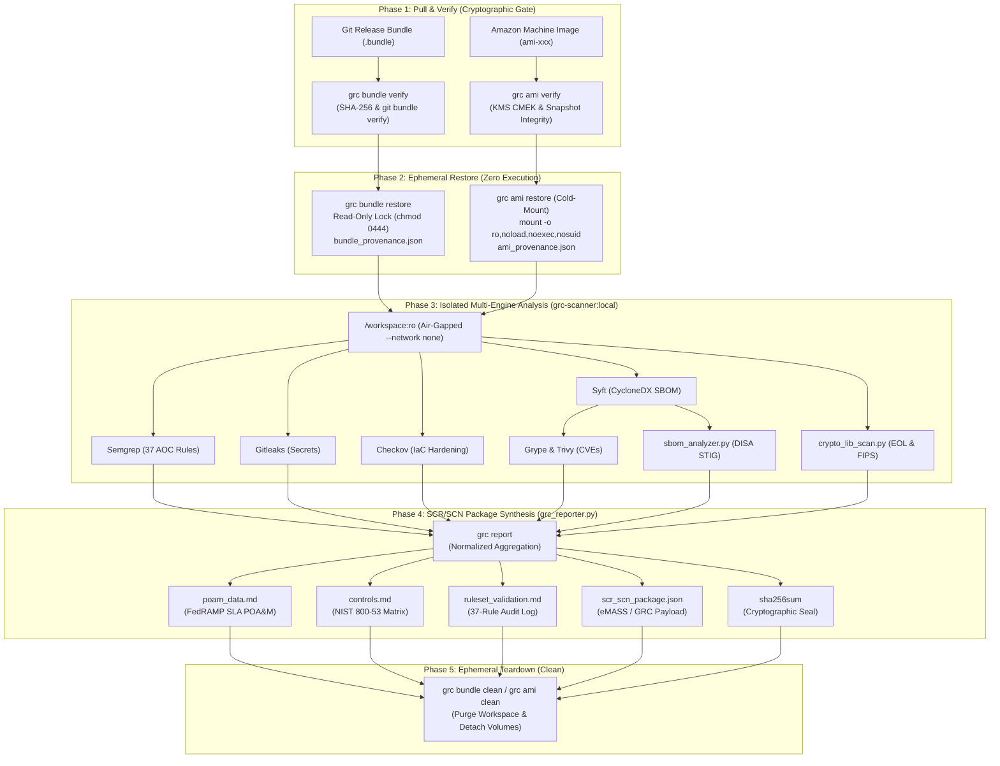

# GRC Bundle Reviewer (`grc-bundle-review`)

```text
> grcfetch
        .--.          .--.          .--.
  ,p#G*""TG#Gp, ,p#G*""TG#Gp, ,p#G*""TG#Gp,    eodartintlabs-hue/grc-bundle-reviewer
 {GGG'     `G# {GGG     `GGG {GGG'     `G#     -------------------------------------
 @GGG          @GGG     ,GGG @GGG              App: GRC Bundle Reviewer v1.0.0
 'GGG   ,p#GG# @GGG#**#GGG"  'GGG              OS: Darwin ARM64 / Linux Bookworm
  GGG   ""`GGG @GGG   `GGG,   GGG              Model: Out-of-Band (OOB) / Fail-Open
 ]GGG#     GGG @GGG    ]GGG  ]GGG#     ,G#     Isolation: Air-Gapped (--network none, :ro)
  @GGGb,,,dGGG @GGG     GGG,  @GGGb,,,dGG"     Scanners: (7) Semgrep, Gitleaks, Checkov,
   `@GGGG###G# @GGG     `GGG   `@GGGG###G"                   Syft, Grype, Trivy, OpenSCAP
     `"%N>"`    `"%NW" `"%NW"    `"%N>"`       Ruleset: 37 AST Rules (AOC 02–140)
                                               Frameworks: DISA STIG, NIST 800-53 R5, FedRAMP
                                               Deliverables: POA&M, Controls, SCR/SCN, SHA-256

                                               ███ ███ ███ ███ ███ ███ ███ ███
                                               ▄▄▄ ▄▄▄ ▄▄▄ ▄▄▄ ▄▄▄ ▄▄▄ ▄▄▄ ▄▄▄
```

> **Classification**: Internal DevSecOps & Security Compliance Specification  
> **Target Frameworks**: DISA STIG, NIST SP 800-53 Rev. 5, FedRAMP High, DoD Cloud Computing SRG, OWASP Top 10  
> **Operational Model**: Out-of-Band (OOB), Fail-Open, Zero Untrusted Execution, Ephemeral Hygiene  
> **Companion Test Corpus**: [`grc-test-dummies`](https://github.com/eodartintlabs-hue/grc-test-dummies)  

---

## Table of Contents

1. [Executive Overview](#1-executive-overview)
2. [End-to-End Architecture & 5-Phase Lifecycle](#2-end-to-end-architecture--5-phase-lifecycle)
3. [Core Architectural Principles](#3-core-architectural-principles)
4. [Areas of Concern (AOC) & NIST SP 800-53 Coverage Matrix](#4-areas-of-concern-aoc--nist-sp-800-53-coverage-matrix)
5. [Integrated Security Scanning & Synthesis Engines](#5-integrated-security-scanning--synthesis-engines)
6. [Phase 4 Compliance Deliverables & SCR/SCN Package](#6-phase-4-compliance-deliverables--scrscn-package)
7. [CLI Command Reference (`./grc`)](#7-cli-command-reference-grc)
8. [Quickstart Workflows](#8-quickstart-workflows)
9. [Negative Testing & Verification](#9-negative-testing--verification)
10. [Repository Structure & Documentation Index](#10-repository-structure--documentation-index)

---

## 1. Executive Overview

The **GRC Bundle & AMI Review Pipeline** is an automated, cryptographic verification and static security analysis framework engineered to audit **Git software release bundles (`.bundle`)** and **Amazon Machine Images (`AMI`)** out-of-band. 

Designed for high-assurance federal and defense environments (**FedRAMP High**, **DISA STIG**, **DoD RMF**), the pipeline guarantees deep compliance verification and automated **Security Change Request / Security Change Notification (SCR/SCN)** evidence generation without gating or slowing down developer CI/CD velocity.

---

## 2. End-to-End Architecture & 5-Phase Lifecycle



---

## 3. Core Architectural Principles

* **Out-of-Band (OOB) & Fail-Open**: Audits execute asynchronously on read-only copies of release artifacts. Engineering deployments are never blocked by scanner latency, while compliance teams receive 100% visibility.
* **Zero Untrusted Code Execution**:
  * **Git Bundles**: Extracted source trees are immediately locked with `0444` read-only permissions; build scripts, hooks, and binaries are never executed.
  * **AMIs (EBS Snapshot Cold-Mount)**: Root EBS snapshots are attached as secondary non-boot volumes and mounted with `mount -o ro,noload,noexec,nosuid` inside an isolated `chroot`, preventing binaries, systemd units, or cron jobs from activating.
* **Air-Gapped Container Isolation & Zero Host Pollution**:
  * All third-party scanners run inside the local **`grc-scanner:local`** Docker container with `--network none` and a read-only workspace mount (`/workspace:ro`).
  * All host orchestration scripts (`grc_bundle.py`, `grc_ami.py`, `grc_reporter.py`, `crypto_lib_scan.py`, `sbom_analyzer.py`) use **100% Python 3 standard library modules**—requiring zero `pip` installs on the host workstation and **\$0.00 in cloud compute costs** for local verification.
* **Automated Evidence Segregation**: `./grc scan` inspects provenance metadata and automatically namespaces outputs into `evidence/<bundle-name>/`, preventing cross-contamination across sequential reviews.

---

## 4. Areas of Concern (AOC) & NIST SP 800-53 Coverage Matrix

The pipeline enforces **37 custom Semgrep AST rules** ([`rules/custom-baseline-ruleset.yaml`](rules/custom-baseline-ruleset.yaml)) alongside cryptographic and vulnerability catalogs across Python, Go, Java, JavaScript/TypeScript, Terraform, and Ansible:

| AOC ID | Area of Concern | Governing NIST 800-53 Controls | DISA STIG Impact | Target Anti-Patterns & Violations Caught |
| :--- | :--- | :--- | :--- | :--- |
| **AOC-02** | **Password Hygiene** | `IA-2` | `CAT I / II` | Hardcoded passwords, database credentials, static API keys, and bearer tokens. |
| **AOC-03** | **Weak Encryption Check** | `SI-16`, `SC-13` | `CAT I / II` | Broken hash algorithms (`MD5`, `SHA-1`), legacy ciphers (`DES`, `3DES`, `RC4`), and insecure `AES/ECB` modes. |
| **AOC-04** | **Command Injection** | `SI-4`, `SI-10` | `CAT I` | Unsanitized runtime shell execution (`os.system`, `subprocess(shell=True)`, Go `exec.Command`, Java `Runtime.exec`). |
| **AOC-05** | **Improper TLS** | `SI-17`, `SC-8` | `CAT I / II` | Deprecated `TLS 1.0` / `TLS 1.1` protocols and disabled certificate verification (`verify=False`, `InsecureSkipVerify`). |
| **AOC-06** | **Secrets Management** | `SC-12`, `IA-2` | `CAT I` | Embedded PEM/PKCS private keys (`RSA`, `EC`, `DSA`, `OPENSSH`) and high-entropy secrets in source history. |
| **AOC-07** | **IaC Misconfigurations** | `AC-3`, `AC-6`, `CM-6`, `SC-28` | `CAT I / II` | Public S3 buckets, open `0.0.0.0/0` SSH/RDP ingress rules, unencrypted EBS volumes, and disabled SELinux. |
| **AOC-09** | **Unsupported Crypto Libraries** | `SI-7`, `SC-12`, `SC-13` | `CAT I` | End-of-Life (EOL) and unmaintained cryptographic providers (`pycrypto`, `OpenSSL 1.1.1`, `Bouncy Castle < 1.70`). |
| **AOC-10** | **CRITICAL Severity Findings** | `RA-5`, `SI-2` | `CAT I` | Known CVSS 9.0–10.0 CVEs (e.g., Log4Shell, Spring4Shell) and unsafe object deserialization (`pickle`, `ObjectInputStream`). |
| **AOC-11** | **Category I STIG Violations** | `SI-2`, `CM-8` | `CAT I` | Exposed production debug listeners, XML External Entity (XXE) processing, insecure cookies, and OS STIG CAT I gaps. |
| **AOC-12** | **Lack of FIPS Mode** | `SC-13` | `CAT I` | Kernel bootloaders with `fips=0`, OS crypto-policies set to `DEFAULT`, and OpenSSL configs missing `[fips_sect] activate = 1`. |
| **AOC-140** | **Org-Specific Guardrails** | `CM-6` | `CAT II` | Credential leakage to `stdout`/logs, hardcoded internal IPs, and root container execution. |

---

## 5. Integrated Security Scanning & Synthesis Engines

### 5.1 Containerized Security Suite (`grc-scanner:local`)
Bundled via [`docker/Dockerfile.scanner`](docker/Dockerfile.scanner) and orchestrated by [`docker/scan_orchestrator.sh`](docker/scan_orchestrator.sh):

| Engine | Domain | Role in Pipeline | Output Artifact |
| :--- | :--- | :--- | :--- |
| **Semgrep** | SAST / AST Policy | Evaluates source code against the 37-rule custom AOC baseline. | `semgrep_findings.json` |
| **Gitleaks** | Secret Detection | Scans files and Git history for exposed API keys, tokens, and private keys. | `gitleaks_findings.json` |
| **Checkov** | IaC Compliance | Audits Terraform, CloudFormation, Kubernetes, and Ansible against CIS/STIG rules. | `checkov_findings.json` |
| **Syft** | SBOM Generation | Generates complete CycloneDX Software Bills of Materials across app & OS layers. | `sbom.cdx.json` |
| **Grype** | CVE Analysis | Matches SBOM components against NVD and vendor advisories for critical CVEs. | `grype_findings.json` |
| **Trivy** | Multi-Target CVE | Secondary vulnerability and filesystem misconfiguration verification. | `trivy_findings.json` |
| **OpenSCAP** | OS STIG Engine | Evaluates cold-mounted AMI filesystems (`oscap-chroot`) against DISA STIG XCCDF profiles. | `oscap_results.xml` |

### 5.2 Native Python Compliance Engines (`scripts/`)
Zero-dependency Python 3 engines that manage provenance, domain-specific analysis, and Phase 4 synthesis:

* **[`grc_bundle.py`](scripts/grc_bundle.py)**: Verifies SHA-256 checksums, validates `git bundle` headers, extracts read-only workspaces, and emits `bundle_provenance.json`.
* **[`grc_ami.py`](scripts/grc_ami.py)**: Validates AWS AMI encryption, orchestrates EBS snapshot cold-mounting (`ro,noload,noexec,nosuid`), resolves `/etc/os-release` to DISA STIG benchmarks, supports `--mock` offline simulation, and emits `ami_provenance.json`.
* **[`crypto_lib_scan.py`](scripts/crypto_lib_scan.py)**: Statically inspects manifests (`requirements.txt`, `package.json`, `pom.xml`, `go.mod`) and native libraries (`libcrypto.so*`) against [`rules/crypto_catalog.json`](rules/crypto_catalog.json).
* **[`sbom_analyzer.py`](scripts/sbom_analyzer.py)**: Maps CycloneDX and SPDX SBOM inventories directly to applicable DISA STIGs and DoD SRGs (`stig_matrix.md`).
* **[`grc_reporter.py`](scripts/grc_reporter.py)**: Phase 4 aggregator that parses all scanner outputs into formal POA&Ms, NIST control matrices, ruleset logs, and sealed SCR/SCN packages.

---

## 6. Phase 4 Compliance Deliverables & SCR/SCN Package

Every completed scan automatically populates `evidence/<target-name>/` with a sealed, audit-ready package:

| Deliverable File | Format | Consumer / System | Compliance Purpose |
| :--- | :--- | :--- | :--- |
| **`bundle_provenance.json`** / **`ami_provenance.json`** | JSON | Audit Archive | Cryptographic chain-of-custody record (SHA-256, Git commit/tag or AMI/Snapshot/KMS ARN, timestamps). |
| **`poam_data.md`** | Markdown | FedRAMP 3PAO / AO | **Plan of Action & Milestones**: Itemizes all findings with FedRAMP SLAs (**30d Critical/CAT I**, **60d High/CAT II**, **90d Medium/CAT III**), target dates, and remediation steps. |
| **`controls.md`** | Markdown | Security Assessors | **NIST SP 800-53 Rev. 5 Traceability Matrix**: Pass/Fail compliance rollup and itemized finding breakdown across `AC`, `IA`, `SC`, `SI`, `CM`, and `RA` control families. |
| **`ruleset_validation.md`** | Markdown | Engineering & GRC | **37-Rule Baseline Validation Log**: Itemized audit log showing which custom Semgrep rules triggered vs. passed clean, including exact file and line locations. |
| **`stig_matrix.md`** | Markdown | DoD RMF Assessors | **DISA STIG Applicability Matrix**: Maps discovered software components to governing DISA STIG and SRG benchmarks. |
| **`scr_scn_package.json`** | JSON | eMASS / ServiceNow / Jira | **Consolidated SCR/SCN Payload**: Unified, schema-validated JSON payload containing provenance, risk scorecards, control rollups, and normalized findings. |
| **`sha256sum`** | Text | Tamper Verification | **Cryptographic Evidence Seal**: Standard SHA-256 manifest computed over every file in the evidence directory. |

---

## 7. CLI Command Reference (`./grc`)

The root `./grc` dispatcher provides a unified interface across all pipeline stages:

| Command | Usage | Description |
| :--- | :--- | :--- |
| **`bundle verify`** | `./grc bundle verify <file.bundle> [--expected-sha256 <hash>]` | Validates bundle SHA-256 digest and `git bundle verify` object integrity prior to extraction. |
| **`bundle restore`** | `./grc bundle restore <file.bundle> -w <dir> -r <ref> [-f] [--read-only]` | Extracts bundle into an ephemeral workspace, locks files read-only (`0444`), and writes `bundle_provenance.json`. |
| **`bundle clean`** | `./grc bundle clean -w <dir> [--delete-bundle <file.bundle>]` | Removes read-only locks and purges the ephemeral workspace while preserving `evidence/`. |
| **`ami verify`** | `./grc ami verify <ami-id> [--region <r>] [--mock]` | Validates AMI availability, root EBS snapshot integrity, and KMS CMK encryption compliance. |
| **`ami restore`** | `./grc ami restore <ami-id> -w <dir> [--worker-id <id>] [--mock]` | Cold-mounts AMI root snapshot read-only (`ro,noload,noexec,nosuid`), resolves OS STIG, and writes `ami_provenance.json`. |
| **`ami clean`** | `./grc ami clean -w <dir> [--mock]` | Unmounts cold-mounted filesystem, detaches/deletes ephemeral EBS volume, and wipes workspace. |
| **`scan`** | `./grc scan -w <workspace> [-e <evidence_dir>]` | Runs the isolated `grc-scanner:local` container suite **and** automatically synthesizes all Phase 4 deliverables. |
| **`report`** | `./grc report -e <evidence_dir> [-w <workspace>]` | Synthesizes or refreshes `poam_data.md`, `controls.md`, `ruleset_validation.md`, `scr_scn_package.json`, and `sha256sum`. |
| **`crypto`** | `./grc crypto -w <workspace> --format json -o <out.json>` | Runs the static cryptographic library and EOL dependency scanner. |
| **`sbom`** | `./grc sbom --sbom <sbom.json> --format markdown -o <stig_matrix.md>` | Maps CycloneDX / SPDX SBOM components to DISA STIGs and DoD SRGs. |
| **`docker-build`** | `./grc docker-build` | Builds or rebuilds the local `grc-scanner:local` Docker image from `docker/Dockerfile.scanner`. |

---

## 8. Quickstart Workflows

### 8.1 Streamlined 2-Step Git Bundle Review (Recommended)

```bash
# Step 1: Restore the release bundle into an isolated, read-only ephemeral workspace
./grc bundle restore /path/to/release-v1.0.0.bundle \
  --workspace ./ephemeral_workspace \
  --ref v1.0.0 \
  --force --read-only

# Step 2: Run the containerized scanner suite + automatic Phase 4 SCR/SCN synthesis
./grc scan -w ./ephemeral_workspace

# Step 3: Review generated compliance work papers in evidence/<bundle-name>/
ls -la evidence/release-v1.0.0/
# -> bundle_provenance.json, poam_data.md, controls.md, ruleset_validation.md, scr_scn_package.json, sha256sum

# Step 4: Tear down the ephemeral workspace
./grc bundle clean --workspace ./ephemeral_workspace
```

### 8.2 AMI Cold-Mount Review (Cloud & Zero-Cost Local `--mock` Mode)

```bash
# 1. Verify AMI metadata, KMS encryption & root snapshot integrity (use --mock for $0 local testing)
./grc ami verify ami-0123456789abcdef0 --region us-east-1 --mock

# 2. Cold-mount AMI snapshot into ephemeral read-only workspace
./grc ami restore ami-0123456789abcdef0 --workspace ./ephemeral_ami_workspace --mock --force

# 3. Scan the cold-mounted rootfs and generate Phase 4 compliance deliverables
./grc scan -w ./ephemeral_ami_workspace/mnt -e ./evidence/ami-0123456789abcdef0

# 4. Tear down ephemeral volume and audit mount
./grc ami clean --workspace ./ephemeral_ami_workspace --mock
```

---

## 9. Security Assurance, Negative Testing & Verification

In high-assurance compliance automation, a scanner that outputs zero findings is untrusted until proven capable of failing. This pipeline is paired with the companion **[`grc-test-dummies`](https://github.com/eodartintlabs-hue/grc-test-dummies)** repository containing 8 pre-compiled synthetic release bundles (`aoc-02` through `aoc-12`) and flawed AMI fixtures engineered to trigger every control in the pipeline:

* 🛡️ **[Security Policy & Architecture Assurance (`SECURITY.md`)](SECURITY.md)** — Detailed analysis of runtime air-gap enforcement (`--network none`), scanner telemetry suppression, symlink escape prevention, and our 7-point threat model.
* 📘 **[Negative Testing & Scanner Verification Help Guide (`docs/test-dummies-guide.md`)](docs/test-dummies-guide.md)** — Master cheat sheet with copy-pasteable commands for every AOC, batch test runner loop, `jq` inspection one-liners, and troubleshooting FAQ.
* 📋 **[End-to-End Verification Test Plan (`TESTING.md`)](TESTING.md)** — Formal test strategy, pre-flight checklist, tamper-rejection gate tests, and deliverable acceptance criteria.

---

## 10. Repository Structure & Documentation Index

```text
grc-bundle-review/
├── README.md                         # Master project overview, architecture, and CLI reference
├── SECURITY.md                       # Air-gap security policy, threat model, and telemetry controls
├── TESTING.md                        # End-to-end audit verification test plan
├── grc                               # Root CLI dispatcher wrapper
├── .gitignore                        # Protects against committing ephemeral workspaces and bundles
│
├── docker/                           # Containerized scanning suite (100% local, $0 cloud cost)
│   ├── Dockerfile.scanner            # Image recipe bundling Semgrep, Checkov, Gitleaks, Syft, Grype, Trivy, OpenSCAP
│   ├── scan_orchestrator.sh          # In-container multi-engine runner with JSON pretty-printing
│   └── README.md                     # Container architecture, --network none isolation, and usage guide
│
├── docs/                             # Governance & architecture specifications
│   ├── ami-review-workflow.md        # AMI EBS snapshot cold-mount audit specification & schema
│   ├── design-rules-and-aocs.md      # Core design principles and AOC 01–140 traceability matrix
│   ├── review-workflow.md            # 5-stage Git bundle review & SCR/SCN lifecycle
│   ├── test-dummies-guide.md         # Negative testing walkthrough, AOC cheat sheet, and jq guide
│   └── workspace-layout.md           # Auditor workstation hardware/software baseline and deliverables
│
├── rules/                            # Declarative compliance policies
│   ├── custom-baseline-ruleset.yaml  # 37-rule Semgrep AST baseline covering Go, Java, Python, JS
│   └── crypto_catalog.json           # Cryptographic library EOL, deprecation, and FIPS 140 catalog
│
└── scripts/                          # Zero-dependency Python 3 automation engines
    ├── grc_bundle.py                 # Git bundle verification, read-only restoration, and cleanup
    ├── grc_ami.py                    # AMI cold-mount restoration, STIG resolution, and cleanup
    ├── grc_reporter.py               # Phase 4 SCR/SCN synthesizer (poam_data.md, controls.md, ruleset log, sha256sum)
    ├── crypto_lib_scan.py            # Static cryptographic provider and EOL dependency auditor
    └── sbom_analyzer.py              # CycloneDX & SPDX to DISA STIG / DoD SRG applicability mapper
```
