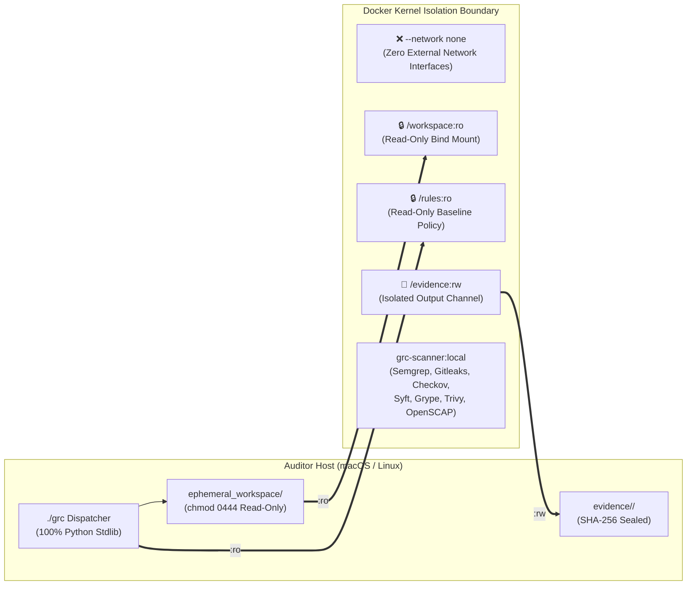

# Security Policy & Architecture Assurance (`SECURITY.md`)

<p align="center">
  <a href="README.md"><b>📖 README</b></a> &nbsp;·&nbsp;
  <a href="ARCHITECTURE.md"><b>🏛️ Architecture & Tech Stack</b></a> &nbsp;·&nbsp;
  <a href="SECURITY.md"><b>🛡️ Security Policy</b></a> &nbsp;·&nbsp;
  <a href="TESTING.md"><b>🧪 Verification Plan</b></a> &nbsp;·&nbsp;
  <a href="grc-bundle%20Use%20Case.md"><b>📑 Use Case Walkthrough</b></a> &nbsp;·&nbsp;
  <a href="docs/test-dummies-guide.md"><b>🎯 Test Dummies Guide</b></a>
</p>

> **Classification**: Internal DevSecOps & Security Compliance Specification  
> **Target Frameworks**: NIST SP 800-53 Rev. 5 (`SC-7`, `SC-8`, `SC-13`, `SI-3`, `SI-7`, `CM-6`, `CM-7`), DISA STIG, FedRAMP High  
> **Isolation Posture**: Air-Gapped Runtime Execution (`--network none`), Read-Only Mounts, Zero Untrusted Code Execution  

---

## Table of Contents

1. [Executive Security Summary](#1-executive-security-summary)
2. [Network Isolation: Do Any Tools Reach Out to the Internet?](#2-network-isolation-do-any-tools-reach-out-to-the-internet)
   * [2.1 Runtime Air-Gap Enforcement (`--network none`)](#21-runtime-air-gap-enforcement---network-none)
   * [2.2 Host Python Engines vs. Containerized Scanners](#22-host-python-engines-vs-containerized-scanners)
   * [2.3 Build-Time vs. Scan-Time Network Behavior](#23-build-time-vs-scan-time-network-behavior)
3. [Threat Model & How the GRC Pipeline Avoids Common Security Pitfalls](#3-threat-model--how-the-grc-pipeline-avoids-common-security-pitfalls)
   * [3.1 Threat 1: Untrusted Code Execution ("Trojan Bundle / Malicious Hook")](#31-threat-1-untrusted-code-execution-trojan-bundle--malicious-hook)
   * [3.2 Threat 2: Proprietary Code Exfiltration & Scanner Telemetry ("Phone Home")](#32-threat-2-proprietary-code-exfiltration--scanner-telemetry-phone-home)
   * [3.3 Threat 3: Symlink Escapes & Host Filesystem Traversal](#33-threat-3-symlink-escapes--host-filesystem-traversal)
   * [3.4 Threat 4: Workspace Mutation & Evidence Tampering ("Chain of Custody")](#34-threat-4-workspace-mutation--evidence-tampering-chain-of-custody)
   * [3.5 Threat 5: Cross-Contamination & Residual Data Spillage](#35-threat-5-cross-contamination--residual-data-spillage)
   * [3.6 Threat 6: Host Workstation Pollution & Supply-Chain Drift](#36-threat-6-host-workstation-pollution--supply-chain-drift)
   * [3.7 Threat 7: Cloud Volume Sprawl & Unencrypted Snapshots (AMI Reviews)](#37-threat-7-cloud-volume-sprawl--unencrypted-snapshots-ami-reviews)
4. [Security Controls Summary Matrix](#4-security-controls-summary-matrix)
5. [Reporting a Security Issue](#5-reporting-a-security-issue)

---

## 1. Executive Security Summary

Auditing unvetted software release bundles (`.bundle`) and virtual machine images (`AMI`) is inherently high-risk: the very artifacts under inspection may contain security vulnerabilities, hardcoded credentials, misconfigurations, or potentially malicious code.

The **GRC Bundle Review Pipeline** is architected on a **Zero-Trust, Zero-Execution, Air-Gapped** security model. It treats every ingested bundle and AMI snapshot as untrusted data, ensuring that neither the audit workstation nor the organization's intellectual property is ever exposed during an evaluation.



---

## 2. Network Isolation: Do Any Tools Reach Out to the Internet?

### 2.1 Runtime Air-Gap Enforcement (`--network none`)

**No.** When you execute `./grc scan`, **zero tools can reach the internet.**

In [`./grc`](grc), the scanner container is invoked with Docker's kernel-level **`--network none`** flag:

```bash
docker run --rm \
    --network none \
    -v "${RESOLVED_WORKSPACE}:/workspace:ro" \
    -v "${SCRIPT_DIR}/rules:/rules:ro" \
    -v "${RESOLVED_EVIDENCE}:/evidence:rw" \
    grc-scanner:local \
    /usr/local/bin/scan_orchestrator.sh
```

When `--network none` is active:
1. Docker creates an isolated Linux network namespace with **no external network interface (`eth0`)**—only the local loopback interface (`127.0.0.1`) exists.
2. There is no DNS resolver, no default gateway, and no NAT bridge to the host.
3. Even if a scanning engine attempted to transmit telemetry, source code snippets, or file hashes externally, the Linux kernel immediately drops the socket request (`ENETUNREACH`).

---

### 2.2 Host Python Engines vs. Containerized Scanners

#### A. Native Host Python Scripts (`scripts/*.py`)
All host-side scripts are written using **100% Python 3 Standard Library** (`json`, `hashlib`, `pathlib`, `re`, `os`, `subprocess`) and contain **zero HTTP/network client calls**:

| Script | Internet Access? | Network & Security Posture |
| :--- | :--- | :--- |
| **[`grc_bundle.py`](scripts/grc_bundle.py)** | ❌ **Never** | Executes local `hashlib.sha256` and `git bundle verify` operations only. |
| **[`crypto_lib_scan.py`](scripts/crypto_lib_scan.py)** | ❌ **Never** | Statically parses local dependency manifests against local [`rules/crypto_catalog.json`](rules/crypto_catalog.json). |
| **[`sbom_analyzer.py`](scripts/sbom_analyzer.py)** | ❌ **Never** | Statically maps local CycloneDX/SPDX JSONs against embedded DISA STIG dictionaries. |
| **[`grc_reporter.py`](scripts/grc_reporter.py)** | ❌ **Never** | Aggregates local JSON findings into Markdown work papers and computes `sha256sum`. |
| **[`grc_ami.py`](scripts/grc_ami.py)** | ⚠️ **AWS API Only (Live Mode)** | • **`--mock` Mode**: ❌ **Never** (100% offline simulation).<br>• **Live Cloud Mode**: Connects exclusively to the authenticated **AWS Regional EC2 API** (`ec2.<region>.amazonaws.com`) via IAM credentials to inspect AMI metadata and attach EBS snapshots. |

#### B. Containerized Security Engines (`grc-scanner:local`)
Inside [`docker/scan_orchestrator.sh`](docker/scan_orchestrator.sh), each tool is explicitly configured for offline execution alongside `--network none`:

| Scanner Tool | Default Vendor Behavior | Pipeline Air-Gap Enforcement |
| :--- | :--- | :--- |
| **Semgrep** | Attempts to send anonymous usage metrics to `semgrep.dev` unless disabled. | Executed with `--metrics=off` (`SEMGREP_SEND_METRICS=off`) against local `/rules/custom-baseline-ruleset.yaml` and blocked by `--network none`. |
| **Gitleaks** | 100% offline compiled Go binary. | Runs purely against local `/workspace` files using embedded regex rules. |
| **Checkov** | Attempts to query Prisma/Bridgecrew API for external policy updates or API keys. | Executed with `--skip-download` (`BC_SKIP_MAPPING=TRUE`) to use embedded Python checks only; blocked by `--network none`. |
| **Syft** | 100% offline cataloger (`SYFT_CHECK_FOR_APP_UPDATE=false`). | Inspects local package manifests and binary headers without network calls. |
| **Grype** | Checks `anchore` servers for vulnerability DB updates on startup. | CVE database is pre-cached into the image during `docker-build`; runs at scan time with `GRYPE_DB_AUTO_UPDATE=false` and `GRYPE_CHECK_FOR_APP_UPDATE=false`. |
| **Trivy** | Attempts to download the latest vulnerability database from GHCR on first run. | Vulnerability DB is pre-cached into the image during `docker-build`; runs at scan time with `--offline-scan` and `--skip-db-update`. |
| **OpenSCAP** | 100% offline C library (`libopenscap25`). | Evaluates local XCCDF/OVAL XML datastreams without network access. |

---

### 2.3 Build-Time vs. Scan-Time Network Behavior

| Lifecycle Phase | Command | Network State | Purpose |
| :--- | :--- | :--- | :--- |
| **1. Image Build** | `./grc docker-build` | 🌐 **Online** | Downloads Debian security packages, Python wheels (`semgrep`, `checkov`), scanner binaries (`gitleaks`, `syft`, `grype`, `trivy`), and pre-caches the offline CVE databases for Grype and Trivy. |
| **2. Bundle / AMI Audit** | `./grc scan` | 🔒 **Air-Gapped (`--network none`)** | Zero network connectivity. All scanning, SBOM generation, and CVE matching run against pre-cached databases inside the isolated container. |
| **3. Report Synthesis** | `./grc report` | 🔒 **Offline** | Local Python standard-library aggregation into `poam_data.md`, `controls.md`, `ruleset_validation.md`, and `sha256sum`. |

---

## 3. Threat Model & How the GRC Pipeline Avoids Common Security Pitfalls

### 3.1 Threat 1: Untrusted Code Execution ("Trojan Bundle / Malicious Hook")
* **The Risk**: A software bundle or VM image submitted for review could contain malicious Git hooks (`.git/hooks/post-checkout`), weaponized build scripts (`Makefile`, `setup.py`, `package.json` `postinstall`), or active rootkits/cron jobs that execute the moment an auditor unpacks or boots the artifact.
* **How We Avoid It**:
  1. **Zero Build / Zero Install Policy**: The pipeline *never* runs `pip install`, `npm install`, `mvn compile`, or `go build` on audited code. Dependency and cryptographic scanners (`Syft`, `crypto_lib_scan.py`) parse manifest files as plain text.
  2. **Immediate Read-Only & Non-Executable Permissions (`0444`)**: Upon extraction (`./grc bundle restore --read-only`), `grc_bundle.py` strips executable bits (`chmod 0444`) across all extracted files.
  3. **EBS Snapshot Cold-Mount (`ro,noload,noexec,nosuid`)**: During AMI audits, the target AMI is **never booted as an EC2 instance**. Instead, its root snapshot is attached to an audit worker as a passive secondary disk and mounted with:
     * `ro`: Read-only filesystem protection.
     * `noexec`: Kernel VFS blocks execution of any binary or script on the volume.
     * `nosuid`: Kernel disables `setuid`/`setgid` privilege escalation bits.
     * `noload`: Prevents corrupt or malicious ext4/xfs filesystem journals from replaying on mount.

### 3.2 Threat 2: Proprietary Code Exfiltration & Scanner Telemetry ("Phone Home")
* **The Risk**: Many commercial and open-source scanners transmit crash reports, rule telemetry, or file hashes back to vendor cloud servers, creating an intellectual property (IP) or compliance data spill.
* **How We Avoid It**:
  * Every tool is configured with telemetry-suppression flags (`--metrics=off`, `--skip-download`, `--offline-scan`), and the container runtime enforces `--network none`, making outbound connections physically impossible during an audit.

### 3.3 Threat 3: Symlink Escapes & Host Filesystem Traversal
* **The Risk**: An untrusted Git repository could include malicious symbolic links (e.g., `app/config.yaml -> /Users/auditor/.ssh/id_rsa` or `/etc/passwd`) designed to trick a scanner into reading and reporting sensitive files from the auditor's host machine.
* **How We Avoid It**:
  * All third-party scanners execute inside the **`grc-scanner:local`** Docker container where only `/workspace:ro` is bind-mounted. Any symlink pointing to an absolute path outside `/workspace` resolves against the minimal, disposable container filesystem rather than the macOS/Linux host.

### 3.4 Threat 4: Workspace Mutation & Evidence Tampering ("Chain of Custody")
* **The Risk**: An automated tool (such as an auto-fixer or linter) could alter source files during a scan, invalidating the audit's forensic integrity, or evidence files could be modified after generation.
* **How We Avoid It**:
  1. **Cryptographic Pre-Verification**: `grc bundle verify` validates the bundle's SHA-256 hash before a single file is unpacked and logs it to `bundle_provenance.json`.
  2. **Read-Only Container Mount (`/workspace:ro`)**: Even if a scanner attempted to auto-fix or write temporary files into the source tree, the Docker daemon blocks write operations at the mount layer (`EROFS: Read-only file system`).
  3. **Cryptographic Evidence Seal (`sha256sum`)**: At the conclusion of Phase 4, `grc_reporter.py` hashes every JSON and Markdown deliverable in `evidence/<bundle>/` and writes a tamper-evident `sha256sum` manifest.

### 3.5 Threat 5: Cross-Contamination & Residual Data Spillage
* **The Risk**: Auditing multiple releases sequentially in the same folder can leave behind residual files from an earlier review, causing false positives or mixing findings from two different systems into one POA&M report.
* **How We Avoid It**:
  1. **Ephemeral Workspace Lifecycle**: `./grc bundle restore --force` completely purges the previous `ephemeral_workspace` before unpacking the next bundle, and `./grc bundle clean` destroys the workspace post-review.
  2. **Automated Evidence Namespacing**: `./grc scan` reads `bundle_provenance.json` and automatically isolates outputs into `evidence/<bundle-name>/`, ensuring findings from `aoc-02` never overwrite or mix with `aoc-03`.
  3. **Git Hygiene (`.gitignore`)**: The repository's [`.gitignore`](.gitignore) explicitly blocks `ephemeral_*/` workspaces and `*.bundle` archives from ever being committed to version control.

### 3.6 Threat 6: Host Workstation Pollution & Supply-Chain Drift
* **The Risk**: Installing complex Python/Node/Go scanner toolchains globally on an auditor's workstation (`pip install semgrep checkov`) can break local system libraries, conflict with other developer tools/agents, and cause two auditors to get different scan results due to tool version drift.
* **How We Avoid It**:
  * **Zero Host Dependencies**: The host requires only `python3`, `git`, and `docker`. All scanning engines and their dependencies are locked inside `grc-scanner:local`, guaranteeing deterministic, reproducible results across every auditor workstation without touching the host's global Python environment.

### 3.7 Threat 7: Cloud Volume Sprawl & Unencrypted Snapshots (AMI Reviews)
* **The Risk**: Provisioning temporary EBS volumes from snapshots during cloud AMI reviews can leave behind unencrypted or orphaned volumes in AWS, creating both a storage cost leak and a data-at-rest compliance violation (`NIST SC-28`).
* **How We Avoid It**:
  * `grc_ami.py` verifies KMS encryption compliance before restoration (`grc ami verify`), tags all temporary volumes with ephemeral session metadata, and executes an automated 3-stage teardown (`umount` $\rightarrow$ `DetachVolume` $\rightarrow$ `DeleteVolume`) via `./grc ami clean`.

---

## 4. Security Controls Summary Matrix

| Threat / Risk Vector | Pipeline Defense Mechanism | Governing NIST 800-53 Control |
| :--- | :--- | :--- |
| **Outbound Data Exfiltration / Telemetry** | Docker `--network none` + `--metrics=off` / `--offline-scan` | `SC-7` (Boundary Protection) |
| **Malicious Code / Hook Execution** | Static AST/manifest parsing + `chmod 0444` + `mount -o noexec,nosuid` | `SI-3` (Malicious Code Protection), `CM-7` (Least Functionality) |
| **Symlink / Path Traversal to Host** | Containerized filesystem namespace isolation (`/workspace:ro`) | `SC-39` (Process Isolation), `AC-6` (Least Privilege) |
| **Source Code Mutation During Audit** | Read-only bind mount (`-v .../workspace:ro`) + `chmod 0444` | `SI-7` (Software & Information Integrity) |
| **Audit Evidence Tampering** | Pre-extraction SHA-256 provenance + post-scan `sha256sum` seal | `AU-9` (Protection of Audit Information) |
| **Cross-Bundle Evidence Contamination** | Ephemeral teardown (`grc clean`) + `evidence/<bundle>/` namespacing | `SC-4` (Information in Shared Resources) |
| **Host Dependency Pollution** | 100% Python Stdlib host scripts + stateless `--rm` container | `CM-2` (Baseline Configuration), `SA-10` (Developer Configuration Management) |

---

## 5. Reporting a Security Issue

If you discover a security vulnerability, isolation bypass, or rule evasion technique within the **GRC Bundle Review Pipeline**:
1. **Do not** open a public issue containing sensitive exploit payloads against production systems.
2. Submit a reproductive test case using a synthetic fixture in the companion **[`grc-test-dummies`](https://github.com/eodartintlabs-hue/grc-test-dummies)** repository.
3. Contact the internal **DevSecOps & GRC Engineering Team** to coordinate rule and container updates.
