# GRC Bundle Reviewer — Full-Stack "Hamburger" Architecture (`TECHSTACK.md`)

> **Classification**: Internal DevSecOps & System Architecture Reference  
> **Architecture Pattern**: 8-Layer Vertical "Hamburger" Stack (Cloud/Git Ingestion $\rightarrow$ Apple Silicon Hardware)  
> **Runtime Posture**: 100% Local Execution, Air-Gapped Container (`--network none`), Zero Host Dependency Pollution  

---

## 1. The GRC Tech Stack "Hamburger" Diagram

This vertical architecture diagram illustrates every layer of the **GRC Bundle Reviewer**, stacked from **Upstream GitHub & Cloud Inputs (Top Bun)** down to the **MacBook Pro Apple Silicon M5 Pro Hardware (Bottom Bun)**:

```mermaid
flowchart TB
    %% =========================================================================
    %% LAYER 1: TOP BUN - UPSTREAM REPOSITORIES, CLOUD & INGESTION TARGETS
    %% =========================================================================
    subgraph L1["🍔 LAYER 1 (TOP BUN): Upstream Source Control, Cloud & Test Corpus"]
        direction LR
        GH["GitHub Repositories\n(grc-bundle-review & grc-test-dummies)"]
        GitBundle["Git Release Bundles (.bundle)\nTag & Commit History"]
        AWS["AWS Cloud (EC2 AMIs)\nEBS Snapshots & KMS CMEK"]
        Packer["HashiCorp Packer\nGolden Image Templates"]
    end

    %% =========================================================================
    %% LAYER 2: LETTUCE - COMPLIANCE FRAMEWORKS & DECLARATIVE POLICY BASELINES
    %% =========================================================================
    subgraph L2["🥬 LAYER 2 (LETTUCE): Compliance Frameworks & Declarative Policy Engines"]
        direction LR
        Frameworks["Federal Baselines\nNIST SP 800-53 R5 | DISA STIG | FedRAMP High | OWASP"]
        RulesYAML["custom-baseline-ruleset.yaml\n37 Semgrep AST Rules (AOC 02–140)"]
        CryptoCat["crypto_catalog.json\nFIPS 140-2/3 & EOL Library Catalog"]
        CVEDB["Pre-Cached Offline CVE DBs\nNVD, GHSA, RHSA, ALAS"]
    end

    %% =========================================================================
    %% LAYER 3: CHEESE - PHASE 4 SCR/SCN DELIVERABLES & AUDIT WORK PAPERS
    %% =========================================================================
    subgraph L3["🧀 LAYER 3 (CHEESE): Phase 4 Compliance Deliverables & Audit Work Papers"]
        direction LR
        POAM["poam_data.md\nFedRAMP SLA POA&M Table"]
        Controls["controls.md\nNIST 800-53 Traceability"]
        RulesLog["ruleset_validation.md\n37-Rule Execution Log"]
        STIGMat["stig_matrix.md\nDISA STIG SBOM Map"]
        SCRJSON["scr_scn_package.json\neMASS / ServiceNow Payload"]
        Seal["bundle_provenance.json\n+ sha256sum Seal"]
    end

    %% =========================================================================
    %% LAYER 4: TOP PATTY - CUSTOM GRC CLI & ZERO-DEPENDENCY PYTHON ENGINES
    %% =========================================================================
    subgraph L4["🥩 LAYER 4 (TOP PATTY): Custom GRC Orchestration & Python Stdlib Engines"]
        direction LR
        GRCCLI["./grc Root CLI Dispatcher\n(Bash + grcfetch UI)"]
        BundlePy["grc_bundle.py\n(Verify, Restore, Clean)"]
        AMIPy["grc_ami.py\n(Cold-Mount & Mock Engine)"]
        CryptoPy["crypto_lib_scan.py\n(Static Crypto Auditor)"]
        SBOMPy["sbom_analyzer.py\n(CycloneDX/SPDX Mapper)"]
        ReportPy["grc_reporter.py\n(Phase 4 Synthesizer)"]
    end

    %% =========================================================================
    %% LAYER 5: BOTTOM PATTY - THIRD-PARTY SECURITY SCANNING SUITE
    %% =========================================================================
    subgraph L5["🥩 LAYER 5 (BOTTOM PATTY): Third-Party Security Scanners (Inside Container)"]
        direction LR
        Semgrep["Semgrep\n(Multi-Lang SAST)"]
        Gitleaks["Gitleaks\n(Secret Scanner)"]
        Checkov["Checkov\n(Terraform/Ansible IaC)"]
        Syft["Syft\n(SBOM Generator)"]
        Grype["Grype\n(SBOM CVE Matcher)"]
        Trivy["Trivy\n(FS & Config CVE)"]
        OpenSCAP["OpenSCAP (libopenscap25)\n(DISA OS STIG Engine)"]
    end

    %% =========================================================================
    %% LAYER 6: PICKLES & ONIONS - CONTAINERIZATION & KERNEL ISOLATION BOUNDARY
    %% =========================================================================
    subgraph L6["🥒 LAYER 6 (PICKLES & ISOLATION): Docker Container & Kernel Security Boundary"]
        direction LR
        DockerImg["grc-scanner:local Image\nDebian 12 Bookworm (python:3.11-slim-bookworm)"]
        Orchestrator["scan_orchestrator.sh\nIn-Container Runner + JSON Formatter"]
        AirGap["Kernel Network Air-Gap\ndocker run --network none --rm"]
        ROLock["Read-Only Mount Controls\n/workspace:ro | chmod 0444 | mount -o ro,noload,noexec,nosuid"]
    end

    %% =========================================================================
    %% LAYER 7: SECRET SAUCE - WORKSTATION IDE, SHELL & LOCAL GIT TOOLCHAIN
    %% =========================================================================
    subgraph L7["🍯 LAYER 7 (SAUCE): Developer Environment, Shell & Local Utilities"]
        direction LR
        IDE["Google Antigravity IDE\nDevelopment & Evidence Inspection"]
        LocalGit["Local Git (v2.30+)\ngit bundle verify & clone"]
        HostPy["Host Python 3.x Runtime\n100% Standard Library (Zero pip installs)"]
        CLIUtils["System Utilities\nZsh / Bash | jq | shasum -a 256 | openssl"]
    end

    %% =========================================================================
    %% LAYER 8: BOTTOM BUN - HOST OS & APPLE SILICON HARDWARE FOUNDATION
    %% =========================================================================
    subgraph L8["🍞 LAYER 8 (BOTTOM BUN): Host Operating System & Apple Silicon Hardware"]
        direction LR
        DockerMac["Docker Desktop for Mac\nLinuxKit ARM64 Virtualization"]
        MacOS["macOS (Darwin ARM64)\nAPFS Encrypted Host Filesystem"]
        Hardware["MacBook Pro Workstation\nApple Silicon (M5 Pro ARM64 SoC)"]
    end

    %% Vertical Stack Connections (Top Bun -> Bottom Bun)
    L1 ==> L2
    L2 ==> L3
    L3 ==> L4
    L4 ==> L5
    L5 ==> L6
    L6 ==> L7
    L7 ==> L8

    %% Hamburger Layer Styling
    style L1 fill:#d97706,stroke:#f59e0b,stroke-width:3px,color:#ffffff
    style L2 fill:#15803d,stroke:#22c55e,stroke-width:2px,color:#ffffff
    style L3 fill:#ca8a04,stroke:#eab308,stroke-width:2px,color:#ffffff
    style L4 fill:#7c2d12,stroke:#ea580c,stroke-width:3px,color:#ffffff
    style L5 fill:#5b21b6,stroke:#a855f7,stroke-width:3px,color:#ffffff
    style L6 fill:#0f766e,stroke:#14b8a6,stroke-width:2px,color:#ffffff
    style L7 fill:#b45309,stroke:#f97316,stroke-width:2px,color:#ffffff
    style L8 fill:#b45309,stroke:#f59e0b,stroke-width:4px,color:#ffffff
```

---

## 2. Layer-by-Layer Component Breakdown

### 🍔 Layer 1 (Top Bun): Upstream Source Control, Cloud & Test Corpus
The external inputs and repositories that feed artifacts into the out-of-band review pipeline:
* **GitHub (`eodartintlabs-hue`)**: Hosts both the core review engine ([`grc-bundle-review`](https://github.com/eodartintlabs-hue/grc-bundle-review)) and the negative-testing corpus ([`grc-test-dummies`](https://github.com/eodartintlabs-hue/grc-test-dummies)).
* **Git Release Bundles (`.bundle`)**: Self-contained binary Git archives packaged with tags (`v1.0.0`) for offline transport.
* **AWS EC2 AMIs & EBS Snapshots**: Cloud machine images and KMS-encrypted root EBS snapshots audited via the cold-mount lifecycle.
* **HashiCorp Packer**: Templates used to model golden images and synthetic failure fixtures.

---

### 🥬 Layer 2 (Lettuce): Compliance Frameworks & Declarative Policy Engines
The regulatory rules, catalogs, and offline vulnerability databases that govern every scan:
* **Compliance Frameworks**: **NIST SP 800-53 Rev. 5**, **DISA STIG / DoD SRG**, **FedRAMP High**, and **OWASP Top 10**.
* **[`rules/custom-baseline-ruleset.yaml`](rules/custom-baseline-ruleset.yaml)**: 37 custom Semgrep AST rules enforcing **AOC 02 through AOC 140** across Python, Go, Java, and JavaScript.
* **[`rules/crypto_catalog.json`](rules/crypto_catalog.json)**: Declarative catalog of approved vs. End-of-Life (EOL) cryptographic libraries (`OpenSSL 1.1.1`, `pycrypto`, `Bouncy Castle`) and FIPS 140 requirements.
* **Pre-Cached CVE Databases**: Offline SQLite vulnerability databases baked into the container image for air-gapped matching against NVD, GHSA, RHSA, and ALAS advisories.

---

### 🧀 Layer 3 (Cheese): Phase 4 Compliance Deliverables & Audit Work Papers
The structured human-readable and machine-readable artifacts emitted into `evidence/<bundle-name>/`:
* **`poam_data.md`**: Plan of Action & Milestones table with automated FedRAMP SLAs (30d Critical/CAT I, 60d High/CAT II, 90d Medium/CAT III).
* **`controls.md`**: NIST SP 800-53 Rev. 5 compliance rollup across `AC`, `IA`, `SC`, `SI`, `CM`, and `RA` control families.
* **`ruleset_validation.md`**: Itemized audit trail of all 37 Semgrep baseline rules (`TRIGGERED` vs. `PASSED`).
* **`stig_matrix.md`**: Component-to-DISA STIG applicability mapping.
* **`scr_scn_package.json`**: Unified JSON payload for automated ingestion into DoD eMASS, ServiceNow GRC, or Jira.
* **`bundle_provenance.json` / `ami_provenance.json` & `sha256sum`**: Cryptographic chain-of-custody records and SHA-256 tamper seal.

---

### 🥩 Layer 4 (Top Patty): Custom GRC Orchestration & Python Stdlib Engines
Our custom-built command-line wrapper and zero-dependency Python 3 engines:
* **[`./grc`](grc)**: Root Bash CLI dispatcher with automatic macOS Docker `PATH` resolution, evidence folder namespacing, and the ANSI `grcfetch` terminal banner.
* **[`scripts/grc_bundle.py`](scripts/grc_bundle.py)**: SHA-256 pre-verification, `git bundle` extraction, `chmod 0444` read-only locking, and workspace teardown.
* **[`scripts/grc_ami.py`](scripts/grc_ami.py)**: AWS AMI metadata verifier, EBS snapshot cold-mounter (`ro,noload,noexec,nosuid`), OS-to-STIG resolver, and `--mock` offline simulator.
* **[`scripts/crypto_lib_scan.py`](scripts/crypto_lib_scan.py)**: Static dependency & native shared-library cryptographic auditor.
* **[`scripts/sbom_analyzer.py`](scripts/sbom_analyzer.py)**: CycloneDX & SPDX parser and DISA STIG applicability engine.
* **[`scripts/grc_reporter.py`](scripts/grc_reporter.py)**: Phase 4 multi-scanner aggregator and SCR/SCN report synthesizer.

---

### 🥩 Layer 5 (Bottom Patty): Third-Party Security Scanners
The 7 industry-standard open-source security engines encapsulated inside our scanner container:
* **Semgrep** (`v1.181.0`): AST-based Static Application Security Testing (SAST).
* **Gitleaks** (`v8.18.4`): High-entropy secret, API token, and private key detection.
* **Checkov** (`v3.3.29`): Static compliance analysis for Terraform, CloudFormation, Kubernetes, and Ansible.
* **Syft**: Software Bill of Materials (SBOM) generator outputting CycloneDX (`sbom.cdx.json`).
* **Grype**: SBOM and dependency vulnerability matcher.
* **Trivy**: Multi-target filesystem vulnerability and misconfiguration scanner.
* **OpenSCAP** (`libopenscap25`): Offline XCCDF/OVAL evaluation engine for DISA OS STIG benchmarks.

---

### 🥒 Layer 6 (Pickles & Isolation): Docker Container & Kernel Security Boundary
The isolation barrier that prevents untrusted code execution, host pollution, and outbound telemetry:
* **`grc-scanner:local` Container**: Built from [`docker/Dockerfile.scanner`](docker/Dockerfile.scanner) on **Debian 12 Bookworm** (`python:3.11-slim-bookworm` multi-arch `linux/arm64`).
* **[`docker/scan_orchestrator.sh`](docker/scan_orchestrator.sh)**: Executes all 6+ scanners sequentially with explicit offline flags (`--metrics=off`, `--skip-download`, `--offline-scan`) and pretty-prints all JSON outputs with 2-space indentation.
* **Kernel Air-Gap (`--network none`)**: Physically disables external network interfaces inside the container during scan runs.
* **Read-Only Bind Mounts (`/workspace:ro`, `/rules:ro`)**: Ensures scanners cannot mutate audited source code or baseline policy files.

---

### 🍯 Layer 7 (Sauce): Developer Environment, Shell & Local Utilities
The local workstation tools used to author, inspect, and version-control the pipeline:
* **Google Antigravity IDE**: Primary engineering environment for code development, JSON/Markdown evidence inspection, and agentic pair-programming.
* **Local Git (`2.30+`)**: Performs local `git bundle verify`, `git clone`, and repository synchronization with GitHub.
* **Host Python 3 Runtime**: Executes `scripts/*.py` using **only standard library modules** (`json`, `hashlib`, `pathlib`, `re`, `os`, `subprocess`).
* **CLI Utilities**: `zsh` / `bash` shells, `jq` for rapid JSON querying, `shasum -a 256` for checksums, and `openssl`.

---

### 🍞 Layer 8 (Bottom Bun): Host OS & Apple Silicon Hardware Foundation
The physical and operating system foundation executing the entire stack at **\$0.00 cloud compute cost**:
* **Docker Desktop for Mac**: Provides the lightweight LinuxKit ARM64 virtual machine and containerd runtime.
* **macOS (Darwin ARM64)**: Host operating system with APFS filesystem permissions and sandbox enforcement.
* **MacBook Pro (Apple Silicon M5 Pro)**: Native ARM64 hardware executing multi-threaded AST analysis, container builds, and cryptographic hashing locally in seconds.
