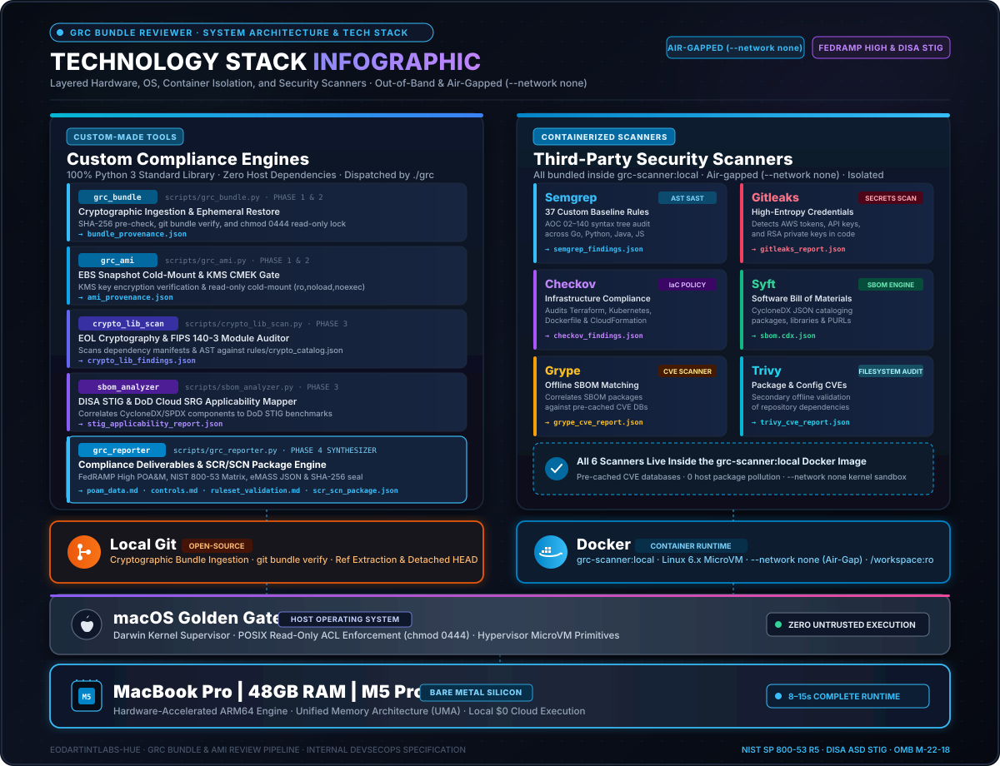

# System Architecture & Technology Stack (`amplifying-info/ARCHITECTURE.md`)

  <a href="../README.md"><b>📖 README</b></a> &nbsp;·&nbsp;
  <a href="ARCHITECTURE.md"><b>🏛️ Architecture & Tech Stack</b></a> &nbsp;·&nbsp;
  <a href="DATAFLOW.md"><b>🔄 Data Flow</b></a> &nbsp;·&nbsp;
  <a href="../SECURITY.md"><b>🛡️ Security Policy</b></a> &nbsp;·&nbsp;
  <a href="GOVERNANCE.md"><b>⚖️ Governance & Mandates</b></a> &nbsp;·&nbsp;
  <a href="../testing/TESTING.md"><b>🧪 Verification Plan</b></a> &nbsp;·&nbsp;
  <a href="../testing/live-demo.md"><b>🎬 Live Demo</b></a> &nbsp;·&nbsp;
  <a href="../hygiene/RELEASE_NOTES.md"><b>🚀 Release Notes</b></a> &nbsp;·&nbsp;
  <a href="../hygiene/PATCH_LOG.md"><b>🩹 v1 Patch Log</b></a> &nbsp;·&nbsp;
  <a href="../hygiene/ROADMAP.md"><b>🗺️ Roadmap</b></a> &nbsp;·&nbsp;
  <a href="../docs/grc-bundle-use-case.md"><b>📑 Use Case Walkthrough</b></a> &nbsp;·&nbsp;
  <a href="../docs/test-dummies-guide.md"><b>🎯 Test Dummies Guide</b></a>

> **Classification**: Internal DevSecOps & Security Compliance Architecture Specification  
> **Target Workstation**: Apple Silicon (`arm64` / M-Series SoC)  
> **Runtime Isolation**: Linux Kernel Namespace (`debian:bookworm-slim`, `--network none`, `:ro` Bind Mounts)  
> **Host Python Footprint**: 100% Python 3 Standard Library (`0` Host Third-Party Packages)  

---

## Table of Contents

1. [Visual Technology Stack Diagram](#1-visual-technology-stack-diagram)
2. [Component Reference & Cost Breakdown](#2-component-reference--cost-breakdown)
   * [2.1 Bare Metal & Hardware Layer](#21-bare-metal--hardware-layer)
   * [2.2 Operating System & Virtualization Layer](#22-operating-system--virtualization-layer)
   * [2.3 Container & Isolation Runtime](#23-container--isolation-runtime)
   * [2.4 Version Control & Supply Chain Layer](#24-version-control--supply-chain-layer)
   * [2.5 Custom Orchestration & Compliance Engines](#25-custom-orchestration--compliance-engines)
   * [2.6 Integrated Security Scanning Engines](#26-integrated-security-scanning-engines)
   * [2.7 Cloud Infrastructure & Storage (Optional AMI Audits)](#27-cloud-infrastructure--storage-optional-ami-audits)
3. [Technology Stack Summary Matrix](#3-technology-stack-summary-matrix)

---

## 1. Visual Technology Stack Diagram

The **GRC Bundle & AMI Review Pipeline** is organized into **4 Core Security & Compliance Domains** at the top, coordinated through a **Unified Application Dispatcher (`./grc`)**, executed inside an **Air-Gapped Container Bus**, synthesized into **Phase 4 SCR/SCN Compliance Deliverables**, and anchored on an **Apple Silicon Hardware Foundation**:

  

---

## 2. Component Reference & Cost Breakdown

### 2.1 Bare Metal & Hardware Layer

#### MacBook Pro | 48GB RAM | M5 Pro
* **Classification**: `[Bare Metal]`
* **General Purpose**: Serves as the high-assurance auditor host workstation. The unified memory architecture (UMA, 48GB Unified RAM) and high-performance M5 Pro ARM64 cores deliver local, hardware-accelerated processing capable of running 7 parallel static analysis engines simultaneously without thermal throttling or remote compute offloading.
* **Item Produced**: Provides the physical compute, hardware cryptographic acceleration (AES-NI / ARMv8 crypto extensions), and memory buses that execute all ephemeral review containers and Python scripts in 8–15 seconds per bundle.
* **Individual Cost**: **$1,999 – $3,499** (one-time physical hardware acquisition; $0 per-scan operational cost).

---

### 2.2 Operating System & Virtualization Layer

#### macOS Golden Gate
* **Classification**: `[Third-Party Software]`
* **General Purpose**: The host operating system running directly on Apple Silicon. It provides kernel-level process isolation, secure user keychain access, POSIX filesystem ACLs (`chmod 0444` write-locks), and the runtime environment for the primary `./grc` dispatcher.
* **Item Produced**: Host system kernel primitives, read-only filesystem mounts, and POSIX signals coordinating the auditor's local command-line environment.
* **Individual Cost**: **$0** (bundled and licensed with Apple hardware; lifetime free OS upgrades).

#### Linux Virtual Machine Kernel (OrbStack / Docker Desktop Guest VM)
* **Classification**: `[Open-Source Tools]` / `[Third-Party Software]`
* **General Purpose**: A lightweight Linux 6.x guest microVM running hypervisor-accelerated on macOS. It exposes the native Linux container runtime APIs, namespace isolation primitives, and filesystem cgroups required by Docker to run Linux-based security scanners on ARM64 macOS.
* **Item Produced**: Linux container virtualization backend exposing unix sockets (`/var/run/docker.sock`) and namespace isolation to the host `./grc` tool.
* **Individual Cost**: **$0** (OrbStack personal/open-source tier or Docker Desktop personal tier; $0 for native Linux kernel).

---

### 2.3 Container & Isolation Runtime

#### Docker Engine (`grc-scanner:local`)
* **Classification**: `[Open-Source Tools]`
* **General Purpose**: The container engine that hosts the complete scanner toolchain inside an ephemeral, reproducible Debian Bookworm container. It strictly enforces the runtime air-gap via `--network none` (disabling all outbound network traffic) and mounts codebases as read-only (`:ro`) to guarantee zero code execution and zero telemetry leakage.
* **Item Produced**: The `grc-scanner:local` multi-architecture container image and ephemeral, network-isolated container execution instances that run scans across target repositories.
* **Individual Cost**: **$0** (Open-source Docker Engine / Moby Project / Docker Community Edition).

---

### 2.4 Version Control & Supply Chain Layer

#### Local Git (`git` CLI)
* **Classification**: `[Open-Source Tools]`
* **General Purpose**: The local command-line distributed version control utility used by the host to cryptographically verify Git release bundles, parse commit objects, inspect detached heads, and extract commit trees without checking out active working directories.
* **Item Produced**: Verifies `.bundle` checksums (`git bundle verify`), extracts raw repository trees for inspection, and manages repository tracking.
* **Individual Cost**: **$0** (Open-source GNU GPLv2 software).

#### GitHub (Remote VCS & Release Repository)
* **Classification**: `[Third-Party Service]`
* **General Purpose**: The central upstream code repository hosting the GRC Bundle Review Pipeline source, compliance documentation, and the companion `grc-test-dummies` repository. It provides release distribution, issue tracking, and collaborative governance.
* **Item Produced**: Hosted Git remote endpoints (`origin`), version-tagged release archives, and companion synthetic test bundle fixtures.
* **Individual Cost**: **$0** (GitHub Free Tier for public and private repositories).

---

### 2.5 Custom Orchestration & Compliance Engines

#### Unified CLI Dispatcher (`./grc`)
* **Classification**: `[Custom-Made Tool]`
* **General Purpose**: The master command-line interface and dispatch wrapper written for the audit workstation. It normalizes all sub-commands (`bundle`, `ami`, `scan`, `report`, `crypto-scan`, `sbom-analyze`, `docker-build`, `fetch`), validates pre-flight dependencies, and provides intuitive ANSI-colored operator feedback.
* **Item Produced**: Interactive CLI execution workflows, standardized terminal outputs, exit status codes, and automated command routing between host scripts and Docker containers.
* **Individual Cost**: **$0** (Proprietary / in-house custom code developed for this pipeline).

#### Git Bundle Extraction & Verification Engine (`scripts/grc_bundle.py`)
* **Classification**: `[Custom-Made Tool]`
* **General Purpose**: A zero-dependency Python script responsible for Phase 1 (cryptographic verification) and Phase 2 (ephemeral restore) of Git release bundles. It calculates SHA-256 digests, executes `git bundle verify`, restores ref trees into an isolated workspace, and locks all files with `chmod 0444`.
* **Item Produced**: `bundle_provenance.json` (cryptographic metadata, bundle SHA-256, target commit ID, and restoration timestamp) and the read-only locked `ephemeral_workspace/`.
* **Individual Cost**: **$0** (In-house custom Python script; relies exclusively on Python standard library).

#### AMI EBS Snapshot Cold-Mount Engine (`scripts/grc_ami.py`)
* **Classification**: `[Custom-Made Tool]`
* **General Purpose**: Automates the ingestion, KMS customer-managed key (CMK) encryption verification, and read-only cold-mounting of AWS EBS volume snapshots associated with Amazon Machine Images (AMIs) without booting or executing the underlying virtual machine.
* **Item Produced**: `ami_provenance.json` (AMI ID, snapshot ID, KMS key ARN, guest OS detection from `/etc/os-release`, and mount telemetry) and the cold-mounted filesystem at `ephemeral_ami_workspace/mnt`.
* **Individual Cost**: **$0** (In-house custom Python script with built-in `--mock` mode for offline execution).

#### Static Cryptographic Provider & EOL Auditor (`scripts/crypto_lib_scan.py`)
* **Classification**: `[Custom-Made Tool]`
* **General Purpose**: Performs AST regex and dependency manifest parsing across Go, Java, Python, and Node.js codebases to identify deprecated, unmaintained, or non-FIPS 140-3 compliant cryptographic libraries (e.g., PyCrypto, BouncyCastle < 1.70, Go crypto/des).
* **Item Produced**: `crypto_lib_audit_report.json` detailing discovered crypto libraries, import locations, deprecation status, recommended FIPS alternatives, and AOC 03 compliance flags.
* **Individual Cost**: **$0** (In-house custom Python script).

#### CycloneDX / SPDX to DISA STIG Applicability Mapper (`scripts/sbom_analyzer.py`)
* **Classification**: `[Custom-Made Tool]`
* **General Purpose**: Ingests CycloneDX and SPDX SBOM JSON documents, indexes software components (web servers, database engines, operating systems, runtime packages), and cross-references them against DISA STIG and DoD Cloud Computing SRG benchmarks.
* **Item Produced**: `stig_applicability_report.json` identifying exact STIG IDs, benchmark version titles, and applicable security profiles required for system accreditation.
* **Individual Cost**: **$0** (In-house custom Python script).

#### Phase 4 SCR/SCN Compliance Reporting Engine (`scripts/grc_reporter.py`)
* **Classification**: `[Custom-Made Tool]`
* **General Purpose**: The central synthesis and compliance engine. It normalizes finding payloads from all 7 security scanners, calculates FedRAMP High SLA remediation deadlines (30/90/180 days), evaluates full NIST SP 800-53 Rev. 5 control coverage, validates the 37-rule AST baseline, and seals all deliverables.
* **Item Produced**: 
  1. `poam_data.md` (FedRAMP POA&M remediation table with vulnerability IDs, severities, and SLA deadlines)
  2. `controls.md` (NIST SP 800-53 Rev. 5 implementation matrix)
  3. `ruleset_validation.md` (Audit verification of 37 custom AST rules)
  4. `scr_scn_package.json` (Machine-readable GRC/eMASS integration payload)
  5. `sha256sum` (Cryptographic manifest sealing all raw and processed evidence)
* **Individual Cost**: **$0** (In-house custom Python script).

#### Declarative Baseline Ruleset & Crypto Catalog
* **Classification**: `[Custom-Made Tool]` / `[Policy]`
* **General Purpose**: High-assurance policy definitions comprising [`rules/custom-baseline-ruleset.yaml`](../rules/custom-baseline-ruleset.yaml) (37 tailored Semgrep AST rules across Python, Go, Java, JS/TS) and [`rules/crypto_catalog.json`](../rules/crypto_catalog.json) (FIPS 140 and EOL database).
* **Item Produced**: Policy rulesets enforced directly by Semgrep and the cryptographic auditor during Phase 3 analysis.
* **Individual Cost**: **$0** (In-house custom compliance policies tailored for FedRAMP High and DISA STIG).

---

### 2.6 Integrated Security Scanning Engines

#### Semgrep OSS
* **Classification**: `[Open-Source Tools]`
* **General Purpose**: An open-source, AST-based static analysis engine. Runs offline inside the container (`--metrics=off`) to evaluate custom compliance rules across syntax trees without invoking compilers or build systems.
* **Item Produced**: `semgrep_results.json` containing syntax-accurate code findings mapped directly to AOC 02 through AOC 140.
* **Individual Cost**: **$0** (Open-source LGPL 2.1 version).

#### Gitleaks
* **Classification**: `[Open-Source Tools]`
* **General Purpose**: A high-speed Go-based secret scanner that uses regular expressions and Shannon entropy detection to find hardcoded passwords, AWS credentials, RSA private keys, and API tokens.
* **Item Produced**: `gitleaks_report.json` highlighting leaked secret locations, rule IDs, and entropy scores.
* **Individual Cost**: **$0** (Open-source MIT License).

#### Checkov
* **Classification**: `[Open-Source Tools]`
* **General Purpose**: Static code analysis engine for Infrastructure-as-Code (IaC). Evaluates Terraform templates, Kubernetes manifests, Dockerfiles, and CloudFormation scripts for federal compliance misconfigurations.
* **Item Produced**: `checkov_results.json` detailing passed and failed security checks across infrastructure configurations.
* **Individual Cost**: **$0** (Open-source Apache 2.0 License; configured with `BC_SKIP_MAPPING=TRUE` to run offline without Bridgecrew cloud services).

#### Syft
* **Classification**: `[Open-Source Tools]`
* **General Purpose**: A specialized CLI utility that catalog-indexes the codebase or cold-mounted filesystem to produce an authoritative Software Bill of Materials (SBOM) across language dependencies and OS packages.
* **Item Produced**: `sbom.cyclonedx.json` (CycloneDX standard SBOM) detailing package names, versions, licenses, and PURLs.
* **Individual Cost**: **$0** (Open-source Apache 2.0 License).

#### Grype
* **Classification**: `[Open-Source Tools]`
* **General Purpose**: An open-source vulnerability scanner designed to match CycloneDX SBOM component inventories against pre-cached vulnerability databases (NVD, GHSA, Red Hat, Alpine).
* **Item Produced**: `grype_cve_report.json` cataloging CVE identifiers, EPSS exploit scores, CVSS ratings, and available remediation versions.
* **Individual Cost**: **$0** (Open-source Apache 2.0 License; operates completely offline using pre-cached databases).

#### Trivy
* **Classification**: `[Open-Source Tools]`
* **General Purpose**: A multi-purpose security scanner that audits source directory trees, lockfiles, and container layers for known CVEs and insecure configuration defaults.
* **Item Produced**: `trivy_cve_report.json` providing independent secondary verification of package CVEs and exposed file vulnerabilities.
* **Individual Cost**: **$0** (Open-source Apache 2.0 License; operates with `--offline-scan --skip-db-update`).

#### OpenSCAP (`oscap`)
* **Classification**: `[Open-Source Tools]`
* **General Purpose**: An enterprise-grade, NIST-certified Security Content Automation Protocol (SCAP) evaluation engine. Evaluates cold-mounted AMI operating system configurations against formal DISA STIG XCCDF benchmarks.
* **Item Produced**: `oscap_results.xml` and HTML compliance assessment reports documenting pass/fail adherence to DoD STIG benchmarks.
* **Individual Cost**: **$0** (Open-source LGPL 2.1 software).

---

### 2.7 Cloud Infrastructure & Storage (Optional AMI Audits)

#### AWS CLI & AWS EBS / KMS
* **Classification**: `[Third-Party Software]` / `[Third-Party Service]`
* **General Purpose**: Used exclusively during Phase 1 & 2 of AMI reviews to inspect EBS volume snapshots, verify customer-managed KMS key encryption, and attach volumes in read-only mode to audit instances. The pipeline features a native `--mock` mode that requires zero AWS access or cloud credentials.
* **Item Produced**: AWS snapshot attachment handles, KMS CMK metadata descriptors, and volume device blocks (`/dev/xvdf`).
* **Individual Cost**: **$0 – $0.05 per audit** (EBS snapshot read API calls and temporary EBS volume attachment fees; $0 when operated in offline `--mock` mode).

---

## 3. Technology Stack Summary Matrix

| Component | Classification | General Purpose | Primary Item / Artifact Produced | Cost |
| :--- | :--- | :--- | :--- | :--- |
| **MacBook Pro \| 48GB RAM \| M5 Pro** | `[Bare Metal]` | Auditor hardware host & compute foundation | ARM64 hardware execution & memory bandwidth | $1,999 – $3,499 (one-time) |
| **macOS Golden Gate** | `[Third-Party Software]` | Host operating system & process supervisor | POSIX filesystem permissions & process control | $0 (bundled) |
| **Linux Virtual Machine** | `[Open-Source Tools]` | Container virtualization layer | Linux kernel namespaces & cgroups | $0 |
| **Docker Engine** | `[Open-Source Tools]` | Container runtime & air-gap enforcement | `grc-scanner:local` image & `--network none` sandbox | $0 |
| **Local Git** | `[Open-Source Tools]` | Cryptographic bundle verification & extraction | Verified ref trees & `git bundle verify` | $0 |
| **GitHub** | `[Third-Party Service]` | Remote repository & release bundle distribution | Hosted git remotes & companion test fixtures | $0 (Free Tier) |
| **`./grc`** | `[Custom-Made Tool]` | Unified CLI dispatcher & orchestration | Command routing, pre-flight checks, status outputs | $0 |
| **`grc_bundle.py`** | `[Custom-Made Tool]` | Phase 1 & 2 Git bundle verification & restore | `bundle_provenance.json` & read-only workspace | $0 |
| **`grc_ami.py`** | `[Custom-Made Tool]` | Phase 1 & 2 AMI snapshot cold-mount & metadata | `ami_provenance.json` & mounted rootfs | $0 |
| **`crypto_lib_scan.py`** | `[Custom-Made Tool]` | Cryptographic library deprecation & FIPS auditor | `crypto_lib_audit_report.json` | $0 |
| **`sbom_analyzer.py`** | `[Custom-Made Tool]` | CycloneDX to DISA STIG applicability mapper | `stig_applicability_report.json` | $0 |
| **`grc_reporter.py`** | `[Custom-Made Tool]` | Phase 4 SCR/SCN synthesis & compliance reporter | `poam_data.md`, `controls.md`, `ruleset_validation.md`, `scr_scn_package.json`, `sha256sum` | $0 |
| **Baseline Rules & Catalog** | `[Custom-Made Tool]` | 37 AST security rules & FIPS crypto database | Policy definitions for Semgrep & crypto scan | $0 |
| **Semgrep OSS** | `[Open-Source Tools]` | AST-based Static Application Security Testing (SAST) | `semgrep_results.json` | $0 |
| **Gitleaks** | `[Open-Source Tools]` | Hardcoded secrets & credential detection | `gitleaks_report.json` | $0 |
| **Checkov** | `[Open-Source Tools]` | Infrastructure-as-Code (IaC) compliance scanner | `checkov_results.json` | $0 |
| **Syft** | `[Open-Source Tools]` | Software Bill of Materials (SBOM) generator | `sbom.cyclonedx.json` | $0 |
| **Grype** | `[Open-Source Tools]` | Offline CVE vulnerability matcher | `grype_cve_report.json` | $0 |
| **Trivy** | `[Open-Source Tools]` | Filesystem vulnerability & misconfig scanner | `trivy_cve_report.json` | $0 |
| **OpenSCAP (`oscap`)** | `[Open-Source Tools]` | SCAP / XCCDF DISA STIG benchmark evaluator | `oscap_results.xml` | $0 |
| **AWS CLI & EBS / KMS** | `[Third-Party Service]` | Cloud snapshot inspection & KMS key validation | AWS snapshot descriptors (optional) | $0 – $0.05 / scan ($0 mock) |
