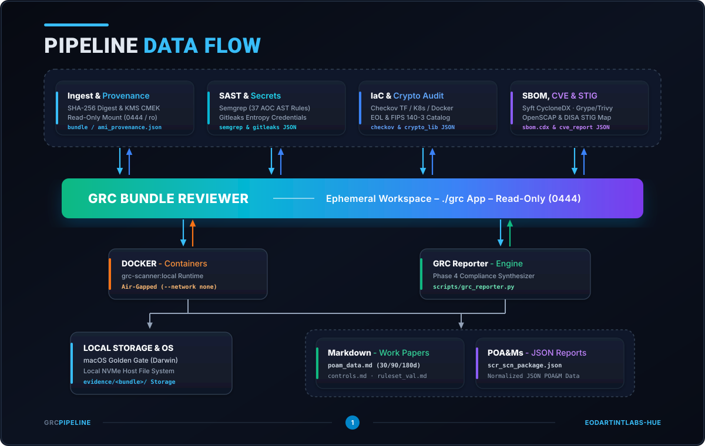
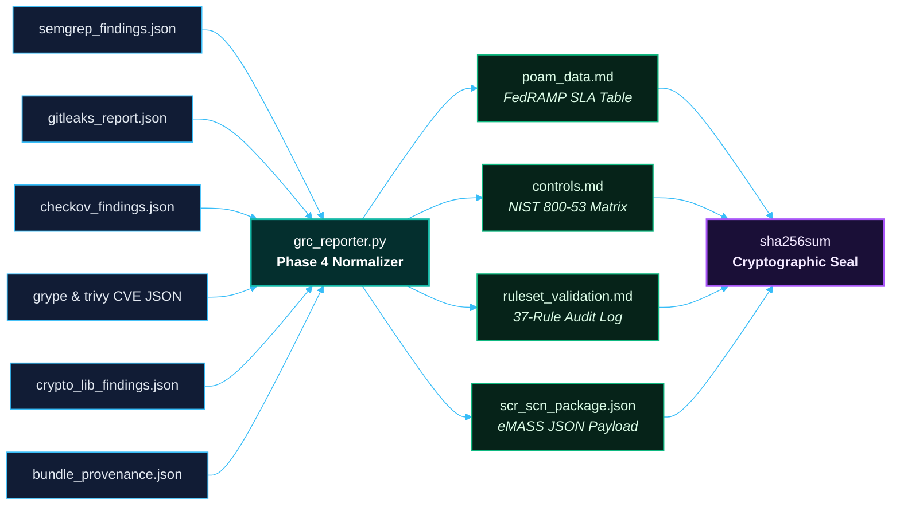

# Pipeline Data Flow & Telemetry Lineage (`amplifying-info/DATAFLOW.md`)

<p align="center">
  <a href="../README.md"><b>📖 README</b></a> &nbsp;·&nbsp;
  <a href="ARCHITECTURE.md"><b>🏛️ Architecture & Tech Stack</b></a> &nbsp;·&nbsp;
  <a href="DATAFLOW.md"><b>🔄 Data Flow</b></a> &nbsp;·&nbsp;
  <a href="../SECURITY.md"><b>🛡️ Security Policy</b></a> &nbsp;·&nbsp;
  <a href="GOVERNANCE.md"><b>⚖️ Governance & Mandates</b></a> &nbsp;·&nbsp;
  <a href="../testing/TESTING.md"><b>🧪 Verification Plan</b></a> &nbsp;·&nbsp;
  <a href="../testing/live-demo.md"><b>🎬 Live Demo</b></a> &nbsp;·&nbsp;
  <a href="../hygiene/RELEASE_NOTES.md"><b>🚀 Release Notes</b></a> &nbsp;·&nbsp;
  <a href="../hygiene/PATCH_LOG.md"><b>🩹 v1 Patch Log</b></a> &nbsp;·&nbsp;
  <a href="../docs/grc-bundle-use-case.md"><b>📑 Use Case Walkthrough</b></a> &nbsp;·&nbsp;
  <a href="../docs/test-dummies-guide.md"><b>🎯 Test Dummies Guide</b></a>
</p>

> **Classification**: Internal DevSecOps & Security Compliance Data Architecture  
> **Data Isolation Model**: Read-Only Ingestion (`chmod 0444` / `ro,noexec`), Air-Gapped Processing (`--network none`), Cryptographic Evidence Sealing (`SHA-256`)  
> **Zero-Retention Policy**: 100% of extracted source trees and mounted snapshots are purged in Phase 5; only normalized compliance telemetry persists in `evidence/<bundle>/`.  

---

<p align="center">
  
</p>

---

## Table of Contents

1. [Executive Data Flow Overview](#1-executive-data-flow-overview)
2. [Trust Boundaries & Data Isolation Zones](#2-trust-boundaries--data-isolation-zones)
3. [Phase-by-Phase Data Flow Lifecycle](#3-phase-by-phase-data-flow-lifecycle)
   * [3.1 Phase 1: Cryptographic Gate & Pre-Extraction Validation](#31-phase-1-cryptographic-gate--pre-extraction-validation)
   * [3.2 Phase 2: Ephemeral Restoration & Provenance Generation](#32-phase-2-ephemeral-restoration--provenance-generation)
   * [3.3 Phase 3: Air-Gapped Container Bus & Multi-Engine Telemetry](#33-phase-3-air-gapped-container-bus--multi-engine-telemetry)
   * [3.4 Phase 4: Finding Normalization, SLA Calculation & SCR/SCN Synthesis](#34-phase-4-finding-normalization-sla-calculation--scrscn-synthesis)
   * [3.5 Phase 5: Ephemeral Sanitization & Zero-Retention Teardown](#35-phase-5-ephemeral-sanitization--zero-retention-teardown)
4. [Internal Scanner Chaining (SBOM-to-CVE & STIG Fan-Out)](#4-internal-scanner-chaining-sbom-to-cve--stig-fan-out)
5. [Master Data Lineage & Artifact I/O Matrix](#5-master-data-lineage--artifact-io-matrix)

---

## 1. Executive Data Flow Overview

The **GRC Bundle & AMI Review Pipeline** enforces a strictly unidirectional, tamper-evident data flow from **untrusted artifact ingestion** to **cryptographically sealed compliance deliverables**. 

At no point in the lifecycle is ingested code executed, nor does any scanner communicate over a network interface. Data moves across four distinct stages:
1. **Raw Binary Stream** (`.bundle` archive or cold-mounted EBS block device)
2. **Read-Only File Tree & Provenance Metadata** (`ephemeral_workspace/` + `bundle_provenance.json`)
3. **Heterogeneous Scanner Telemetry** (7 raw JSON/XML streams inside `evidence/<bundle>/`)
4. **Normalized SCR/SCN Compliance Package** (`poam_data.md`, `controls.md`, `ruleset_validation.md`, `scr_scn_package.json`, and `sha256sum`)

---

## 2. Trust Boundaries & Data Isolation Zones

To prevent untrusted release artifacts from compromising the auditor's workstation or exfiltrating intellectual property, data crosses four hardware- and kernel-enforced trust boundaries:

| Zone | Directory / Namespace | Access Mode | Network Posture | Data Permitted in Zone |
| :--- | :--- | :--- | :--- | :--- |
| **Zone 0: Untrusted Ingest** | External `.bundle` path or AWS EBS Snapshot | Read-Only Stream | Host Local (Offline verification) | Raw Git packfiles or encrypted EBS blocks prior to cryptographic verification. |
| **Zone 1: Ephemeral Workspace** | `./ephemeral_workspace/` or `./ephemeral_ami_workspace/mnt` | **Locked Read-Only** (`chmod 0444` / `mount -o ro,noload,noexec,nosuid`) | Host Local | Verified source files, configuration manifests, and `bundle_provenance.json`. |
| **Zone 2: Air-Gapped Container Bus** | `grc-scanner:local` (`/workspace:ro`, `/evidence:rw`) | Read-Only on `/workspace`; Append/Write on `/evidence` | **Kernel Air-Gap** (`--network none`, loopback `lo` only) | In-memory AST structures, pre-cached CVE databases, and raw scanner JSON/XML outputs. |
| **Zone 3: Sealed Evidence Vault** | `./evidence/<bundle-name>/` | Write-Once, Sealed via `sha256sum` | Host Local | Raw scanner JSON telemetry, Markdown compliance work papers, eMASS JSON payload, and cryptographic seal. |

---

## 3. Phase-by-Phase Data Flow Lifecycle

### 3.1 Phase 1: Cryptographic Gate & Pre-Extraction Validation

Before any file is extracted to the host filesystem, the ingestion controller ([`scripts/grc_bundle.py`](../scripts/grc_bundle.py) or [`scripts/grc_ami.py`](../scripts/grc_ami.py)) validates the artifact stream:

* **Git Release Bundles (`.bundle`)**:
  1. Streams the `.bundle` file through Python's `hashlib.sha256()` in 64 KB chunks to compute its cryptographic digest.
  2. Compares the computed digest against `--expected-sha256` (if provided). Any mismatch triggers an immediate `[FATAL]` abort.
  3. Invokes `git bundle verify <bundle>` and `git bundle list-heads <bundle>` to validate packfile integrity, prerequisite commits, and contained refs (`HEAD`, `refs/tags/v1.0.0`).
* **Amazon Machine Images (`ami-xxx`)**:
  1. Queries AMI block device mappings (`DescribeImages` / `DescribeSnapshots` or offline `--mock` fixture).
  2. Verifies that the root EBS snapshot is encrypted (`Encrypted: true`) with an approved KMS Customer-Managed Key (`KmsKeyId`).

---

### 3.2 Phase 2: Ephemeral Restoration & Provenance Generation

Once Phase 1 passes, the verified artifact is materialized into **Zone 1 (Ephemeral Workspace)**:

* **Source Tree Materialization**:
  * `grc_bundle.py` clones the bundle without hardlinks (`git clone --no-hardlinks`), checks out the target release tag in detached `HEAD` mode, and strips write bits across the entire directory tree (`chmod 0444` on files, `chmod 0555` on directories).
  * `grc_ami.py` attaches the EBS volume to a non-boot block device and cold-mounts the filesystem using `mount -o ro,noload,noexec,nosuid`.
* **Provenance Emission**:
  * Extracts Git commit metadata (`commit_hash`, `author_name`, `author_email`, `author_date`, `subject`) or AMI OS metadata (`/etc/os-release`).
  * Writes [`bundle_provenance.json`](../docs/workspace-layout.md) (or `ami_provenance.json`) into the workspace root, establishing the formal **Artifact Identifier** that links all downstream scanner findings to the exact cryptographic digest of the release.

---

### 3.3 Phase 3: Air-Gapped Container Bus & Multi-Engine Telemetry

When `./grc scan` executes, the host dispatcher mounts Zone 1 (`./ephemeral_workspace`) into **Zone 2 (`grc-scanner:local`)** at `/workspace:ro` and mounts the target evidence folder at `/evidence:rw`. Inside the container, [`docker/scan_orchestrator.sh`](../docker/scan_orchestrator.sh) drives 7 analysis streams:

1. **Provenance Copy**: Copies `/workspace/bundle_provenance.json` (or `ami_provenance.json`) directly into `/evidence/` to anchor the audit trail.
2. **Stream 1 — Semgrep AST SAST**: Parses source files into Abstract Syntax Trees and evaluates all 37 rules in `/rules/custom-baseline-ruleset.yaml` (`--metrics=off`). Writes **`/evidence/semgrep_findings.json`**.
3. **Stream 2 — Gitleaks Secrets**: Scans all files (`--no-git`) for high-entropy credentials, private keys, and cloud tokens. Writes **`/evidence/gitleaks_report.json`**.
4. **Stream 3 — Checkov IaC Policy**: Evaluates Terraform, Kubernetes, Dockerfile, and CloudFormation manifests offline (`BC_SKIP_MAPPING=TRUE`, `--skip-download`). Writes **`/evidence/checkov_findings.json`**.
5. **Stream 4 — Syft SBOM Indexing**: Catalogs all OS packages and language dependencies (`go.mod`, `pom.xml`, `requirements.txt`, `package.json`) into CycloneDX format. Writes **`/evidence/sbom.cdx.json`**.
6. **Stream 5 — Grype & Trivy Offline CVE Matching**:
   * **Grype** ingests `sbom.cdx.json` (`sbom:/evidence/sbom.cdx.json`) and matches components against its pre-cached SQLite vulnerability database (`GRYPE_DB_AUTO_UPDATE=false`). Writes **`/evidence/grype_cve_report.json`**.
   * **Trivy** scans `/workspace` using its pre-cached BoltDB vulnerability database (`--offline-scan --skip-db-update`). Writes **`/evidence/trivy_cve_report.json`**.
7. **Stream 6 — Cryptographic Library & EOL Audit**: [`scripts/crypto_lib_scan.py`](../scripts/crypto_lib_scan.py) inspects dependency manifests and source imports against [`rules/crypto_catalog.json`](../rules/crypto_catalog.json). Writes **`/evidence/crypto_lib_findings.json`**.
8. **Stream 7 — DISA STIG & DoD SRG Mapping**: [`scripts/sbom_analyzer.py`](../scripts/sbom_analyzer.py) ingests `/evidence/sbom.cdx.json` and maps discovered components to applicable DISA STIG benchmarks. Writes **`/evidence/stig_applicability_report.json`** and **`/evidence/stig_applicability_matrix.md`**.

---

### 3.4 Phase 4: Finding Normalization, SLA Calculation & SCR/SCN Synthesis

Immediately after container termination (or via standalone `./grc report -e ./evidence/<bundle>`), [`scripts/grc_reporter.py`](../scripts/grc_reporter.py) ingests all raw telemetry files from `evidence/<bundle>/` and transforms them into standardized compliance deliverables:



1. **Schema Normalization**: Converts disparate scanner fields (Semgrep `extra.severity`, Checkov `check_id`, Grype `vulnerability.severity`, Gitleaks `RuleID`, CryptoScan `risk_level`) into a canonical finding schema with deterministic `POA&M-YYYY-NNN` IDs.
2. **FedRAMP High SLA Calculation**: Computes exact calendar remediation deadlines from the scan timestamp (`CRITICAL` / `HIGH` = **+30 days**, `MEDIUM` = **+90 days**, `LOW` = **+180 days**) and writes **[`poam_data.md`](../evidence/aoc-07-iac-misconfig/poam_data.md)**.
3. **NIST SP 800-53 Rev. 5 Control Mapping**: Evaluates findings against 18 NIST control families (`AC-3`, `AC-6`, `AU-2`, `CM-6`, `CM-7`, `IA-5`, `RA-5`, `SA-11`, `SC-7`, `SC-8`, `SC-12`, `SC-13`, `SC-28`, `SI-2`, `SI-7`, `SI-10`, `SI-17`, `SR-3`), marking each control as `FAIL (Open Findings)` or `PASS (No Violations)` in **[`controls.md`](../evidence/aoc-07-iac-misconfig/controls.md)**.
4. **AST Ruleset Verification**: Cross-references all 37 rules in [`rules/custom-baseline-ruleset.yaml`](../rules/custom-baseline-ruleset.yaml) against Semgrep execution telemetry to prove 100% policy load coverage in **[`ruleset_validation.md`](../evidence/aoc-07-iac-misconfig/ruleset_validation.md)**.
5. **eMASS / GRC Machine Payload**: Serializes provenance, executive metrics, control statuses, ruleset logs, and normalized POA&M items into **[`scr_scn_package.json`](../evidence/aoc-07-iac-misconfig/scr_scn_package.json)**.
6. **Cryptographic Evidence Sealing**: Computes the SHA-256 hash and byte size of every JSON, XML, and Markdown file in the evidence directory and writes **[`sha256sum`](../evidence/aoc-07-iac-misconfig/sha256sum)**.

---

### 3.5 Phase 5: Ephemeral Sanitization & Zero-Retention Teardown

In the final stage (`./grc bundle clean` or `./grc ami clean`), the pipeline enforces strict data hygiene:
* Restores temporary write permissions (`chmod 0700`) on `ephemeral_workspace/` solely to unlink and recursively purge all extracted source code files.
* Unmounts cold-mounted AMI filesystems (`umount`) and detaches temporary EBS volumes.
* Optionally deletes the ingested `.bundle` file (`--delete-bundle`), leaving zero proprietary source code on the audit workstation while preserving the sealed compliance package in `evidence/<bundle>/`.

---

## 4. Internal Scanner Chaining (SBOM-to-CVE & STIG Fan-Out)

Rather than redundantly indexing the filesystem multiple times, the pipeline uses **Syft** as an upstream data producer inside Phase 3:

```text
/workspace:ro (Source Tree / Rootfs)
   │
   └──► [Syft Engine] ──► generates /evidence/sbom.cdx.json (CycloneDX 1.5 JSON)
                              │
                              ├──► [Grype Engine]     ──► /evidence/grype_cve_report.json
                              └──► [sbom_analyzer.py] ──► /evidence/stig_applicability_report.json
                                                      ──► /evidence/stig_applicability_matrix.md
```

This single-index fan-out guarantees that the vulnerability report (`grype_cve_report.json`) and the DISA STIG applicability matrix (`stig_applicability_report.json`) are derived from the exact same component inventory (`sbom.cdx.json`).

---

## 5. Master Data Lineage & Artifact I/O Matrix

| Data Artifact / Stream | Phase | Producer Component | Consumer Component(s) | Format | Trust Zone | Lifecycle / Retention |
| :--- | :---: | :--- | :--- | :--- | :--- | :--- |
| **`<release>.bundle`** | 1 | Engineering Release CI | `grc_bundle.py` (`verify` / `restore`) | Git Packfile v2/v3 | Zone 0 (Ingest) | Deleted in Phase 5 (`--delete-bundle`) |
| **`ephemeral_workspace/`** | 2 | `grc_bundle.py` (`restore`) | All 7 Scanners via `/workspace:ro` | Read-Only File Tree (`0444`) | Zone 1 (Ephemeral) | Purged in Phase 5 (`bundle clean`) |
| **`bundle_provenance.json`** | 2 | `grc_bundle.py` (`restore`) | `scan_orchestrator.sh`, `grc_reporter.py` | JSON (`grc-bundle-provenance-v1`) | Zone 1 $\rightarrow$ Zone 3 | Preserved & sealed in `evidence/<bundle>/` |
| **`ami_provenance.json`** | 2 | `grc_ami.py` (`restore`) | `scan_orchestrator.sh`, `grc_reporter.py` | JSON (`grc-ami-provenance-v1`) | Zone 1 $\rightarrow$ Zone 3 | Preserved & sealed in `evidence/<ami>/` |
| **`semgrep_findings.json`** | 3 | Semgrep OSS + 37 AOC Rules | `grc_reporter.py` | JSON (Semgrep Schema) | Zone 2 $\rightarrow$ Zone 3 | Preserved & sealed in `evidence/<bundle>/` |
| **`gitleaks_report.json`** | 3 | Gitleaks v8.18.4 | `grc_reporter.py` | JSON Array | Zone 2 $\rightarrow$ Zone 3 | Preserved & sealed in `evidence/<bundle>/` |
| **`checkov_findings.json`** | 3 | Checkov IaC Engine | `grc_reporter.py` | JSON (Checkov Schema) | Zone 2 $\rightarrow$ Zone 3 | Preserved & sealed in `evidence/<bundle>/` |
| **`sbom.cdx.json`** | 3 | Syft v1.18.1 | Grype, `sbom_analyzer.py`, Auditors | CycloneDX JSON | Zone 2 $\rightarrow$ Zone 3 | Preserved & sealed in `evidence/<bundle>/` |
| **`grype_cve_report.json`** | 3 | Grype v0.86.1 (Offline DB) | `grc_reporter.py` | JSON (Grype Matches) | Zone 2 $\rightarrow$ Zone 3 | Preserved & sealed in `evidence/<bundle>/` |
| **`trivy_cve_report.json`** | 3 | Trivy v0.58.1 (Offline DB) | `grc_reporter.py` | JSON (Trivy Results) | Zone 2 $\rightarrow$ Zone 3 | Preserved & sealed in `evidence/<bundle>/` |
| **`crypto_lib_findings.json`** | 3 | `scripts/crypto_lib_scan.py` | `grc_reporter.py` | JSON (`crypto-audit-v1`) | Zone 2 $\rightarrow$ Zone 3 | Preserved & sealed in `evidence/<bundle>/` |
| **`stig_applicability_report.json`** | 3 | `scripts/sbom_analyzer.py` | `grc_reporter.py`, Auditors | JSON (`stig-map-v1`) | Zone 2 $\rightarrow$ Zone 3 | Preserved & sealed in `evidence/<bundle>/` |
| **`poam_data.md`** | 4 | `scripts/grc_reporter.py` | Authorizing Officials (AOs), 3PAOs | GitHub-Flavored Markdown | Zone 3 (Sealed) | Permanent Compliance Work Paper |
| **`controls.md`** | 4 | `scripts/grc_reporter.py` | Security Control Assessors (SCAs) | GitHub-Flavored Markdown | Zone 3 (Sealed) | Permanent Compliance Work Paper |
| **`ruleset_validation.md`** | 4 | `scripts/grc_reporter.py` | DevSecOps & Audit Reviewers | GitHub-Flavored Markdown | Zone 3 (Sealed) | Permanent Compliance Work Paper |
| **`scr_scn_package.json`** | 4 | `scripts/grc_reporter.py` | DoD eMASS, ServiceNow GRC, Archer | JSON (`grc-scr-scn-package-v1.0`) | Zone 3 (Sealed) | Permanent Machine Ingestion Payload |
| **`sha256sum`** | 4 | `scripts/grc_reporter.py` | `shasum -a 256 -c sha256sum` | Standard SHA-256 Manifest | Zone 3 (Sealed) | Immutable Chain-of-Custody Seal |
