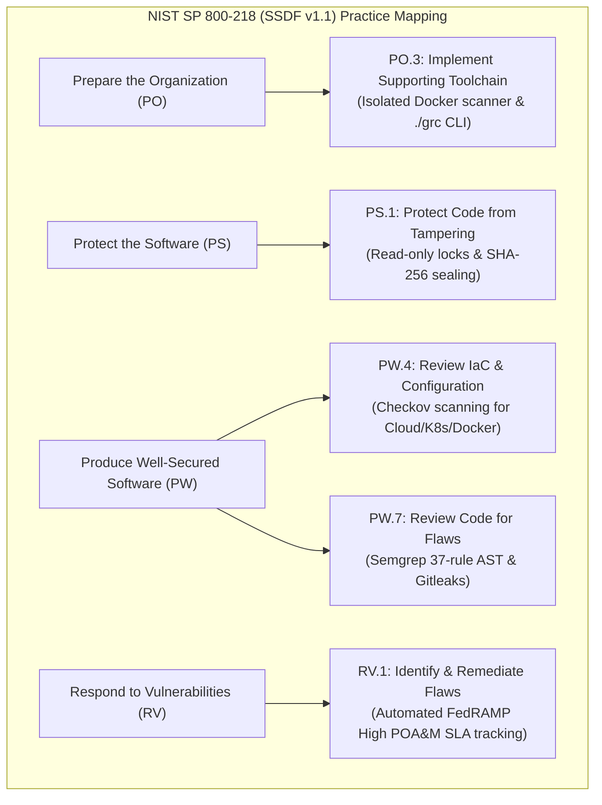
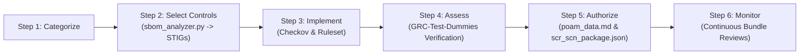

# Federal & DoD Regulatory Governance Matrix (`amplifying-info/GOVERNANCE.md`)

<p align="center">
  <a href="../README.md"><b>📖 README</b></a> &nbsp;·&nbsp;
  <a href="ARCHITECTURE.md"><b>🏛️ Architecture & Tech Stack</b></a> &nbsp;·&nbsp;
  <a href="DATAFLOW.md"><b>🔄 Data Flow</b></a> &nbsp;·&nbsp;
  <a href="../SECURITY.md"><b>🛡️ Security Policy</b></a> &nbsp;·&nbsp;
  <a href="GOVERNANCE.md"><b>⚖️ Governance & Mandates</b></a> &nbsp;·&nbsp;
  <a href="../testing/TESTING.md"><b>🧪 Verification Plan</b></a> &nbsp;·&nbsp;
  <a href="../testing/live-demo.md"><b>🎬 Live Demo</b></a> &nbsp;·&nbsp;
  <a href="../hygiene/RELEASE_NOTES.md"><b>🚀 Release Notes</b></a> &nbsp;·&nbsp;
  <a href="../hygiene/PATCH_LOG.md"><b>🩹 v1 Patch Log</b></a> &nbsp;·&nbsp;
  <a href="../hygiene/ROADMAP.md"><b>🗺️ Roadmap</b></a> &nbsp;·&nbsp;
  <a href="../docs/grc-bundle-use-case.md"><b>📑 Use Case Walkthrough</b></a> &nbsp;·&nbsp;
  <a href="../docs/test-dummies-guide.md"><b>🎯 Test Dummies Guide</b></a>
</p>

> **Classification**: Internal DevSecOps & Security Compliance Governance Specification  
> **Applicable Baselines**: NIST SP 800-53 Rev. 5 (FedRAMP High), NIST SP 800-218 (SSDF v1.1), NIST SP 800-161 Rev. 1 (C-SCRM)  
> **DoD Directives**: DoDI 8500.01, DoDI 8510.01 (DoD RMF), DoD Cloud Computing SRG (IL4/IL5/IL6), DISA ASD STIG  
> **Executive & Federal Policy**: Executive Order 14028, OMB Memorandum M-22-18 / M-23-16  

---

## Table of Contents

1. [Executive Governance Charter](#1-executive-governance-charter)
2. [Master Regulatory & Mandate Traceability Matrix](#2-master-regulatory--mandate-traceability-matrix)
3. [NIST Special Publications Alignment](#3-nist-special-publications-alignment)
   * [3.1 NIST SP 800-53 Rev. 5: Security and Privacy Controls](#31-nist-sp-800-53-rev-5-security-and-privacy-controls)
   * [3.2 NIST SP 800-218: Secure Software Development Framework (SSDF v1.1)](#32-nist-sp-800-218-secure-software-development-framework-ssdf-v11)
   * [3.3 NIST SP 800-161 Rev. 1: Cybersecurity Supply Chain Risk Management (C-SCRM)](#33-nist-sp-800-161-rev-1-cybersecurity-supply-chain-risk-management-c-scrm)
   * [3.4 NIST SP 800-137: Information Security Continuous Monitoring (ISCM)](#34-nist-sp-800-137-information-security-continuous-monitoring-iscm)
   * [3.5 NIST FIPS 140-3: Cryptographic Module Validation](#35-nist-fips-140-3-cryptographic-module-validation)
4. [Department of Defense (DoD) Mandates & Directives](#4-department-of-defense-dod-mandates--directives)
   * [4.1 DoDI 8510.01 & DoDI 8500.01: Risk Management Framework (RMF) for DoD Systems](#41-dodi-851001--dodi-850001-risk-management-framework-rmf-for-dod-systems)
   * [4.2 DoD Cloud Computing Security Requirements Guide (DoD CC SRG)](#42-dod-cloud-computing-security-requirements-guide-dod-cc-srg)
   * [4.3 DISA Security Technical Implementation Guides (STIG)](#43-disa-security-technical-implementation-guides-stig)
5. [Presidential Executive Orders & OMB Memoranda](#5-presidential-executive-orders--omb-memoranda)
   * [5.1 Executive Order (EO) 14028: Improving the Nation's Cybersecurity](#51-executive-order-eo-14028-improving-the-nations-cybersecurity)
   * [5.2 OMB Memoranda M-22-18 & M-23-16: Software Supply Chain Attestation](#52-omb-memoranda-m-22-18--m-23-16-software-supply-chain-attestation)
6. [Companion Negative Testing: How `GRC-Test-Dummies` Proves Compliance Assurance](#6-companion-negative-testing-how-grc-test-dummies-proves-compliance-assurance)
7. [Authorizing Official (AO) & Auditor Artifact Handoff Package](#7-authorizing-official-ao--auditor-artifact-handoff-package)

---

## 1. Executive Governance Charter

**GRCx** (*The GRC eXperience*) and its companion test harness **`GRC-Test-Dummies`** establish an automated, mathematically verifiable governance system for releasing software into federal, defense, and national security environments. 

Traditional compliance frameworks rely on self-attestation questionnaires and manual auditor sampling, which introduce latency, human error, and security blind spots. This pipeline replaces subjective assertions with **cryptographic provenance, air-gapped static analysis, automated STIG mapping, and programmatic FedRAMP/DoD deliverable generation**.

Operating **out-of-band (OOB)** and **fail-open** relative to engineering release pipelines, the system guarantees that compliance oversight never gates deployment velocity, while providing Authorizing Officials (AOs), Security Control Assessors (SCAs), and DevSecOps leads with continuous, tamper-evident audit packages.

---

## 2. Master Regulatory & Mandate Traceability Matrix

The table below maps the automated workflows conducted across `GRC-x` and `GRC-Test-Dummies` to explicit federal statutory, regulatory, and defense mandates:

| Pipeline Workflow / Activity | Implementing Component | Specific NIST Publication | Specific DoD / Federal Mandate | Regulatory Requirement Enforced |
| :--- | :--- | :--- | :--- | :--- |
| **Phase 1: Cryptographic Ingestion & Pre-Verification** | `./grc bundle verify`, `scripts/grc_bundle.py` | NIST SP 800-53 Rev. 5: `SI-7`, `SR-4`<br>NIST SP 800-161 Rev. 1: `2.4` | DoDI 8500.01 Enc. 3<br>EO 14028 Sec. 4(e) | Verify digital authenticity and cryptographic checksums prior to software ingestion; reject altered release artifacts. |
| **Phase 1: AMI Cold-Mount & KMS Encryption Gate** | `./grc ami verify`, `scripts/grc_ami.py` | NIST SP 800-53 Rev. 5: `SC-13`, `SC-28`<br>NIST FIPS 140-3 | DoD CC SRG Sec. 5.4.1 (IL5/IL6)<br>DoDI 8510.01 RMF Step 3 | Verify AWS EBS snapshots are encrypted at rest using customer-managed KMS keys (CMK) prior to compute mounting. |
| **Phase 2: Ephemeral Restore & Zero Untrusted Code Execution** | `./grc bundle restore`, `chmod 0444`, `mount -o ro` | NIST SP 800-53 Rev. 5: `CM-7`, `SI-3`, `SC-7`<br>NIST SP 800-218: `PO.3.1` | DoDI 8500.01 Enc. 4<br>DISA Enclave STIG | Prohibit execution of untrusted build scripts or git hooks during audit; enforce read-only POSIX isolation (`chmod 0444`). |
| **Phase 2: Immutable Provenance Generation** | `bundle_provenance.json`, `ami_provenance.json` | NIST SP 800-53 Rev. 5: `AU-10`, `CM-8`, `SR-4`<br>NIST SP 800-161 Rev. 1: `3.3` | OMB M-22-18 Sec. II.A<br>EO 14028 Sec. 4(e)(i) | Capture machine-readable chain of custody: commit hash, signing key, bundle digest, author identity, and checkout timestamp. |
| **Phase 3: Air-Gapped Multi-Engine Analysis** | `grc-scanner:local`, `--network none`, `docker/` | NIST SP 800-53 Rev. 5: `SC-7(21)`, `AC-4`, `SC-8` | DoD Zero Trust Ref Arch v2.0<br>DISA Network STIG | Complete runtime network isolation; guarantee zero scanner telemetry exfiltration, zero external DNS, and zero code leaks. |
| **Phase 3: AST Static Application Security Testing (SAST)** | Semgrep OSS + `rules/custom-baseline-ruleset.yaml` | NIST SP 800-53 Rev. 5: `SA-11`, `RA-5`, `SI-10`<br>NIST SP 800-218: `PW.7.1` | DISA ASD STIG V-222606<br>DoDI 8510.01 Enc. 6 | Automated syntax-tree detection of 37 compliance Areas of Concern (AOC 02–140), including hardcoded passwords and injection. |
| **Phase 3: Secret & Credential Scanning** | Gitleaks Engine (`--no-git`) | NIST SP 800-53 Rev. 5: `IA-5(1)`, `IA-5(7)`, `SC-12` | DISA ASD STIG V-222643<br>FedRAMP High `IA-5` | Zero-tolerance detection of unencrypted API keys, RSA private keys, AWS secrets, and database credentials in source. |
| **Phase 3: Infrastructure-as-Code (IaC) Auditing** | Checkov Policy Engine (`BC_SKIP_MAPPING=TRUE`) | NIST SP 800-53 Rev. 5: `AC-3`, `CM-6`, `SC-7`<br>NIST SP 800-218: `PW.4.1` | DoD CC SRG Sec. 5.1<br>FedRAMP High `CM-6` | Evaluate Terraform, Kubernetes manifests, and Dockerfiles for federal compliance violations (public buckets, root users). |
| **Phase 3: CycloneDX SBOM Indexing** | Syft (`SYFT_CHECK_FOR_APP_UPDATE=false`) | NIST SP 800-53 Rev. 5: `SR-3`, `SR-4`, `CM-8`<br>NIST SP 800-161 Rev. 1: `App. F` | EO 14028 Sec. 4(e)(vii)<br>NTIA Minimum Elements for SBOM | Produce deterministic, machine-readable Software Bill of Materials (SBOM) indexing all dependencies and transitives. |
| **Phase 3: Offline Vulnerability Matching** | Grype + Trivy (`--offline-scan`) | NIST SP 800-53 Rev. 5: `RA-5`, `SI-2`<br>NIST SP 800-218: `RV.1.1` | FedRAMP Continuous Monitoring<br>DoD Cyber Hygiene Mandate | Match SBOM and filesystem components against pre-cached NVD/GHSA CVE databases with EPSS and CISA KEV context. |
| **Phase 3: EOL & FIPS Crypto Provider Audit** | `scripts/crypto_lib_scan.py`, `rules/crypto_catalog.json` | NIST SP 800-53 Rev. 5: `SC-13`, `SI-7(6)`<br>NIST FIPS 140-3 | DoDI 8500.01 Sec. 3.d<br>DISA ASD STIG V-222608 | Detect deprecated, unmaintained, or non-FIPS 140-3 validated cryptographic modules (PyCrypto, DES, MD5, RC4). |
| **Phase 3: DISA STIG / DoD SRG Applicability Mapping** | `scripts/sbom_analyzer.py` | NIST SP 800-53 Rev. 5: `CA-2`, `CM-6`<br>NIST SP 800-137 | DoDI 8510.01 RMF Step 2<br>DISA STIG Mandate | Programmatically correlate software components to applicable DISA STIGs and DoD Cloud SRG technology profiles. |
| **Phase 4: FedRAMP High SLA POA&M Generation** | `scripts/grc_reporter.py` (`poam_data.md`) | NIST SP 800-53 Rev. 5: `CA-5`, `RA-5`, `SI-2`<br>NIST SP 800-37 Rev. 2 | FedRAMP High ConMon Policy<br>DoDI 8510.01 RMF Step 6 | Calculate strict remediation deadlines: Critical/High = 30 days, Medium = 90 days, Low = 180 days; generate POA&M table. |
| **Phase 4: NIST SP 800-53 Control Matrix Synthesis** | `scripts/grc_reporter.py` (`controls.md`) | NIST SP 800-53 Rev. 5: 18 Families (`AC`, `AU`, `CA`, `CM`, `CP`, `IA`, etc.) | DoDI 8510.01 RMF Step 4<br>FedRAMP System Security Plan | Map scanner results directly into formal control pass/fail implementation work papers for assessor review. |
| **Phase 4: eMASS / GRC Machine Payload** | `scripts/grc_reporter.py` (`scr_scn_package.json`) | NIST SP 800-53 Rev. 5: `CA-7`, `CM-3`, `CM-4` | DoD eMASS API Ingestion<br>DoDI 8510.01 Continuous Auth | Emit unified JSON payload for programmatic ingestion into DoD eMASS, ServiceNow GRC, and Archer platforms. |
| **Phase 4: Cryptographic Seal & Evidence Custody** | `scripts/grc_reporter.py` (`sha256sum`) | NIST SP 800-53 Rev. 5: `AU-10`, `SI-7`<br>NIST FIPS 180-4 | Federal Rules of Evidence (FRE 902)<br>DoDI 8500.01 Auditing | Hash all raw telemetry and markdown deliverables into an immutable `sha256sum` manifest establishing tamper evidence. |
| **Phase 5: Ephemeral Teardown & Zero Data Retention** | `./grc bundle clean`, `./grc ami clean` | NIST SP 800-53 Rev. 5: `MP-6`, `SI-12`<br>NIST SP 800-88 Rev. 1 | DoD Media Sanitization<br>FedRAMP Isolation Mandate | Completely destroy extracted workspaces and unmount snapshots post-analysis to prevent data spillage. |
| **Negative Testing Verification Suite** | `GRC-Test-Dummies` (`aoc-02`–`aoc-12`, flawed AMIs) | NIST SP 800-53 Rev. 5: `CA-2(1)`, `SA-11(1)`<br>NIST SP 800-218: `PW.7.2` | DoDI 8510.01 SCA Testing<br>FedRAMP Assessment Guide | Continuous synthetic negative testing proving scanners accurately fail on defective fixtures (zero false negatives). |

---

## 3. NIST Special Publications Alignment

### 3.1 NIST SP 800-53 Rev. 5: Security and Privacy Controls

The pipeline directly implements and audits controls across **18 NIST SP 800-53 Rev. 5 control families**, highlighted in [`controls.md`](../testing/demo-evidence/aoc-07-iac-misconfig/controls.md):

```text
NIST SP 800-53 Rev. 5 Control Family Implementation:
├── AC (Access Control)           : AC-2, AC-3, AC-4, AC-6 (Least Privilege, Network Segregation)
├── AU (Audit & Accountability)   : AU-2, AU-3, AU-6, AU-10 (Non-Repudiation, Provenance Manifests)
├── CA (Assessment & Auth)        : CA-2, CA-5, CA-7 (Continuous Monitoring, Plan of Action & Milestones)
├── CM (Configuration Mgmt)       : CM-2, CM-3, CM-6, CM-7, CM-8 (Least Functionality, IaC Baseline)
├── CP (Contingency Planning)     : CP-9, CP-10 (Snapshot & Bundle Backup Verification)
├── IA (Identification & Auth)    : IA-2, IA-5 (Authenticator Mgmt, Zero Hardcoded Credentials)
├── MP (Media Protection)         : MP-6 (Media Sanitization via Ephemeral Workspace Teardown)
├── RA (Risk Assessment)          : RA-5 (Vulnerability Scanning via Grype & Trivy)
├── SA (System & Services Acq)    : SA-8, SA-10, SA-11 (Developer Testing, AST Code Review)
├── SC (System & Comms Protection): SC-7, SC-8, SC-12, SC-13, SC-28 (Air-Gap, FIPS Cryptography)
├── SI (System & Info Integrity)  : SI-2, SI-3, SI-7, SI-10, SI-17 (Flaw Remediation, Hash Sealing)
└── SR (Supply Chain Risk Mgmt)   : SR-3, SR-4, SR-5 (Supplier Provenance, CycloneDX SBOM)
```

#### Detailed Control Highlights:

* **`SC-7(21)` Boundary Protection | Isolation of Information System Components**: The Docker execution container is instantiated with `--network none`, ensuring that the scanning runtime has no route to the host network, intranet, or public Internet.
* **`SI-7` Software, Firmware, and Information Integrity**: Every ingested bundle is evaluated against its pre-recorded SHA-256 hash and verified via `git bundle verify`. Once Phase 4 concludes, all evidence files are hashed into a tamper-evident `sha256sum` file.
* **`CA-5` Plan of Action and Milestones (POA&M)**: Vulnerabilities discovered by Semgrep, Checkov, Grype, Trivy, and CryptoScan are automatically compiled into a FedRAMP-formatted POA&M (`poam_data.md`) with explicit SLA countdown dates.

---

### 3.2 NIST SP 800-218: Secure Software Development Framework (SSDF v1.1)

Pursuant to **Executive Order 14028** and **OMB M-22-18**, federal agencies and commercial vendors must attest to compliance with NIST SP 800-218. **GRCx** automates evidence collection for the core SSDF practice groups:



* **`PO.3.1` (Automated Tooling)**: The pipeline wraps Semgrep, Checkov, Gitleaks, Syft, Grype, and Trivy into a unified, reproducible CLI (`./grc scan`).
* **`PS.1.1` (Code Integrity)**: Bundle verification confirms that incoming release objects have not been modified post-release.
* **`PW.4.1` (IaC Hardening)**: Checkov scans detect insecure container capabilities, unencrypted storage volumes, and permissive IAM policies.
* **`PW.7.1` (Automated Static Analysis)**: Semgrep AST rules detect memory safety issues, command injections, and broken access controls.
* **`RV.1.1` (Vulnerability Tracking)**: Grype and Trivy match SBOM packages against known vulnerability databases.

---

### 3.3 NIST SP 800-161 Rev. 1: Cybersecurity Supply Chain Risk Management (C-SCRM)

NIST SP 800-161 Rev. 1 provides guidance on identifying, assessing, and mitigating supply chain risks. The pipeline enforces C-SCRM through:

1. **Deterministic SBOM Generation (`SR-4`)**: Syft catalogs all open-source libraries, package versions, licenses, and Package URLs (PURLs) into a standardized `sbom.cdx.json` document.
2. **Third-Party Component Integrity (`SR-3`)**: Component versions identified in `pom.xml`, `go.mod`, `package.json`, and `requirements.txt` are cross-referenced with NVD and GitHub Security Advisory databases.
3. **Cryptographic Supplier Chain of Custody (`SR-5`)**: Provenance manifests (`bundle_provenance.json`) link every inspected artifact to its Git commit author, committer email, and parent tree hash.

---

### 3.4 NIST SP 800-137: Information Security Continuous Monitoring (ISCM)

NIST SP 800-137 emphasizes transition from periodic point-in-time security evaluations to **continuous, automated monitoring**.

* **Out-of-Band (OOB) Execution**: The GRC Review Pipeline runs asynchronously on release bundles, enabling security teams to audit release tags without delaying deployment pipelines.
* **Fail-Open Velocity**: Developer CI/CD merges and deploys without waiting for multi-minute static scans, while GRC teams receive real-time, comprehensive compliance work papers.

---

### 3.5 NIST FIPS 140-3: Cryptographic Module Validation

* **Enforcement Script**: [`scripts/crypto_lib_scan.py`](../scripts/crypto_lib_scan.py)
* **Policy Database**: [`rules/crypto_catalog.json`](../rules/crypto_catalog.json)
* **Function**: Audits application imports and dependency manifests to reject legacy, broken, or non-FIPS 140-3 approved algorithms (e.g., MD5, SHA-1, DES, 3DES, RC4, Blowfish) and unmaintained crypto providers (e.g., PyCrypto).

---

## 4. Department of Defense (DoD) Mandates & Directives

### 4.1 DoDI 8510.01 & DoDI 8500.01: Risk Management Framework (RMF) for DoD Systems

**DoD Instruction 8510.01** establishes the RMF for DoD Information Technology, transitioning defense systems to continuous authorization:



* **Step 2 (Select Controls)**: `sbom_analyzer.py` determines which DISA STIGs and SRG benchmarks apply based on detected components.
* **Step 4 (Assess Controls)**: Containerized scanners assess code against NIST 800-53 controls; `GRC-Test-Dummies` proves assessor tool validity.
* **Step 5 (Authorize System)**: The synthesized `scr_scn_package.json` delivers the Security Change Request (SCR) and Security Change Notification (SCN) evidence directly to the Authorizing Official.
* **Step 6 (Monitor Controls)**: Automated review of every Git release bundle provides ongoing continuous monitoring.

#### DoD eMASS Integration Payload:
The file `scr_scn_package.json` generated by [`scripts/grc_reporter.py`](../scripts/grc_reporter.py) formats findings with NIST control tags, severity ratings, and remediation dates formatted for automated ingestion into the **DoD Enterprise Mission Assurance Support Service (eMASS)**.

---

### 4.2 DoD Cloud Computing Security Requirements Guide (DoD CC SRG)

The pipeline supports systems operating at **DoD Impact Levels IL4, IL5, and IL6**:

* **Controlled Unclassified Information (CUI) & Mission Critical (IL4/IL5)**: Verified via automated check of customer-managed KMS encryption (`grc ami verify`), automated STIG mapping, and air-gapped AST analysis.
* **National Security Systems (IL6 / Secret Enclaves)**: The pipeline operates entirely offline without Internet dependencies (`--network none`, pre-cached vulnerability databases), enabling execution within disconnected SIPRNet, JWICS, or SCIF workstations.

---

### 4.3 DISA Security Technical Implementation Guides (STIG)

* **Application Security and Development (ASD) STIG**:
  * `V-222606` (Static Code Analysis): Satisfied via Semgrep AST scanning across 37 AOC rules.
  * `V-222643` (Hardcoded Credentials): Satisfied via Gitleaks high-entropy detection.
  * `V-222608` (Approved Cryptography): Satisfied via `crypto_lib_scan.py` checking against `rules/crypto_catalog.json`.
* **Container & OS STIGs**:
  * OpenSCAP (`oscap`) evaluates cold-mounted AMI root filesystems against official DISA STIG XCCDF profiles (Canonical Ubuntu, Red Hat Enterprise Linux, Amazon Linux 2023).

---

## 5. Presidential Executive Orders & OMB Memoranda

### 5.1 Executive Order (EO) 14028: Improving the Nation's Cybersecurity

Issued by the President on May 12, 2021, **EO 14028** fundamentally restructured federal software procurement and development standards:

* **Section 4(e)(i) - Automated Tools**: Requires developers to employ automated tools that run consistently to discover vulnerabilities in code.  
  * *GRC Pipeline Enforcement*: Orchestrates Semgrep, Checkov, Gitleaks, Syft, Grype, and Trivy under a single CLI (`./grc scan`).
* **Section 4(e)(vii) - Software Bill of Materials (SBOM)**: Mandates providing purchasers an SBOM for each product.  
  * *GRC Pipeline Enforcement*: Generates standardized CycloneDX SBOMs (`sbom.cdx.json`) on every bundle evaluation.
* **Section 4(e)(vi) - Remediating Known Exploits**: Mandates tracking and remediating known vulnerabilities.  
  * *GRC Pipeline Enforcement*: Grype and Trivy match components against CISA Known Exploited Vulnerabilities (KEV) and NVD databases.

---

### 5.2 OMB Memoranda M-22-18 & M-23-16: Software Supply Chain Attestation

Office of Management and Budget (OMB) Memoranda **M-22-18** and **M-23-16** require federal agencies to obtain self-attestations from software producers certifying conformance with the NIST SP 800-218 SSDF:

* **Attestation Verification**: When vendors submit Git release bundles to federal agencies, the receiving GRC team uses this pipeline to independently verify that the code conforms to the vendor's SSDF self-attestation.
* **Third-Party Open Source Governance**: The pipeline indexes and audits open-source software (OSS) transitives, ensuring agencies satisfy M-23-16 requirements for open-source component transparency.

---

## 6. Companion Negative Testing: How `GRC-Test-Dummies` Proves Compliance Assurance

In federal compliance assessments, an automated scanner that outputs zero findings cannot be trusted until its detection accuracy is rigorously verified. 

**NIST SP 800-53 Control `SA-11(1)` (Developer Security Testing | Static Code Analysis)** and **DoDI 8510.01 (Assessor Verification)** require proof that security inspection tools reliably detect targeted defects.

The companion repository **[`GRC-Test-Dummies`](https://github.com/eodartintlabs-hue/grc-test-dummies)** provides synthetic, pre-compiled release bundles engineered to intentionally trigger every compliance rule in the pipeline:

| Synthetic Test Bundle | Targeted Area of Concern (AOC) | NIST SP 800-53 Control Tested | Expected Failure Behavior Verified |
| :--- | :--- | :--- | :--- |
| **`aoc-02-weak-passwords.bundle`** | AOC-02 (Weak Password & Hardcoded Credentials) | `IA-5`, `IA-5(1)`, `IA-5(7)` | Gitleaks detects AWS secret keys; Semgrep flags hardcoded strings. |
| **`aoc-03-legacy-crypto.bundle`** | AOC-03 (Legacy & Deprecated Cryptography) | `SC-13`, `SI-7(6)` | `crypto_lib_scan.py` flags DES, MD5, and unmaintained PyCrypto. |
| **`aoc-04-tls-cleartext.bundle`** | AOC-04 (Cleartext Protocols & Broken TLS) | `SC-8`, `SC-8(1)` | Semgrep flags HTTP/Telnet; Checkov flags unencrypted listener ports. |
| **`aoc-05-node-tls-disabled.bundle`** | AOC-05 (TLS Certificate Validation Bypasses) | `SC-8`, `SI-17` | Semgrep flags `NODE_TLS_REJECT_UNAUTHORIZED='0'`. |
| **`aoc-06-jwt-none.bundle`** | AOC-06 (Broken JWT & `algorithm: "none"`) | `IA-2`, `SC-13` | Semgrep flags unverified JWT tokens and algorithm substitution. |
| **`aoc-07-iac-misconfig.bundle`** | AOC-07 (Infrastructure-as-Code Misconfigurations) | `AC-3`, `CM-6`, `SC-7` | Checkov flags public S3 buckets, missing EBS KMS encryption, open ports. |
| **`aoc-08-cors-wildcard.bundle`** | AOC-08 (Insecure CORS & Access-Control Wildcards) | `AC-4`, `SC-7` | Semgrep flags `Access-Control-Allow-Origin: *`. |
| **`aoc-09-sql-injection.bundle`** | AOC-09 (SQL & Command Injection) | `SI-10` | Semgrep flags unparameterized string concatenations in database queries. |
| **`aoc-10-cmd-injection.bundle`** | AOC-10 (OS Command Injection via Shell Invocation) | `SI-10` | Semgrep flags `child_process.exec()` and `os.system()` with user input. |
| **`aoc-11-docker-root.bundle`** | AOC-11 (Insecure Dockerfile & Root Execution) | `AC-6`, `CM-6` | Checkov flags missing non-root `USER` directive in container images. |
| **`aoc-12-hardcoded-keys.bundle`** | AOC-12 (Exposed Private RSA / SSH Keys) | `IA-5`, `SC-12` | Gitleaks flags unencrypted RSA private key blocks committed to repo. |

> 🧪 **Assessor Verification Walkthrough**: See [`docs/test-dummies-guide.md`](../docs/test-dummies-guide.md) for the batch verification test runner and instructions for executing the complete negative testing suite.

---

## 7. Authorizing Official (AO) & Auditor Artifact Handoff Package

At the conclusion of each review cycle, the pipeline compiles a cryptographically sealed compliance handoff package inside `evidence/<bundle-name>/` for direct review by Authorizing Officials (AOs), Security Control Assessors (SCAs), and FedRAMP 3PAO evaluators:

```text
evidence/<bundle-name>/
├── poam_data.md           # FedRAMP High Plan of Action & Milestones (POAM)
│                          # -> Categorized by High (30d), Medium (90d), Low (180d) SLAs
│
├── controls.md            # NIST SP 800-53 Rev. 5 Comprehensive Controls Matrix
│                          # -> Pass/Fail status across 18 NIST control families
│
├── ruleset_validation.md  # 37-Rule AST Baseline Policy Execution & Coverage Log
│                          # -> Proves all AOC 02-140 rules were loaded and evaluated
│
├── scr_scn_package.json   # Machine-Readable Security Change Request/Notification Payload
│                          # -> Direct programmatic ingestion for DoD eMASS & ServiceNow GRC
│
├── bundle_provenance.json # Cryptographic Provenance & Verification Manifest
│                          # -> Records Git commit hash, committer, bundle SHA-256, and timestamp
│
├── sbom.cdx.json          # CycloneDX Standard Software Bill of Materials (SBOM)
│                          # -> Satisfies EO 14028 Sec. 4(e)(vii) and NTIA Minimum Elements
│
├── semgrep_findings.json  # Raw AST static code review finding telemetry
├── gitleaks_report.json   # Raw high-entropy secrets and credential detection output
├── checkov_findings.json  # Raw Infrastructure-as-Code policy assessment output
├── grype_cve_report.json  # Raw SBOM CVE vulnerability matching output
├── trivy_cve_report.json  # Raw filesystem CVE vulnerability scan output
├── crypto_lib_findings.json # Raw cryptographic library deprecation and FIPS report
├── stig_applicability.json# Raw DISA STIG and DoD Cloud SRG applicability report
│
└── sha256sum              # Cryptographic Chain of Custody Manifest
                           # -> SHA-256 checksum of every artifact above, sealing evidence
```

This package satisfies **Federal Rules of Evidence (FRE 902)** for self-authenticating digital records, giving federal agencies complete defensibility during FISMA audits, FedRAMP assessments, and DoD RMF authorizations to operate (ATO).
