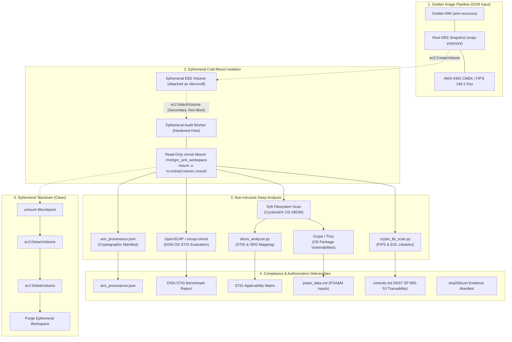

# AMI Review Workflow & Specification

> **Classification**: Internal DevSecOps & Compliance Specification  
> **Target Frameworks**: DISA STIG, NIST SP 800-53 Rev. 5, FedRAMP, DoD Cloud Computing SRG  
> **Operational Model**: Out-of-Band (OOB), Fail-Open, Ephemeral Workspace Execution  
> **Core Architecture**: EBS Snapshot Cold-Mount Pattern  

---

## 1. Executive Summary & Purpose

The **GRC AMI Review Pipeline** extends the governance, risk, and compliance review framework from application Git release bundles to **Amazon Machine Images (AMIs)**. It enables compliance analysts and security engineers to audit virtual machine images for Federal and DoD authorizations (FedRAMP High/Moderate, DoD IL4/IL5/IL6) prior to deployment into operational cloud environments.

The pipeline operates strictly **out-of-band (OOB)** and is **fail-open** relative to release velocity: it never gates or blocks the image build pipeline (e.g., Packer, EC2 Image Builder). Instead, it creates an authoritative, cryptographically verified compliance package and Plan of Action and Milestones (POA&M) deliverable for every audited golden image.

---

## 2. Core Architectural Pattern: EBS Snapshot Cold-Mount

### 2.1 The Danger of "Live-Boot" Auditing

A naive approach to machine image scanning launches an EC2 instance directly from the candidate AMI and runs security agents inside the running OS. In a zero-trust compliance architecture, this "live-boot" pattern presents critical security and integrity flaws:

1. **Untrusted Code Execution**: Booting an untrusted or newly built AMI executes unvetted kernels, systemd services, daemons, cron jobs, and cloud-init scripts directly within the audit boundary. If an image contains malicious logic or supply-chain backdoors, the audit runner itself is compromised.
2. **Forensic State Mutation**: The operating system boot process immediately writes to disk: rotating logs in `/var/log`, updating filesystem access timestamps (`atime`/`mtime`), generating fresh host SSH keys, creating temporary runtime files (`/run`, `/tmp`), and replaying filesystem journals. This destroys the cryptographic immutability of the image state.
3. **Evasion & Anti-Forensics**: Adversarial code or unvetted software can detect virtualized audit environments or hypervisor artifacts and modify its behavior, concealing compliance violations or security defects.
4. **Agent Dependency & Footprint**: Injecting scanning agents requires network egress, SSH/SSM credentials, and agent installation into the candidate image, violating the principle of read-only observation.

### 2.2 The Cold-Mount Isolation Architecture

To guarantee absolute forensic isolation and zero untrusted code execution, the pipeline implements the **EBS Snapshot Cold-Mount Pattern**:



### 2.3 Strict Filesystem Mount Controls

When attaching the ephemeral secondary volume to the audit worker host, the volume is mounted with four mandatory security flags:

```bash
mount -t <fstype> -o ro,noload,noexec,nosuid /dev/<secondary_partition> /mnt/grc_ami_workspace/<session_id>
```

| Mount Flag | Security Function | Compliance & Integrity Rationale |
| :--- | :--- | :--- |
| `ro` | Read-Only Access | Guarantees that neither scanner tools nor host processes modify the inspected filesystem. |
| `noload` | Prevent Journal Replay | For ext4/XFS filesystems, standard mounts attempt to replay the journal even if mounted `ro`, writing journal blocks to disk. `noload` prevents any physical write operation to the underlying EBS volume. |
| `noexec` | Block Binary Execution | Forbids direct execution of any binary located on the mounted image. Prevents accidental execution of untrusted software or malicious ELF payloads. |
| `nosuid` | Invalidate SUID/SGID | Ignores set-user-identifier or set-group-identifier bits, neutralizing local privilege escalation vectors from the image files. |

---

## 3. End-to-End Operational Lifecycle

The AMI review process mirrors the Git bundle review pipeline across five standardized lifecycle phases:

```
  Phase 1: Pull & Verify       Phase 2: Restore (Cold-Mount)       Phase 3: Analyze
┌─────────────────────────┐    ┌───────────────────────────┐    ┌─────────────────────┐
│  grc ami verify         │ -> │  grc ami restore          │ -> │  OpenSCAP + Syft    │
│  - Query AMI metadata   │    │  - Create EBS volume      │    │  - DISA STIG eval   │
│  - Check KMS encryption │    │  - Attach secondary block │    │  - OS SBOM extract  │
│  - Validate root snap   │    │  - Mount ro,noload,noexec │    │  - Crypto scan      │
└─────────────────────────┘    └───────────────────────────┘    └─────────────────────┘
                                                                           │
  Phase 5: Clean (Teardown)    Phase 4: Evidence & SCR-SCN Deliverables    │
┌─────────────────────────┐    ┌───────────────────────────────────────────┘
│  grc ami clean          │ <- │  - ami_provenance.json
│  - Umount workspace     │    │  - STIG Benchmark Results (CAT I/II/III)
│  - Detach EBS volume    │    │  - poam_data.md & controls.md
│  - Delete EBS volume    │    │  - sha256sum validation manifest
└─────────────────────────┘    └───────────────────────────────────────────
```

### 3.1 Phase 1: Pull & Verify (`grc ami verify`)

Before provisioning any cloud infrastructure or audit volumes, the analyst validates the target AMI:

1. **AMI Existence & State**: Resolves AMI ID (`ami-xxxxxxxxxxxxxxxxx`), confirming state is `available` and virtualization type is `hvm`.
2. **Root Snapshot Resolution**: Identifies the root device snapshot (`snap-xxxxxxxxxxxxxxxxx`) and verifies snapshot completion status (`completed`).
3. **Cryptographic Storage & KMS**: Verifies that the underlying EBS snapshot is encrypted with an approved AWS KMS Key (NIST SP 800-53 SC-12, SC-13, FedRAMP High). Captures KMS Key ARN / Key ID.
4. **Architecture & Firmware**: Checks system architecture (`x86_64` vs `arm64`), boot mode (`uefi` vs `legacy-bios`), and TPM support (`tpm2.0` / NitroTPM).
5. **Expected Hash Validation**: If an image digest or release manifest was signed at build time, compares against expected checksums.

```bash
# Phase 1: Command Invocation
./grc ami verify ami-0123456789abcdef0 \
  --region us-east-1 \
  --expected-snapshot snap-0987654321fedcba0
```

### 3.2 Phase 2: Restore / Cold-Mount (`grc ami restore`)

The restore phase transforms the static snapshot into an isolated, readable filesystem ready for static analysis:

1. **Volume Creation**: Calls `ec2:CreateVolume` specifying the AMI root snapshot ID, setting volume type to `gp3`, in the availability zone of the audit worker.
2. **Compliance Tagging**: Applies mandatory tracking tags:
   - `GRC-Audit-Session`: Unique UUID session identifier.
   - `Ephemeral-Worker`: Instance ID of the audit worker host.
   - `Owner`: Compliance & DevSecOps Engineering.
   - `PurgeAfter`: UTC timestamp (+4 hours) for automated safety cleanup.
3. **Secondary Attachment**: Calls `ec2:AttachVolume` attaching the volume as a secondary non-boot disk (e.g., `/dev/xvdf` or `/dev/nvme1n1`).
4. **Partition Discovery**: Inspects block partitions without mounting (`lsblk -J -f /dev/xvdf`). Resolves the primary root filesystem partition (e.g., `/dev/xvdf1` or `/dev/xvdf2` or LVM root volume).
5. **Chroot-Safe Read-Only Mount**: Creates the ephemeral mount point at `--workspace` (defaults to `/mnt/grc_ami_workspace/<session_id>`) and mounts with `-o ro,noload,noexec,nosuid`.
6. **OS Distribution Identification**: Reads `/etc/os-release` and `/etc/system-release` from the mounted filesystem to determine the exact OS family (`rhel`, `amzn`, `ubuntu`, `rocky`), version (`9.2`, `2023.4`, `22.04`), and default STIG benchmark ID.
7. **Provenance Manifest Generation**: Writes `ami_provenance.json` at the root of the workspace directory.

```bash
# Phase 2: Command Invocation
./grc ami restore ami-0123456789abcdef0 \
  --region us-east-1 \
  --workspace ./ephemeral_ami_workspace \
  --worker-id i-0abcdef1234567890 \
  --device /dev/xvdf
```

### 3.3 Phase 3: Deep Security & Compliance Analysis

With the root filesystem cold-mounted at `<workspace>/mnt`, the pipeline executes offline security analyzers:

#### 3.3.1 OS-Level STIG Auditing (OpenSCAP Offline Evaluation)
Using `oscap-chroot` or `oscap xccdf eval` against the chroot mount path, OpenSCAP verifies system configuration files, permission models, PAM configs, auditd rules, and kernel sysctl baselines without booting the image:

```bash
# Example: Offline OpenSCAP audit of cold-mounted RHEL/AL2023 filesystem
oscap-chroot ./ephemeral_ami_workspace/mnt xccdf eval \
  --profile xccdf_org.ssgproject.content_profile_stig \
  --results ./ephemeral_ami_workspace/oscap_results.xml \
  --report ./ephemeral_ami_workspace/oscap_report.html \
  /usr/share/xml/scap/ssg/content/ssg-rhel9-ds.xml
```

Findings are categorized into DISA Severity Categories:
- **CAT I (High)**: Vulnerabilities that directly permit unauthorized access or root compromise (e.g., empty root password, missing FIPS mode, telnet daemon enabled). Immediate remediation required.
- **CAT II (Medium)**: Vulnerabilities that degrade security defenses or auditing (e.g., password expiration limits, audit log buffer size).
- **CAT III (Low)**: Minor configuration deficiencies or administrative hygiene issues.

#### 3.3.2 Software Bill of Materials (SBOM) Generation via Syft
Syft scans the cold-mounted filesystem in directory mode to catalog 100% of installed OS packages (RPM, DEB, APK), programming language dependencies, and system binaries:

```bash
syft dir:./ephemeral_ami_workspace/mnt \
  -o cyclonedx-json=./ephemeral_ami_workspace/ami_sbom.cdx.json
```

#### 3.3.3 DISA STIG SBOM Applicability Analysis (`sbom_analyzer.py`)
The generated `ami_sbom.cdx.json` is passed directly to the pipeline's existing `sbom_analyzer.py` engine:

```bash
./grc sbom --sbom ./ephemeral_ami_workspace/ami_sbom.cdx.json \
  --format markdown \
  -o ./ephemeral_ami_workspace/stig_applicability_matrix.md
```

This identifies any application servers, runtimes, or database packages installed on the AMI (e.g., Apache HTTPD, NGINX, PostgreSQL, Java JRE) and maps them to applicable technology-specific DISA STIGs and SRGs.

#### 3.3.4 Cryptographic Library & EOL Scan (`crypto_lib_scan.py`)
The pipeline runs `crypto_lib_scan.py` across system library directories (`/usr/lib64`, `/usr/lib`, `/lib`, `/usr/local/lib`) to detect deprecated, vulnerable, or non-FIPS compliant crypto libraries against [`crypto_catalog.json`](file:///Users/byronturner-pro/Desktop/GRC-Bundle-Review_Pipeline/rules/crypto_catalog.json):

```bash
./grc crypto --workspace ./ephemeral_ami_workspace/mnt \
  --format json \
  -o ./ephemeral_ami_workspace/crypto_findings.json
```

#### 3.3.5 Common Vulnerabilities and Exposures (CVE) Scanning
Trivy or Grype analyzes the generated SBOM or cold-mount directory against the National Vulnerability Database (NVD) and vendor security advisories (RHSA, ALAS, USN):

```bash
grype sbom:./ephemeral_ami_workspace/ami_sbom.cdx.json \
  --output json > ./ephemeral_ami_workspace/cve_findings.json
```

---

## 4. Work Products & Compliance Deliverables

The AMI review workflow generates a standardized evidence package structured identically to the Git release bundle deliverables:

| Deliverable File | Format | FedRAMP / DoD Compliance Purpose |
| :--- | :--- | :--- |
| `ami_provenance.json` | JSON | Cryptographic provenance manifest, AMI identifier, snapshot ID, KMS key, architecture, and verification session metadata. |
| `ami_sbom.cdx.json` | CycloneDX JSON | Complete system bill of materials detailing all installed packages, versions, and licenses (NIST SP 800-53 SI-7). |
| `stig_applicability_matrix.md` | Markdown | Comprehensive matrix of applicable DISA STIGs and SRGs generated by `sbom_analyzer.py`. |
| `oscap_results.xml` / `.html` | ARF/XCCDF | Detailed OpenSCAP rule evaluation records for DISA OS STIG benchmarks. |
| `crypto_findings.json` | JSON | Static evaluation of cryptographic libraries against FIPS and EOL baselines (AOC 09). |
| `cve_findings.json` | JSON | Raw CVE vulnerability results categorized by CVSS score and severity. |
| `poam_data.md` | Markdown | Structured Plan of Action and Milestones (POA&M) inputs for all unmitigated CAT I and Critical findings. |
| `controls.md` | Markdown | Direct traceability matrix mapping audit findings to NIST SP 800-53 controls (CM-6, SI-2, SI-7, SC-12, SC-13, IA-2). |
| `sha256sum` | Text | Cryptographic checksum manifest ensuring immutability across all generated evidence files. |

### 4.1 Schema Specification: `ami_provenance.json`

```json
{
  "$schema": "https://specs.grc.internal/schemas/ami-provenance-v1.json",
  "manifest_schema": "grc-ami-provenance-v1",
  "session_id": "8f3b2c1a-5d4e-4f6a-9b1c-0123456789ab",
  "ami_identifier": "ami-0123456789abcdef0",
  "image_metadata": {
    "image_id": "ami-0123456789abcdef0",
    "name": "rhel-9-hardened-golden-image-2026-10",
    "owner_id": "123456789012",
    "architecture": "x86_64",
    "creation_date": "2026-10-14T08:00:00.000Z",
    "virtualization_type": "hvm",
    "hypervisor": "xen",
    "ena_support": true,
    "root_device_name": "/dev/sda1"
  },
  "storage_provenance": {
    "root_snapshot_id": "snap-0987654321fedcba0",
    "snapshot_size_gb": 40,
    "encrypted": true,
    "kms_key_id": "arn:aws:kms:us-east-1:123456789012:key/12345678-1234-1234-1234-123456789012",
    "volume_type": "gp3"
  },
  "cold_mount_execution": {
    "ephemeral_volume_id": "vol-01122334455667788",
    "audit_worker_id": "i-0abcdef1234567890",
    "attached_device": "/dev/xvdf",
    "mounted_partition": "/dev/xvdf1",
    "workspace_mount_path": "/mnt/grc_ami_workspace/8f3b2c1a-5d4e-4f6a-9b1c-0123456789ab",
    "mount_options": "ro,noload,noexec,nosuid",
    "mounted_at": "2026-10-14T19:30:00Z"
  },
  "os_identification": {
    "os_id": "rhel",
    "version_id": "9.2",
    "pretty_name": "Red Hat Enterprise Linux 9.2 (Plow)",
    "applicable_stig_benchmark": "U_RHEL_9_STIG"
  },
  "status": "COLD_MOUNTED",
  "ephemeral": true
}
```

---

## 5. Phase 5: Ephemeral Teardown & Cleanup (`grc ami clean`)

To satisfy the **ephemeral lifecycle rule**, once evidence artifacts and POA&M datapoints are generated and archived, all temporary AWS resources and local mount points are destroyed:

1. **Unmount Filesystem**: Executes `umount -f <workspace_mount>` with lazy fallback (`umount -l`).
2. **Detach EBS Volume**: Calls `ec2:DetachVolume` and polls until state is `detached`.
3. **Delete EBS Volume**: Calls `ec2:DeleteVolume` destroying the audit volume.
4. **Purge Workspace Mount**: Removes the local mount point directory.
5. **Preserve Audit Evidence**: Keeps the evidence directory (`./evidence/`) intact while destroying all ephemeral mount and volume artifacts.

```bash
# Phase 5: Command Invocation
./grc ami clean \
  --workspace ./ephemeral_ami_workspace \
  --region us-east-1
```

---

## 6. Execution Modes: Cloud-Native vs Local Emulation

The `grc_ami.py` engine is designed to run in two primary modes:

### 6.1 Cloud-Native AWS Mode
When executed on an EC2-based ephemeral audit worker instance equipped with an appropriate IAM instance profile:
- Directly leverages the AWS SDK (`boto3`) or `aws` CLI.
- Dispatches EC2 Volume creation, attachment, detachment, and deletion.
- Mounts secondary block devices (`/dev/xvdf` or `/dev/nvme1n1`) natively into the Linux filesystem.

### 6.2 Local / Mock Emulation Mode (`--mock`)
For local compliance testing, developer workstations (such as macOS Apple Silicon hosts), and synthetic CI/CD testing:
- Operates without live AWS credentials or cloud infrastructure.
- Uses synthetic or local directory fixtures and mocked EC2 API responses.
- Generates fully compliant `ami_provenance.json` manifests and feeds them into downstream tools (`sbom_analyzer.py`, `crypto_lib_scan.py`).
- Allows complete verification of the audit pipeline logic offline.
