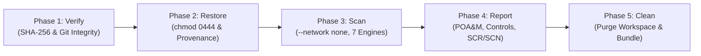

# End-to-End Git Bundle Review Scenario (`docs/grc-bundle-use-case.md`)

<p align="center">
  <a href="../README.md"><b>📖 README</b></a> &nbsp;·&nbsp;
  <a href="../ARCHITECTURE.md"><b>🏛️ Architecture & Tech Stack</b></a> &nbsp;·&nbsp;
  <a href="../DATAFLOW.md"><b>🔄 Data Flow</b></a> &nbsp;·&nbsp;
  <a href="../SECURITY.md"><b>🛡️ Security Policy</b></a> &nbsp;·&nbsp;
  <a href="../GOVERNANCE.md"><b>⚖️ Governance & Mandates</b></a> &nbsp;·&nbsp;
  <a href="../TESTING.md"><b>🧪 Verification Plan</b></a> &nbsp;·&nbsp;
  <a href="grc-bundle-use-case.md"><b>📑 Use Case Walkthrough</b></a> &nbsp;·&nbsp;
  <a href="test-dummies-guide.md"><b>🎯 Test Dummies Guide</b></a>
</p>

> **Classification**: Internal DevSecOps & Security Compliance Walkthrough  
> **Target Frameworks**: DISA STIG, NIST SP 800-53 Rev. 5, FedRAMP High, DoD Cloud Computing SRG  
> **Operational Posture**: Out-of-Band (OOB), Air-Gapped (`--network none`), Read-Only Ephemeral Workspace  

---

## Scenario Overview

This scenario provides a step-by-step walkthrough of the **GRC Bundle Review Pipeline** evaluating a software release bundle (`auth-service-v1.2.0.bundle`). It demonstrates the complete 5-phase lifecycle from pre-extraction cryptographic verification to containerized static analysis, Phase 4 SCR/SCN compliance reporting, and ephemeral workspace cleanup.

### Scenario Baseline

* **Artifact Under Review**: `auth-service-v1.2.0.bundle` (Git release bundle provided by the engineering release pipeline).
* **Expected Release Ref / Tag**: `v1.2.0`
* **Recorded Baseline SHA-256**: `e5b7a1c93f48d02e6b7c5a91f83d2e04a7b1c3d5e7f9a2b4c6d8e0f2a4b6c8d0`
* **Target Evidence Directory**: `./evidence/auth-service-v1.2.0`
* **Objective**: Ingest, verify integrity, restore into an isolated read-only workspace, execute 7 containerized security engines under `--network none`, synthesize Phase 4 FedRAMP/NIST deliverables, seal evidence, and purge the ephemeral workspace.

---

## 5-Phase End-to-End Walkthrough



---

### Step 1: Pre-Extraction Integrity Check (`Phase 1: Pull & Verify`)

In **Phase 1**, the compliance analyst verifies the bundle's cryptographic digest against the session baseline and validates that the Git object history inside the bundle is sound before any files are unpacked:

```bash
./grc bundle verify auth-service-v1.2.0.bundle \
  --expected-sha256 e5b7a1c93f48d02e6b7c5a91f83d2e04a7b1c3d5e7f9a2b4c6d8e0f2a4b6c8d0
```

**Terminal Output:**
```text
[*] Starting Pull & Verify for bundle: auth-service-v1.2.0.bundle
    -> SHA-256 Digest: e5b7a1c93f48d02e6b7c5a91f83d2e04a7b1c3d5e7f9a2b4c6d8e0f2a4b6c8d0
    -> Cryptographic checksum verified against session baseline: MATCH
    -> Git bundle object verification: VALID
    -> References found:
       - HEAD -> 4a9f2bc18d3e710294abcf581029384756201948
       - refs/tags/v1.2.0 -> 4a9f2bc18d3e710294abcf581029384756201948
[SUCCESS] Bundle verification passed for: auth-service-v1.2.0.bundle
```

---

### Step 2: Restoring into an Ephemeral Read-Only Workspace (`Phase 2: Restore`)

In **Phase 2**, the analyst unpacks the verified bundle into an isolated `ephemeral_workspace/`, checks out ref `v1.2.0`, and applies read-only filesystem locks (`chmod 0444`) to guarantee zero file mutation or malicious hook execution:

```bash
./grc bundle restore auth-service-v1.2.0.bundle \
  --workspace ./ephemeral_workspace \
  --ref v1.2.0 \
  --expected-sha256 e5b7a1c93f48d02e6b7c5a91f83d2e04a7b1c3d5e7f9a2b4c6d8e0f2a4b6c8d0 \
  --read-only \
  --force
```

**Terminal Output:**
```text
[*] Starting Pull & Verify for bundle: auth-service-v1.2.0.bundle
    -> SHA-256 Digest: e5b7a1c93f48d02e6b7c5a91f83d2e04a7b1c3d5e7f9a2b4c6d8e0f2a4b6c8d0
    -> Cryptographic checksum verified against session baseline: MATCH
    -> Git bundle object verification: VALID
[*] Extracting bundle into ephemeral workspace: /Users/byronturner-pro/Desktop/GRC-Bundle-Review_Pipeline/ephemeral_workspace
    -> Cloned bundle repository successfully.
    -> Checked out reference: v1.2.0
    -> Checked out Commit: 4a9f2bc1 (HEAD -> v1.2.0, tag: v1.2.0)
    -> Author: Release Automation <sec-ops@company.internal>
    -> Subject: Release v1.2.0: Core authentication microservice
[*] Provenance manifest generated: bundle_provenance.json
    -> Applied read-only filesystem permissions (chmod 0444) across source tree.
[SUCCESS] Bundle successfully restored and ready for Phase 3 (Analyze).
```

---

### Step 3: Inspecting the Generated Audit Manifest (`bundle_provenance.json`)

The restore engine automatically emits [`bundle_provenance.json`](workspace-layout.md) at the root of `ephemeral_workspace/`. This manifest captures immutable cryptographic chain-of-custody metadata:

```bash
cat ./ephemeral_workspace/bundle_provenance.json | jq .
```

**Terminal Output:**
```json
{
  "manifest_schema": "grc-bundle-provenance-v1",
  "session_id": "7f8b91a2-c34d-4e5f-89ab-0123456789cd",
  "bundle_identifier": "e5b7a1c93f48d02e6b7c5a91f83d2e04a7b1c3d5e7f9a2b4c6d8e0f2a4b6c8d0",
  "bundle_source_path": "/Users/byronturner-pro/Desktop/GRC-Bundle-Review_Pipeline/auth-service-v1.2.0.bundle",
  "bundle_size_bytes": 14829312,
  "bundle_sha256": "e5b7a1c93f48d02e6b7c5a91f83d2e04a7b1c3d5e7f9a2b4c6d8e0f2a4b6c8d0",
  "workspace_path": "/Users/byronturner-pro/Desktop/GRC-Bundle-Review_Pipeline/ephemeral_workspace",
  "checked_out_ref": "v1.2.0",
  "commit_metadata": {
    "commit_hash": "4a9f2bc18d3e710294abcf581029384756201948",
    "short_hash": "4a9f2bc1",
    "author_name": "Release Automation",
    "author_email": "sec-ops@company.internal",
    "author_date": "Wed Oct 14 07:15:22 2026 -0400",
    "subject": "Release v1.2.0: Core authentication microservice",
    "ref": "HEAD -> v1.2.0, tag: v1.2.0"
  },
  "restored_at": "2026-10-15T12:50:11.492104+00:00",
  "status": "RESTORED",
  "ephemeral": true,
  "verification": {
    "session_id": "7f8b91a2-c34d-4e5f-89ab-0123456789cd",
    "bundle_sha256": "e5b7a1c93f48d02e6b7c5a91f83d2e04a7b1c3d5e7f9a2b4c6d8e0f2a4b6c8d0",
    "checksum_verified": true,
    "git_bundle_valid": true,
    "contained_references": [
      {
        "commit": "4a9f2bc18d3e710294abcf581029384756201948",
        "ref": "refs/tags/v1.2.0"
      }
    ],
    "verified_at": "2026-10-15T12:50:11.401022+00:00"
  }
}
```

---

### Step 4: Multi-Engine Air-Gapped Analysis (`Phase 3: Analyze`)

In **Phase 3**, the analyst triggers the containerized scanning suite via `./grc scan`. The host dispatcher invokes `docker run` with `--network none` (complete kernel air-gapping) and mounts `ephemeral_workspace` as read-only (`:ro`). All 7 scanning engines execute concurrently:

```bash
./grc scan -w ./ephemeral_workspace -e ./evidence/auth-service-v1.2.0
```

**Terminal Output:**
```text
========================================================================
 GRC Multi-Engine Security & Compliance Scanner
========================================================================
 [*] Workspace Target : /workspace (read-only)
 [*] Evidence Output  : /evidence
 [*] Network Isolation: AIR-GAPPED (--network none)
========================================================================

>>> [1/7] Executing Semgrep AST Compliance Engine (rules/custom-baseline-ruleset.yaml)...
    -> Semgrep scan completed: 3 findings recorded in /evidence/semgrep_findings.json

>>> [2/7] Executing Gitleaks Hardcoded Secret Detection...
    -> Gitleaks scan completed: 0 secrets detected.

>>> [3/7] Executing Checkov Infrastructure-as-Code (IaC) Scanner...
    -> Checkov scan completed: 1 failed check in /evidence/checkov_findings.json

>>> [4/7] Generating CycloneDX Software Bill of Materials (SBOM) via Syft...
    -> Syft SBOM generated: 84 components indexed in /evidence/sbom.cdx.json

>>> [5/7] Executing Offline Vulnerability Matching via Grype & Trivy...
    -> Grype scan completed: 2 CVEs recorded in /evidence/grype_cve_report.json
    -> Trivy scan completed: 2 CVEs recorded in /evidence/trivy_cve_report.json

>>> [6/7] Executing Static Cryptographic Provider & EOL Library Scan...
    -> CryptoScan completed: 1 deprecated cipher detected in /evidence/crypto_lib_findings.json

>>> [7/7] Generating DISA STIG / DoD Cloud SRG Applicability Matrix...
    -> STIG mapping completed: 3 STIG profiles identified in /evidence/stig_applicability_report.json

[SUCCESS] Phase 3 Security Analysis complete. Raw telemetry preserved in ./evidence/auth-service-v1.2.0
```

---

### Step 5: Synthesizing Phase 4 Compliance Deliverables (`Phase 4: Report`)

With raw telemetry captured in `./evidence/auth-service-v1.2.0`, the pipeline executes [`scripts/grc_reporter.py`](../scripts/grc_reporter.py) (automatically at the end of `./grc scan` or manually via `./grc report`). 

The reporting engine normalizes findings across all engines, calculates FedRAMP High SLA remediation windows, evaluates full NIST SP 800-53 Rev. 5 control coverage, validates the 37-rule AST baseline, and seals all deliverables with SHA-256 hashes:

```bash
./grc report -e ./evidence/auth-service-v1.2.0
```

**Terminal Output:**
```text
========================================================================
 GRC Phase 4 Compliance Reporting Engine (SCR/SCN Synthesis)
========================================================================
 [*] Ingesting telemetry from: ./evidence/auth-service-v1.2.0
 [*] Ingestion Summary:
     - Semgrep AST Findings : 3
     - Gitleaks Secrets     : 0
     - Checkov IaC Findings : 1
     - Grype CVE Findings   : 2
     - Trivy CVE Findings   : 2
     - Crypto Library Alerts: 1
     - Total Normalized Findings: 7

 [*] Generating FedRAMP High Plan of Action & Milestones (poam_data.md)...
     -> High Severity SLA (30 Days) : 2 findings (Due: 2026-11-14)
     -> Medium Severity SLA (90 Days): 4 findings (Due: 2027-01-13)
     -> Low Severity SLA (180 Days)  : 1 finding  (Due: 2027-04-13)

 [*] Generating NIST SP 800-53 Rev. 5 Controls Matrix (controls.md)...
     -> Evaluated 18 Control Families (AC, AU, CA, CM, CP, IA, MP, PE, PL, PS, RA, SA, SC, SI, SR)
     -> Passed Controls: 14 | Open Findings: 4

 [*] Generating AST Baseline Ruleset Validation Log (ruleset_validation.md)...
     -> Parsed 37 AST rules from rules/custom-baseline-ruleset.yaml: 100% VALID

 [*] Generating Machine-Readable eMASS / GRC Package (scr_scn_package.json)...
     -> Serialized comprehensive SCR/SCN JSON payload.

 [*] Sealing Evidence Package with Cryptographic Checksums (sha256sum)...
     -> Hashed 12 evidence artifacts into sha256sum manifest.

[SUCCESS] Phase 4 SCR/SCN Deliverables generated in ./evidence/auth-service-v1.2.0:
  ├── poam_data.md           (FedRAMP High POA&M Remediation Schedule)
  ├── controls.md            (NIST SP 800-53 Rev. 5 Traceability Matrix)
  ├── ruleset_validation.md  (37-Rule Baseline Audit Verification Log)
  ├── scr_scn_package.json   (eMASS / Archer / ServiceNow Ingestion Payload)
  └── sha256sum              (Cryptographic Evidence Chain of Custody)
========================================================================
```

#### Inspecting the Generated `poam_data.md` (Sample)

```bash
cat ./evidence/auth-service-v1.2.0/poam_data.md | head -n 25
```

```markdown
# Plan of Action and Milestones (POA&M)

> **Generated**: 2026-10-15T12:55:00.000000+00:00  
> **Source Evidence**: `evidence/auth-service-v1.2.0`  
> **SLA Framework**: FedRAMP High (High: 30d, Moderate/Medium: 90d, Low: 180d)  
> **Total Open Items**: 7  

## Severity Summary

| Severity | Count | SLA Window | Oldest Due Date |
|:---|:---:|:---|:---|
| **HIGH** | 2 | 30 Calendar Days | 2026-11-14 |
| **MEDIUM** | 4 | 90 Calendar Days | 2027-01-13 |
| **LOW** | 1 | 180 Calendar Days | 2027-04-13 |
```

---

### Step 6: Post-Audit Ephemeral Teardown (`Phase 5: Clean`)

To uphold the core zero-persistence hygiene principle ([`docs/design-rules-and-aocs.md`](design-rules-and-aocs.md)), the analyst tears down the ephemeral workspace and safely purges the release bundle once deliverables are archived:

```bash
./grc bundle clean \
  --workspace ./ephemeral_workspace \
  --delete-bundle auth-service-v1.2.0.bundle
```

**Terminal Output:**
```text
[*] Destroying ephemeral workspace: /Users/byronturner-pro/Desktop/GRC-Bundle-Review_Pipeline/ephemeral_workspace
    -> Recursively removed read-only workspace directory.
[*] Deleting processed bundle: /Users/byronturner-pro/Desktop/GRC-Bundle-Review_Pipeline/auth-service-v1.2.0.bundle
    -> Bundle file deleted.
[SUCCESS] Ephemeral cleanup complete. Workspace restored to pristine state.
```

---

## Negative Testing & Error Handling Scenarios

### Scenario A: Tampered / Modified Bundle Checksum

If an attacker alters even a single byte of a release bundle in transit, the SHA-256 pre-check immediately aborts the operation before any files are unpacked:

```bash
./grc bundle restore tampered.bundle \
  --expected-sha256 e5b7a1c93f48d02e6b7c5a91f83d2e04a7b1c3d5e7f9a2b4c6d8e0f2a4b6c8d0 \
  --workspace ./ephemeral_workspace
```

**Terminal Output (Aborted):**
```text
[*] Starting Pull & Verify for bundle: tampered.bundle
    -> Computed SHA-256: 111122223333444455556666777788889999aaaabbbbccccddddeeeeffff0000
[ERROR] SHA-256 mismatch!
        Expected: e5b7a1c93f48d02e6b7c5a91f83d2e04a7b1c3d5e7f9a2b4c6d8e0f2a4b6c8d0
        Computed: 111122223333444455556666777788889999aaaabbbbccccddddeeeeffff0000
[FATAL] Operation failed: Bundle cryptographic integrity verification failed.
```

---

### Scenario B: Corrupted Git Object Graph Rejection

If an adversary generates an invalid Git bundle containing truncated objects or broken commit histories, `git bundle verify` catches the corruption during Phase 1:

```bash
./grc bundle verify corrupted.bundle
```

**Terminal Output (Aborted):**
```text
[*] Starting Pull & Verify for bundle: corrupted.bundle
    -> SHA-256 Digest: 88fa3910c29481bc201490218491823901928491829481928391829381928391
    -> Validating Git bundle object graph...
fatal: error reading bundle object
[ERROR] Git bundle object verification failed: corrupted.bundle is not a valid git bundle.
[FATAL] Aborting pipeline: Refusing to extract unverified bundle.
```

---

## Summary of Completed Review Lifecycle

| Phase | Action | Primary Tool | Key Artifacts Produced | Security Assurance |
| :--- | :--- | :--- | :--- | :--- |
| **Phase 1** | Pull & Verify | `./grc bundle verify` | Verified SHA-256 digest | Prevents ingestion of tampered or corrupted bundles |
| **Phase 2** | Restore | `./grc bundle restore` | `ephemeral_workspace/`, `bundle_provenance.json` | `chmod 0444` write-lock prevents malicious script mutation |
| **Phase 3** | Analyze | `./grc scan` (`grc-scanner:local`) | 7 raw JSON/XML scanner reports | `--network none` kernel air-gap guarantees zero telemetry leakage |
| **Phase 4** | Report | `./grc report` (`grc_reporter.py`) | `poam_data.md`, `controls.md`, `ruleset_validation.md`, `scr_scn_package.json`, `sha256sum` | Standardized FedRAMP High POA&M, NIST 800-53 matrix & cryptographic seal |
| **Phase 5** | Clean | `./grc bundle clean` | Clean workstation | Zero residual data leakage; pristine auditor hygiene |