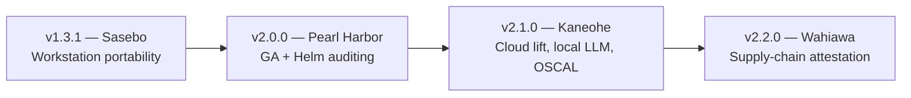

# Product Roadmap (`hygiene/ROADMAP.md`)

  <a href="../README.md"><b>📖 README</b></a> &nbsp;·&nbsp;
  <a href="../amplifying-info/ARCHITECTURE.md"><b>🏛️ Architecture & Tech Stack</b></a> &nbsp;·&nbsp;
  <a href="../amplifying-info/DATAFLOW.md"><b>🔄 Data Flow</b></a> &nbsp;·&nbsp;
  <a href="../SECURITY.md"><b>🛡️ Security Policy</b></a> &nbsp;·&nbsp;
  <a href="../amplifying-info/GOVERNANCE.md"><b>⚖️ Governance & Mandates</b></a> &nbsp;·&nbsp;
  <a href="../testing/TESTING.md"><b>🧪 Verification Plan</b></a> &nbsp;·&nbsp;
  <a href="../testing/live-demo.md"><b>🎬 Live Demo</b></a> &nbsp;·&nbsp;
  <a href="RELEASE_NOTES.md"><b>🚀 Release Notes</b></a> &nbsp;·&nbsp;
  <a href="PATCH_LOG.md"><b>🩹 v1 Patch Log</b></a> &nbsp;·&nbsp;
  <a href="ROADMAP.md"><b>🗺️ Roadmap</b></a> &nbsp;·&nbsp;
  <a href="RELEASING.md"><b>🏷️ Releasing</b></a> &nbsp;·&nbsp;
  <a href="../docs/scan-transform-guide.md"><b>📊 Scan-to-POA&M Guide</b></a> &nbsp;·&nbsp;
  <a href="../docs/grc-bundle-use-case.md"><b>📑 Bundle Walkthrough</b></a> &nbsp;·&nbsp;
  <a href="../docs/test-dummies-guide.md"><b>🎯 Test Dummies Guide</b></a>

> **Current release**: `v1.3.0 — Sasebo` (Restricted Beta)  
> This file covers **planned** work only. For what has already shipped, see [`RELEASE_NOTES.md`](RELEASE_NOTES.md) and [`PATCH_LOG.md`](PATCH_LOG.md). Versioning and codename rules are in [`RELEASING.md`](RELEASING.md).  
> Plans may change. A feature is only considered delivered once it appears in the release notes.

---

## Where things stand

GRCx `v1.3.0` provides the 5-phase bundle and AMI review pipeline with nine scanning engines, plus the standalone Tenable / AWS Inspector scan-to-FedRAMP POA&M transformer (`./grc transform`). The remaining `v1.x` beta work focuses on making GRCx run reliably on any workstation. `v2.0.0` marks general availability.

| Version | Codename | Focus | Status |
| :--- | :--- | :--- | :--- |
| `v1.3.1` | Sasebo | Workstation portability and `./grc doctor` | Next |
| `v2.0.0` | Pearl Harbor | General availability; Helm chart compliance engine | Planned |
| `v2.1.0` | Kaneohe | Cloud execution, air-gapped local LLM, NIST OSCAL export, `./grc diff` | Backlog |
| `v2.2.0` | Wahiawa | Cosign / Sigstore and SLSA provenance checks; container image auditing | Backlog |

---

## v1.3.1 — Sasebo: Workstation Portability

**Problem.** Some defaults in `./grc` and the scanner container assume a specific workstation setup, which causes friction when moving between macOS, Linux, and Windows (WSL2).

**Planned changes:**

1. **Container file ownership.** On native Linux, containers running as root leave `evidence/` files owned by `root:root`, which locks out the host user. Containers will run with the host user's UID/GID (`--user $(id -u):$(id -g)`) and writable scratch caches (`/tmp/.cache`) so `semgrep`, `checkov`, `syft`, `grype`, and `trivy` work as non-root.
2. **Pinned scanner image.** `Dockerfile.scanner` will use version-pinned, SHA-256-verified `linux/amd64` and `linux/arm64` releases of Syft, Grype, Trivy, Semgrep, and Checkov, replacing the floating `install.sh` downloads. This prevents upstream changes from breaking `./grc docker-build`.
3. **Container runtime support.** Replace macOS-specific Docker checks with a detector that supports Docker Desktop, Colima, Rancher Desktop, Linux Docker Engine, and rootless Podman.
4. **SELinux volume labels.** Detect SELinux-enforcing hosts (RHEL, Fedora, Rocky) and apply the correct mount labels (`:ro,Z`) so scanners can read `/workspace` and write `/evidence`.
5. **`./grc doctor`.** A pre-flight check for `git`, `python3` (3.9 or later), container runtime status, disk space, and CPU architecture. `./grc fetch` will detect the host OS and CPU instead of hard-coding `Darwin ARM64`.

---

## v2.0.0 — Pearl Harbor: General Availability

The first production release, following beta integration sign-off. It also adds a Helm chart compliance engine.

### Helm chart compliance engine (`./grc scan --engine helm`)

**Goal.** Extend Phase 3 infrastructure-as-code auditing (AOC-07, AOC-11, AOC-140) to Kubernetes Helm charts before deployment.

**Planned implementation:**

- **Offline rendering.** Find `Chart.yaml` files in restored bundles, render manifests offline with `helm template` using the default `values.yaml` and environment overrides (for example, `values-prod.yaml`), and audit both the raw templates and the rendered output.
- **DISA Kubernetes STIG and NSA/CISA hardening checks**, including:
  - privileged pods (`privileged: true`) and containers allowed to run as root (`runAsNonRoot: false`);
  - missing `seccompProfile` or `readOnlyRootFilesystem`;
  - image tags that aren't pinned to a digest (for example, `:latest` instead of `@sha256:`);
  - missing CPU and memory limits (SC-6) and missing `NetworkPolicy` isolation (SC-7);
  - plaintext secrets in `values.yaml` (SC-12, SC-28).

---

## v2.1.0 — Kaneohe: Cloud Lift, Local LLM, and OSCAL

### Cloud execution on AWS EC2 and Bottlerocket

**Goal.** Run GRCx as an automated worker inside AWS Commercial and AWS GovCloud (IL4–IL6) enclaves, not only on an analyst's workstation.

- **Hardened EC2 worker.** Terraform and CloudFormation modules for a STIG-hardened EC2 instance with a least-privilege IAM profile (`ec2:CreateVolume`, `AttachVolume`, `DetachVolume`, `DeleteVolume`, plus scoped KMS decrypt) for in-region EBS snapshot cold-mounts (`./grc ami`).
- **Bottlerocket support.** Run the scanner suite on AWS Bottlerocket, a minimal, immutable, SELinux-enforcing container OS with no SSH or shell.
- **No internet access.** Run in private subnets using S3 and EC2 VPC endpoints, keeping the `--network none` air gap during Phase 3.

### Air-gapped local LLM (`./grc report --ai-enrich`)

**Goal.** Reduce manual drafting of POA&M weakness descriptions, remediation steps, milestones, and false-positive justifications. All inference stays on the host or enclave, so no CUI or vulnerability data leaves it.

- Run quantized open-weight models (Google Gemma or OpenAI GPT-OSS) inside the compliance worker. They will turn normalized scanner output and Tenable / Inspector rows into 3PAO-ready POA&M text.
- **Memory-based model selection.** `./grc` will read available memory (`sysctl hw.memsize` on macOS, `/proc/meminfo` on Linux) and pick a model size to match:

  | Host RAM | Planned behavior |
  | :--- | :--- |
  | Under 8 GB | No LLM; use rule-based templates |
  | 8–16 GB | Small model (roughly 2B–4B parameters, 4-bit quantized) |
  | 16–32 GB | Mid-size model (roughly 9B–12B parameters) |
  | 32–64 GB+ | Large model (roughly 20B–27B parameters, for example Gemma 27B or GPT-OSS 20B) |

  Specific model versions will be chosen closer to implementation.

### NIST OSCAL 1.1.x export

- Produce OSCAL Assessment Results (`assessment-results.json`) and OSCAL POA&M (`poam.json`) alongside `scr_scn_package.json`, for ingestion into systems such as eMASS.

### Release-to-release comparison (`./grc diff`)

- Compare findings between two reviews of the same system.

---

## v2.2.0 — Wahiawa: Supply-Chain Attestation

- **Provenance check in Phase 1.** Verify Cosign / Sigstore signatures and SLSA v1.0 provenance before a bundle is restored.
- **Container image auditing (`./grc image`).** Audit OCI image tarballs directly.

---

## Later

Remaining candidate codenames for future `v2.x` releases: Kunia, Kekaha.
