# Product Roadmap (`hygiene/ROADMAP.md`)

<p align="center">
  <a href="../README.md"><b>📖 README</b></a> &nbsp;·&nbsp;
  <a href="../amplifying-info/ARCHITECTURE.md"><b>🏛️ Architecture & Tech Stack</b></a> &nbsp;·&nbsp;
  <a href="../amplifying-info/DATAFLOW.md"><b>🔄 Data Flow</b></a> &nbsp;·&nbsp;
  <a href="../SECURITY.md"><b>🛡️ Security Policy</b></a> &nbsp;·&nbsp;
  <a href="../amplifying-info/GOVERNANCE.md"><b>⚖️ Governance & Mandates</b></a> &nbsp;·&nbsp;
  <a href="../testing/TESTING.md"><b>🧪 Verification Plan</b></a> &nbsp;·&nbsp;
  <a href="../testing/live-demo.md"><b>🎬 Live Demo</b></a> &nbsp;·&nbsp;
  <a href="RELEASE_NOTES.md"><b>🚀 Release Notes</b></a> &nbsp;·&nbsp;
  <a href="PATCH_LOG.md"><b>🩹 v1 Patch Log</b></a> &nbsp;·&nbsp;
  <a href="ROADMAP.md"><b>🗺️ Roadmap</b></a> &nbsp;·&nbsp;
  <a href="../docs/scan-transform-guide.md"><b>📊 Scan-to-POA&M Guide</b></a> &nbsp;·&nbsp;
  <a href="../docs/grc-bundle-use-case.md"><b>📑 Bundle Walkthrough</b></a> &nbsp;·&nbsp;
  <a href="../docs/test-dummies-guide.md"><b>🎯 Test Dummies Guide</b></a>
</p>

> **Project**: GRCx — The GRC eXperience (`grcx`)  
> **Active Series**: `v1.2.x — Misawa` *(Restricted Beta — Standalone Tenable & AWS Inspector Scan-to-FedRAMP POA&M Transformation Engine)*  
> **Upcoming `v1.x` Minor Release (🇯🇵 Japan Series)**: `v1.3.0 — Sasebo` *(Universal Workstation Portability)*  
> **Upcoming `v2.x` GA Releases (🌺 Hawaiian Series)**: `v2.0.0 — Pearl Harbor` *(Full Production GA & Helm Chart Auditing)* $\rightarrow$ `v2.1.0+ — Kaneohe` *(Cloud Lift, Local LLM Baseline & RAM-Adaptive Scaling, OSCAL)*  
> **Companion Release History**: See **[`hygiene/RELEASE_NOTES.md`](RELEASE_NOTES.md)** and **[`hygiene/PATCH_LOG.md`](PATCH_LOG.md)**.

---

## 1. Executive Release Progression: Japan Beta (`v1.x`) $\rightarrow$ Hawaii GA (`v2.x`)

**GRCx** (*The GRC eXperience*) follows a structured maturity progression from a single-workstation Beta prototype into an enterprise-grade, cloud-hosted, AI-enriched compliance platform:

1. **🇯🇵 `v1.0.x — Yokosuka` & `v1.1.0 — Kadena` (Completed Baseline & `GRCx` Rebrand)**: Established the 5-phase out-of-band (`.bundle` & `AMI` cold-mount) workflow, 9-engine air-gapped Docker scanner suite, 37 AST rules, Phase 4 Markdown/JSON synthesis, and full platform rebrand to **GRCx — "The GRC eXperience"**.
2. **🇯🇵 `v1.2.0 — Misawa` (Active Baseline — Standalone Scan-to-POA&M Transformer: `scripts/transform_scans.py` / `./grc transform`)**: Introduces a standalone Native Python Compliance Engine that ingests **Tenable** and **AWS Inspector** `.csv`/`.xlsx` exports, populates the official **OPEN** and **CLOSED** FedRAMP POA&M `.xlsx` templates (1 row per `Vulnerability + Asset`), reconciles against a previous OPEN POA&M to move remediated items to the CLOSED POA&M, interactively drafts missing remediation plans with official Tenable/AWS URLs, and reports passed SLAs and finding age in days.
3. **🇯🇵 `v1.3.0 — Sasebo` (Universal Workstation Portability & Plug-and-Play Compatibility)**: Eliminates single-machine assumptions so any engineer or assessor pulling the repo from GitHub on **macOS (Apple Silicon / Intel)**, **Linux (`amd64` / `arm64`)**, or **Windows WSL2** can run `./grc` out-of-the-box with zero permission errors, UID/GID volume conflicts, or unpinned image build failures.
4. **🌺 `v2.0.0 — Pearl Harbor` (Full Production GA Launch — Helm Chart Compliance Engine)**: Launches the **Hawaiian Military Base Cities** GA series with full production sign-off and introduces offline **Helm Chart compliance auditing (`./grc scan --engine helm`)** against DISA Kubernetes STIG and NSA/CISA hardening baselines.
5. **🌺 `v2.1.0+ — Subsequent Hawaiian Series (`Kaneohe`, `Wahiawa`)**: Lifts execution from local workstations into **AWS EC2 & Bottlerocket** cloud enclaves, integrates the **air-gapped local LLM (`Gemma` / `GPT-OSS`) synthesis baseline** alongside **dynamic endpoint RAM-adaptive LLM tier selection**, and adds NIST OSCAL 1.1.x export and cryptographic bundle signature attestation.

```mermaid
%%{init: {
  'theme': 'base',
  'themeVariables': {
    'darkMode': true,
    'background': '#070a12',
    'primaryColor': '#0f172a',
    'primaryTextColor': '#f8fafc',
    'primaryBorderColor': '#38bdf8',
    'lineColor': '#38bdf8',
    'secondaryColor': '#1e1b4b',
    'tertiaryColor': '#0c4a6e',
    'mainBkg': '#0f172a',
    'nodeBorder': '#38bdf8',
    'clusterBkg': '#0b0f19',
    'clusterBorder': '#1e293b',
    'defaultLinkColor': '#38bdf8',
    'fontFamily': 'system-ui, -apple-system, sans-serif'
  }
}}%%
flowchart LR
    classDef yokosuka fill:#0c192e,stroke:#0284c7,stroke-width:1.5px,color:#f0f9ff;
    classDef misawa fill:#1e1b4b,stroke:#6366f1,stroke-width:1.8px,color:#e0e7ff;
    classDef sasebo fill:#0d1c38,stroke:#3b82f6,stroke-width:1.8px,color:#ffffff;
    classDef pearl fill:#042f2e,stroke:#14b8a6,stroke-width:2px,color:#ffffff;
    classDef kaneohe fill:#1a0f37,stroke:#a855f7,stroke-width:1.5px,color:#f3e8ff;

    subgraph JPN["<b>🇯🇵 v1.x — Japan Military Installation Series (Beta &amp; Hardening)</b>"]
        direction LR
        Y["<b>v1.0.x Yokosuka / v1.1.0 Kadena</b><br/><i>Active Baseline &amp; GRCx Rebrand</i><br/>• 5-Phase Bundle &amp; AMI Flow<br/>• 9-Engine Air-Gapped Suite<br/>• Markdown POA&amp;M &amp; JSON"]:::yokosuka
        M["<b>v1.2.0 — Misawa</b><br/><i>External Telemetry Ingest</i><br/>• Tenable CSV Parser<br/>• AWS Inspector CSV Parser<br/>• Cross-Scanner Deduplication<br/>• Official FedRAMP POA&amp;M .xlsx"]:::misawa
        S["<b>v1.3.0 — Sasebo</b><br/><i>Workstation Portability</i><br/>• Multi-OS (macOS/Linux/WSL2)<br/>• Rootless/UID Volume Fix<br/>• ./grc doctor Pre-Flight<br/>• Pinned Deterministic Docker"]:::sasebo
        Y --> M --> S
    end

    subgraph HWI["<b>🌺 v2.x — Hawaiian Military Base Cities Series (Full Production GA)</b>"]
        direction LR
        P["<b>v2.0.0 — Pearl Harbor</b><br/><i>Production GA Launch</i><br/>• Full Production GA Sign-Off<br/>• Helm Chart Compliance Engine<br/>  (./grc scan --engine helm)<br/>• DISA K8s STIG &amp; NSA/CISA"]:::pearl
        K["<b>v2.1.0+ — Kaneohe / Wahiawa</b><br/><i>Cloud Lift, Local LLM &amp; OSCAL</i><br/>• Cloud Lift (AWS EC2 &amp; Bottlerocket)<br/>• Air-Gapped Local LLM Baseline<br/>  &amp; RAM-Adaptive Tier Sizing<br/>• NIST OSCAL 1.1.x &amp; Cosign"]:::kaneohe
        P --> K
    end

    S ==>|"GA Graduation"| P

    style JPN fill:#051326,stroke:#0284c7,stroke-width:1.5px,color:#38bdf8
    style HWI fill:#041c16,stroke:#10b981,stroke-width:2px,color:#34d399
```



---

## 2. Near-Term `v1.x` Minor Releases (🇯🇵 Japan Series)

### 🛩️ `v1.2.0 — Misawa` *(Implemented & Active)*: Standalone Tenable & AWS Inspector Scan-to-FedRAMP POA&M Transformation (`scripts/transform_scans.py`)

* **Operational Problem**: Beyond static Git bundle and cold-mounted AMI analysis, GRC analysts and 3PAOs rely on continuous vulnerability exports from **Tenable (Nessus / Tenable.sc / Tenable.io)** and **Amazon Inspector** in `.csv` or `.xlsx` format. Manually mapping these scan exports into the **official OPEN and CLOSED FedRAMP POA&M Excel workbooks (`.xlsx`)**, tracking which previously open items were remediated, drafting missing remediation plans, and calculating passed SLA dates and finding age is slow and error-prone.
* **Delivered Capabilities in `v1.2.0 — Misawa` ([`docs/scan-transform-guide.md`](../docs/scan-transform-guide.md))**:
  1. **Standalone Multi-Source Ingestion Engine (`scripts/transform_scans.py` / `./grc transform`)**:
     * Auto-detects **Tenable** and **AWS Inspector** exports in `.csv` or `.xlsx` format and maps every finding (1 row per `Vulnerability + Asset` pair) into the 27 columns of [`templates/OPEN FedRAMP-POAM-Template.xlsx`](../templates/OPEN%20FedRAMP-POAM-Template.xlsx) using 100% Python 3 Standard Library modules.
  2. **Open $\rightarrow$ Closed POA&M Delta Reconciliation**:
     * Requests the previously filled-out OPEN FedRAMP POA&M form (`.xlsx`). Findings still present carry over with their immutable `Original Detection Date`; findings no longer present in the new scan (or marked `False Positive = Yes`) automatically move into [`templates/CLOSED LEGACY FedRAMP-POAM-Template.xlsx`](../templates/CLOSED%20LEGACY%20FedRAMP-POAM-Template.xlsx).
  3. **Interactive Missing Remediation Plan Drafter (`[y/n]`)**:
     * Prompts the analyst if any OPEN POA&M entries are missing a `Remediation Plan` (`Column K`) and, when confirmed (`y`), inserts structured remediation steps alongside official **Tenable Plugin URLs**, **AWS ALAS Advisory URLs**, **AWS Inspector docs**, and **NVD CVE URLs**.
  4. **SLA Breach & Finding Age Reporting**:
     * Reports the exact count of finished OPEN POA&M entries whose `Scheduled Completion Date` (SLA) has passed and itemizes how many days old each entry is from its `Original Detection Date`.
* **CLI Interface**:
  ```bash
  ./grc transform \
    --scan ./testing/sample-scans/tenable_monthly_scan.csv \
    --previous-open ./testing/sample-scans/previous_open_poam.xlsx \
    --draft-remediations y
  ```

---

### ⚓ `v1.3.0 — Sasebo`: Universal Workstation Portability & Clone-and-Run Hardening

* **Operational Problem**: Currently, the pipeline includes workstation-specific assumptions (e.g., Apple Silicon `Darwin ARM64` defaults, Docker Desktop for Mac volume ownership translation, root-owned container outputs on Linux hosts, and unpinned `curl | sh` installer scripts in `Dockerfile.scanner`). When another engineer or assessor clones the repository from GitHub onto an Intel Mac, Ubuntu/RHEL workstation, Fedora with Podman, or Windows WSL2, these differences can cause immediate build or runtime failures.
* **Planned Code & Architecture Changes in `v1.3.0 — Sasebo`**:
  1. **Container UID/GID Ownership Synchronization (`--user $(id -u):$(id -g)`)**: On native Linux hosts, containers running as `root` write `evidence/` files owned by `root:root`, locking out the host user during `grc report` or cleanup. `Sasebo` passes host UID/GID context and configures writable scratch caches (`/tmp/.cache`) so `semgrep`, `checkov`, `syft`, `grype`, and `trivy` run cleanly as non-root across Linux, macOS, and WSL2.
  2. **Deterministic, Version-Pinned `Dockerfile.scanner`**: Replaces floating `main/install.sh` downloads for Syft, Grype, Trivy, Semgrep, and Checkov with version-pinned, SHA-256-verified multi-arch (`linux/amd64` and `linux/arm64`) binary releases—preventing upstream breaking changes when a new user runs `./grc docker-build`.
  3. **Container Runtime Agnosticism (Docker Desktop, Colima, Rancher Desktop, Podman & Linux Engine)**: Replaces macOS-specific Docker daemon checks in `./grc` with a portable runtime detector supporting standard `docker` and rootless `podman`.
  4. **SELinux / AppArmor Volume Mount Compatibility (`:ro,Z`)**: Detects SELinux-enforcing Linux hosts (RHEL, Fedora, Rocky Linux) and automatically applies proper mount labels so container scanners are not blocked with `Permission denied` when reading `/workspace` or writing `/evidence`.
  5. **Pre-Flight Environment Diagnostic (`./grc doctor`) & Dynamic Host Detection**: Adds a `./grc doctor` command that verifies `git`, `python3` ($\ge 3.9$), container daemon status, disk space, and architecture, while dynamically detecting host OS/CPU in `./grc fetch` instead of hardcoding `Darwin ARM64`.

---

## 3. Full Production GA Launch: `v2.0.0 — Pearl Harbor` (🌺 Hawaiian Series)

Following external Tenable/AWS Inspector CSV ingestion and FedRAMP `.xlsx` generation in `Misawa` (`v1.2.0`) and universal workstation portability hardening in `Sasebo` (`v1.3.0`), **`v2.0.0 — Pearl Harbor`** marks the pipeline's graduation to **Full Production General Availability (GA)**.

### Helm Chart Compliance Engine (`./grc scan --engine helm`)

* **Operational Goal**: Extend Phase 3 Infrastructure-as-Code compliance auditing (`AOC-07`, `AOC-11`, `AOC-140`) to natively render and audit **Kubernetes Helm charts** before cluster deployment.
* **Planned Implementation**:
  * **Offline Helm Template Rendering**: Automatically discovers `Chart.yaml` hierarchies inside restored Git bundles, renders effective Kubernetes manifests offline (`helm template`) across default `values.yaml` and environment override files (`values-prod.yaml`), and audits both raw templates and rendered manifests.
  * **DISA Kubernetes STIG & NSA/CISA Hardening Checks**:
    * Flags privileged pods (`privileged: true`), root container execution (`runAsNonRoot: false`), and missing `seccompProfile` / `readOnlyRootFilesystem` security contexts.
    * Detects unpinned container image tags (`:latest` vs. immutable `@sha256:` digests), missing CPU/memory resource limits (`SC-6`), missing `NetworkPolicy` isolation (`SC-7`), and plaintext secrets in `values.yaml` (`SC-12`, `SC-28`).

---

## 4. Post-GA `v2.x` Roadmap (`Kaneohe` & `Wahiawa`)

### 🌺 `v2.1.0+ — Kaneohe`: Cloud Enclave Lift, Air-Gapped Local LLM Baseline & RAM-Adaptive Scaling, and NIST OSCAL

#### Pillar 1: Cloud-Hosted Enclave Execution (`AWS EC2` & `AWS Bottlerocket`)

* **Operational Goal**: Lift the pipeline from a local auditor workstation tool to an automated, cloud-hosted compliance worker running inside **AWS Commercial** and **AWS GovCloud (IL4–IL6)** enclaves.
* **Planned Implementation**:
  * **Hardened AWS EC2 Worker Blueprint**: Terraform and CloudFormation deployment modules provisioning a STIG-hardened EC2 scanner worker with least-privilege IAM instance profiles (`ec2:CreateVolume`, `ec2:AttachVolume`, `ec2:DetachVolume`, `ec2:DeleteVolume`, and scoped KMS decrypt permissions) to perform real-time, in-region EBS snapshot cold-mounts (`./grc ami`).
  * **AWS Bottlerocket Immutable Host Support**: Native container orchestration profile for **AWS Bottlerocket**—running the `grc-scanner` suite atop an immutable, minimal, SELinux-enforcing OS purpose-built for hosting containers with transactional updates and no SSH/shell attack surface.
  * **Zero-Internet VPC Endpoint Operation**: Executes inside private VPC subnets using S3 and EC2 VPC Endpoints, preserving the pipeline's `--network none` air-gap posture during Phase 3 scanning.

#### Pillar 2: Air-Gapped Local LLM Compliance Synthesis (`Gemma` / `GPT-OSS` Baseline) & Dynamic RAM-Adaptive Scaling

* **Operational Goal**: Eliminate manual analyst bottlenecks when drafting FedRAMP POA&M weakness descriptions, code-context remediation steps, and milestone schedules—while strictly maintaining a **100% offline, air-gapped (`--network none`)** security posture where zero CUI or vulnerability data ever leaves the host or cloud enclave.
* **Bundled Offline Open-Weights Inference (`./grc report --ai-enrich`)**:
  * Integrates an air-gapped local inference runtime running quantized **Google `Gemma`** or **`GPT-OSS`** models directly inside the compliance worker environment to translate normalized scanner JSON and ingested Tenable/Inspector CSV rows into 3PAO-ready FedRAMP POA&M weakness narratives, remediation steps, and false-positive justification drafts.
* **Hardware-Aware RAM Profiler for Local LLMs (`Gemma` / `GPT-OSS`)**:
  * Introduces automatic host memory & accelerator inspection (`sysctl hw.memsize` on macOS, `/proc/meminfo` on Linux/EC2/Bottlerocket) so `./grc` dynamically selects the optimal quantized model tier based on the endpoint's RAM configuration:
    * **`< 8 GB RAM`**: Deterministic rule-based template fallback (zero LLM memory overhead).
    * **`8 GB – 16 GB RAM`**: Lightweight quantized tier (`Gemma-2B` / `Gemma-4B Q4_K_M`) for laptops and small EC2 workers.
    * **`16 GB – 32 GB RAM`**: Balanced tier (`Gemma-9B` / `GPT-OSS-8B Q5_K_M`) for pro workstations and standard cloud workers.
    * **`32 GB – 64 GB+ RAM`**: Deep-reasoning tier (`Gemma-27B` / `GPT-OSS-20B+ Q8_0`) for high-memory EC2 instances, generating comprehensive 3PAO deviation requests and multi-control impact analyses.

#### Pillar 3: NIST OSCAL 1.1.x Machine Export

* Emits standardized OSCAL Assessment Results (`assessment-results.json`) and OSCAL POA&M (`poam.json`) payloads alongside `scr_scn_package.json` for direct eMASS API ingestion.

---

## 5. Master Release Milestone Schedule

| Release Version | Codename | Series Theme | Primary Focus & Key Deliverables | Status |
| :--- | :--- | :--- | :--- | :--- |
| **`v1.0.0` – `v1.0.6`** | **`Yokosuka`** | 🇯🇵 Japan *(Beta)* | • 5-phase Out-of-Band Git `.bundle` and AWS AMI cold-mount lifecycle<br/>• 9-engine air-gapped scanner suite & 37 custom Semgrep AST rules<br/>• Phase 4 Markdown & JSON synthesis (`poam_data.md`, `controls.md`, `scr_scn_package.json`) | ✅ **Completed** |
| **`v1.1.0`** | **`Kadena`** | 🇯🇵 Japan *(Beta)* | • **Platform Rebrand to `GRCx` ("The GRC eXperience")** across repo, CLI, and analyzers<br/>• Root [`INSTALL.md`](../INSTALL.md) and [`COMMANDS.md`](../COMMANDS.md) onboarding & CLI guides<br/>• Light/Dark seagull-escaping-square brand lockups (`assets/logo/`) & updated `grcfetch` banner | ✅ **Completed** |
| **`v1.2.0`** | **`Misawa`** | 🇯🇵 Japan *(Beta)* | • **Standalone Scan-to-POA&M Transformer (`scripts/transform_scans.py` / `./grc transform`)** for Tenable & AWS Inspector `.csv`/`.xlsx` exports<br/>• Automated **OPEN $\rightarrow$ CLOSED FedRAMP POA&M (`.xlsx`)** delta reconciliation<br/>• Interactive missing remediation plan URL drafter & SLA breach / finding age reporting | ✅ **Active Baseline (`v1.2`)** |
| **`v1.3.0`** | **`Sasebo`** | 🇯🇵 Japan *(Beta)* | • **Universal Workstation Portability**: Out-of-the-box compatibility across macOS (`arm64`/`amd64`), Linux, and Windows WSL2<br/>• Non-root UID/GID container volume mapping & SELinux/Podman compatibility<br/>• Deterministic version-pinned `Dockerfile.scanner` & `./grc doctor` pre-flight check | 🎯 **Next Up (`v1.3`)** |
| **`v2.0.0`** | **`Pearl Harbor`** | 🌺 Hawaii *(GA)* | • **Full Production GA Launch**<br/>• **Helm Chart Compliance Engine (`./grc scan --engine helm`)** with offline template rendering and DISA K8s STIG / NSA-CISA checks | 🚧 **Planned (`v2.0` GA)** |
| **`v2.1.0+`** | **`Kaneohe`** | 🌺 Hawaii *(GA)* | • **Cloud-Hosted Enclave Execution** on **AWS EC2** and **AWS Bottlerocket** container hosts<br/>• **Air-Gapped Local LLM Baseline (`Gemma` / `GPT-OSS`) & RAM-Adaptive Profiler** (`2B` $\rightarrow$ `27B+`) dictated by endpoint RAM configuration<br/>• **NIST OSCAL 1.1.x Export** & release-to-release delta comparison (`./grc diff`) | 🗓️ **Post-GA Backlog** |
| **`v2.2.0`** | **`Wahiawa`** | 🌺 Hawaii *(GA)* | • **Cosign / Sigstore & SLSA v1.0 Provenance Gate** in Phase 1<br/>• Direct OCI container image tarball auditing (`./grc image`) | 🗓️ **Post-GA Backlog** |
