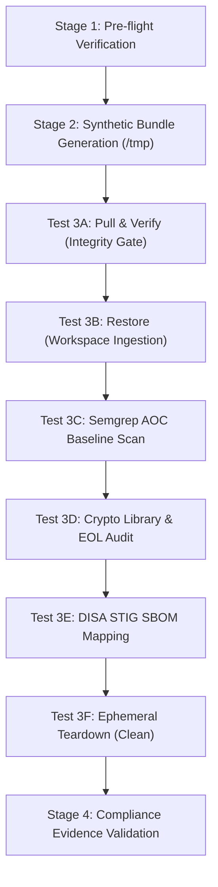

# GRCx — Test Plan & Verification Guide (`testing/TESTING.md`)

<p align="center">
  <a href="../README.md"><b>📖 README</b></a> &nbsp;·&nbsp;
  <a href="../amplifying-info/ARCHITECTURE.md"><b>🏛️ Architecture & Tech Stack</b></a> &nbsp;·&nbsp;
  <a href="../amplifying-info/DATAFLOW.md"><b>🔄 Data Flow</b></a> &nbsp;·&nbsp;
  <a href="../SECURITY.md"><b>🛡️ Security Policy</b></a> &nbsp;·&nbsp;
  <a href="../amplifying-info/GOVERNANCE.md"><b>⚖️ Governance & Mandates</b></a> &nbsp;·&nbsp;
  <a href="TESTING.md"><b>🧪 Verification Plan</b></a> &nbsp;·&nbsp;
  <a href="live-demo.md"><b>🎬 Live Demo</b></a> &nbsp;·&nbsp;
  <a href="../hygiene/RELEASE_NOTES.md"><b>🚀 Release Notes</b></a> &nbsp;·&nbsp;
  <a href="../hygiene/PATCH_LOG.md"><b>🩹 v1 Patch Log</b></a> &nbsp;·&nbsp;
  <a href="../hygiene/ROADMAP.md"><b>🗺️ Roadmap</b></a> &nbsp;·&nbsp;
  <a href="../docs/grc-bundle-use-case.md"><b>📑 Use Case Walkthrough</b></a> &nbsp;·&nbsp;
  <a href="../docs/test-dummies-guide.md"><b>🎯 Test Dummies Guide</b></a>
</p>

> **Classification**: Internal DevSecOps & Compliance Specification  
> **Target Frameworks**: DISA STIG, NIST SP 800-53 Rev. 5, FedRAMP, OWASP Top 10  
> **Pipeline Role**: Out-of-Band (OOB) Ingestion, Restoration & Audit Verification  

---

## 1. Overview & Verification Strategy

This document outlines the end-to-end verification and testing procedures for **GRCx** (*The GRC eXperience*). It exercises the complete lifecycle of a software release bundle without requiring access to production systems or halting developer deployment pipelines.

> [!TIP]
> **Fast-Track Testing with Pre-Built Test Bundles**:  
> If you are verifying the pipeline using the companion [`grc-test-dummies`](https://github.com/eodartintlabs-hue/grc-test-dummies) (`../GRC-Test-Dummies`) repository, refer to the **[Negative Testing & Scanner Verification Help Guide (docs/test-dummies-guide.md)](../docs/test-dummies-guide.md)** for an interactive cheat sheet and copy-pasteable scan commands for all 12 test bundles (`aoc-02` through `aoc-combo-4x`).



---

## 2. Verification Checklist

Reviewers and compliance auditors can use this interactive checklist to track verification:

### Environment & Pre-Flight
- [ ] Python 3.9+ runtime available (`python3 --version`)
- [ ] Git 2.30+ installed (`git --version`)
- [ ] CLI dispatcher executable permissions set (`chmod +x grc`)

### Ingestion & Integrity Gates
- [ ] **Test 3A (Pass)**: Bundle verified successfully against matching baseline SHA-256
- [ ] **Test 3A (Fail)**: Tampered bundle rejected with non-zero exit code before extraction
- [ ] **Test 3B**: Repository unbundled cleanly into `./ephemeral_test_workspace`
- [ ] **Test 3B**: Root `bundle_provenance.json` generated with matching Bundle Identifier
- [ ] **Test 3B**: Source files locked with read-only (`0444`) permissions

### Security & Compliance Scanners
- [ ] **Test 3C**: Semgrep scans all 37 rules across Go, Java, Python, and JavaScript
- [ ] **Test 3C**: Semgrep detects intentional AOC 02, 03, 04, 05, and 10 violations
- [ ] **Test 3D**: `crypto_lib_scan.py` flags deprecated `pycrypto` as `CRITICAL` EOL (AOC 09)
- [ ] **Test 3E**: `sbom_analyzer.py` maps components to DISA STIGs and DoD SRGs

### Ephemeral Teardown & Deliverables
- [ ] **Test 3F**: Ephemeral workspace and bundle deleted (`grc bundle clean`)
- [ ] **Stage 4**: Standardized JSON and Markdown audit deliverables verified

---

## 3. Stage 1: Pre-Flight Environment Sanity Check

Verify runtime prerequisites in your local terminal:

```bash
# 1. Verify Python 3
python3 --version

# 2. Verify Git
git --version

# 3. Ensure executable permissions on all pipeline scripts
chmod +x ./grc ./scripts/grc_bundle.py ./scripts/sbom_analyzer.py ./scripts/crypto_lib_scan.py
```

> [!NOTE]
> All pipeline scripts (`grc_bundle.py`, `sbom_analyzer.py`, `crypto_lib_scan.py`) use **only Python 3 standard library modules** (`json`, `re`, `hashlib`, `os`, `sys`, `pathlib`). No external `pip` dependencies are required.

---

## 4. Stage 2: Synthetic Test Bundle Generation

To safely test detection capabilities without risking proprietary source code, you can either:
1. **Use Pre-Built Dummies (Recommended)**: Use the companion [`grc-test-dummies`](https://github.com/eodartintlabs-hue/grc-test-dummies) (`../GRC-Test-Dummies`) repository and follow the **[Negative Testing & Scanner Verification Help Guide (docs/test-dummies-guide.md)](../docs/test-dummies-guide.md)**.
2. **Generate Manually in `/tmp`**: Follow the steps below to construct a synthetic scratch bundle from scratch:

```bash
# 1. Create a temporary scratch project
rm -rf /tmp/mock-grc-project && mkdir -p /tmp/mock-grc-project
cd /tmp/mock-grc-project
git init -b main

# 2. Add sample code with intentional AOC triggers (AOC 02, 03, 04, 05, 10)
cat << 'EOF' > app.py
import hashlib
import os
import pickle
import requests

# AOC-02: Hardcoded Password
password = "super_secret_admin_pass"

# AOC-03: Weak Hash
insecure_md5 = hashlib.md5(b"test").hexdigest()

# AOC-04: Command Injection
user_input = "test"
os.system(f"echo {user_input}")

# AOC-05: Disabled TLS Verification
res = requests.get("https://internal.service", verify=False)

# AOC-10: Unsafe Deserialization
untrusted_data = b"cos\nsystem\n(S'echo pwned'\ntR."
obj = pickle.loads(untrusted_data)
EOF

# 3. Add dependency manifest with EOL crypto package (AOC-09)
cat << 'EOF' > requirements.txt
requests==2.31.0
pycrypto==2.6.1
EOF

# 4. Add mock CycloneDX SBOM file
cat << 'EOF' > bom.json
{
  "bomFormat": "CycloneDX",
  "specVersion": "1.4",
  "components": [
    { "name": "openssl", "version": "1.1.1", "purl": "pkg:deb/debian/openssl@1.1.1", "type": "library" },
    { "name": "nginx", "version": "1.22.0", "purl": "pkg:deb/debian/nginx@1.22.0", "type": "application" },
    { "name": "python", "version": "3.9.0", "purl": "pkg:generic/python@3.9.0", "type": "application" },
    { "name": "express", "version": "4.18.2", "purl": "pkg:npm/express@4.18.2", "type": "framework" }
  ]
}
EOF

# 5. Commit, tag, and export the Git bundle
git add .
git commit -m "feat: release v1.0.0 candidate"
git tag -a v1.0.0 -m "Release v1.0.0"

# Create the offline bundle
git bundle create /tmp/test-app-v1.0.0.bundle --all

# 6. Record the baseline SHA-256 digest
TEST_SHA256=$(shasum -a 256 /tmp/test-app-v1.0.0.bundle | awk '{print $1}')
echo "Baseline Bundle SHA-256: ${TEST_SHA256}"
```

---

## 5. Stage 3: Step-by-Step Pipeline Test Execution

Navigate back to your pipeline repository root:

```bash
cd /path/to/GRC-Bundle-Review_Pipeline
```

---

### Test 3A: Pull & Verify Integrity Gate

#### Scenario 1: Happy Path (Matching SHA-256)
```bash
./grc bundle verify /tmp/test-app-v1.0.0.bundle --expected-sha256 "${TEST_SHA256}"
```
* **Expected Result**: Exits with code `0`. Reports SHA-256 match and `Git bundle object verification: VALID`.

#### Scenario 2: Negative Test (Tampered Bundle Checksum)
```bash
./grc bundle verify /tmp/test-app-v1.0.0.bundle --expected-sha256 "0000000000000000000000000000000000000000000000000000000000000000"
```
* **Expected Result**: Aborts immediately with `[FATAL]` error and non-zero exit code. Extraction is blocked.

---

### Test 3B: Ephemeral Workspace Restoration

Extract the bundle into an isolated test workspace and verify provenance tracking:

```bash
./grc bundle restore /tmp/test-app-v1.0.0.bundle \
  --workspace ./ephemeral_test_workspace \
  --ref v1.0.0 \
  --expected-sha256 "${TEST_SHA256}" \
  --read-only
```

* **Pass Criteria**:
  1. Clones repository into `./ephemeral_test_workspace`.
  2. Checks out release tag `v1.0.0`.
  3. Source files have read-only permissions (`0444`).
  4. Generates `bundle_provenance.json` at root.

<details>
<summary><b>View Expected <code>bundle_provenance.json</code> Output</b></summary>

```json
{
  "manifest_schema": "grc-bundle-provenance-v1",
  "bundle_identifier": "e5b7a1c93f48d02e6b7c5a91f83d2e04a7b1c3d5e7f9a2b4c6d8e0f2a4b6c8d0",
  "workspace_path": "/path/to/ephemeral_test_workspace",
  "checked_out_ref": "v1.0.0",
  "commit_metadata": {
    "short_hash": "4a9f2bc1",
    "subject": "feat: release v1.0.0 candidate"
  },
  "status": "RESTORED",
  "ephemeral": true
}
```

</details>

---

### Test 3C: Semgrep Custom Baseline Scan

Run the 37-rule Semgrep policy engine against the extracted workspace:

```bash
semgrep scan \
  --config="rules/custom-baseline-ruleset.yaml" \
  --json \
  --output="./ephemeral_test_workspace/semgrep_findings.json" \
  ./ephemeral_test_workspace
```

* **Pass Criteria**:
  * Scans cleanly without syntax errors.
  * Correctly detects intentional violations in `app.py`:
    * `grc-aoc02-python-hardcoded-credentials` (NIST IA-2)
    * `grc-aoc03-python-weak-hashing` (NIST SI-16)
    * `grc-aoc04-python-command-injection` (NIST SI-4)
    * `grc-aoc05-python-disabled-tls-verification` (NIST SI-17)
    * `grc-aoc10-python-unsafe-deserialization` (NIST RA-5)

---

### Test 3D: Cryptographic Library & EOL Scanner

Run the crypto scanner to identify deprecated and unsupported providers:

```bash
./grc crypto \
  --workspace ./ephemeral_test_workspace \
  --format json \
  --output ./ephemeral_test_workspace/crypto_findings.json
```

* **Pass Criteria**:
  * Scans `requirements.txt`.
  * Flags `pycrypto==2.6.1` with `FAIL_DEPRECATED` and `CRITICAL` severity (satisfying **AOC 09**).
  * References NIST SP 800-53 controls `SI-7` and `SC-13`.

<details>
<summary><b>View Expected <code>crypto_findings.json</code> Output</b></summary>

```json
{
  "summary": {
    "total_crypto_libraries": 1,
    "critical_eol_count": 1
  },
  "findings": [
    {
      "library_name": "pycrypto",
      "detected_version": "2.6.1",
      "compliance_status": "FAIL_DEPRECATED",
      "severity": "CRITICAL",
      "area_of_concern": "AOC-09: Crypto Dependencies on Unsupported Libraries",
      "remediation": "Migrate all cryptographic operations to 'cryptography' or 'pycryptodome'."
    }
  ]
}
```

</details>

---

### Test 3E: DISA STIG / SRG SBOM Analyzer

Run the SBOM applicability analyzer against `bom.json`:

```bash
./grc sbom \
  --sbom "./ephemeral_test_workspace/bom.json" \
  --format markdown \
  --output "./ephemeral_test_workspace/stig_matrix.md"
```

* **Pass Criteria**:
  * Correctly resolves all 4 components to DISA STIGs:
    * `openssl` $\rightarrow$ Cryptographic Module SRG (`CAT I`)
    * `nginx` $\rightarrow$ NGINX Web Server STIG (`CAT I`)
    * `python` $\rightarrow$ Python Runtime SRG (`CAT I`)
    * `express` $\rightarrow$ Application Security and Development (ASD) STIG (`CAT I`)
  * Summarizes applicable NIST SP 800-53 controls (`SI-2`, `SI-7`, `SC-12`, `AC-3`).

---

### Test 3F: Ephemeral Teardown (Clean)

Verify that the workspace and test bundle are purged completely:

```bash
./grc bundle clean \
  --workspace ./ephemeral_test_workspace \
  --delete-bundle /tmp/test-app-v1.0.0.bundle
```

* **Pass Criteria**:
  * `./ephemeral_test_workspace` is deleted.
  * `/tmp/test-app-v1.0.0.bundle` is deleted.
  * No test code or extracted artifacts persist on the audit workstation.

---

## 6. Stage 4: Compliance Evidence Deliverables Checklist

When executing against production bundles, confirm that Phase 4 generates the complete set of required deliverables:

| Deliverable File | Tool | Purpose / Consumer |
| :--- | :--- | :--- |
| **`bundle_provenance.json`** | `grc_bundle.py` | Cryptographic provenance record & Bundle Identifier |
| **`semgrep_findings.json`** | `semgrep` | Unified SAST findings mapped to AOCs and NIST controls |
| **`crypto_findings.json`** | `crypto_lib_scan.py` | EOL and deprecated crypto inventory (AOC 09) |
| **`stig_matrix.md`** | `sbom_analyzer.py` | Component-to-DISA STIG traceability matrix |
| **`sha256sum` manifest** | `shasum -a 256 *` | Cryptographic tamper-proofing across all evidence files |

> [!TIP]
> All evidence deliverables are designed for direct ingestion into formal **POA&M** databases and **SCR/SCN** (Security Change Request / Security Change Notification) packages.
